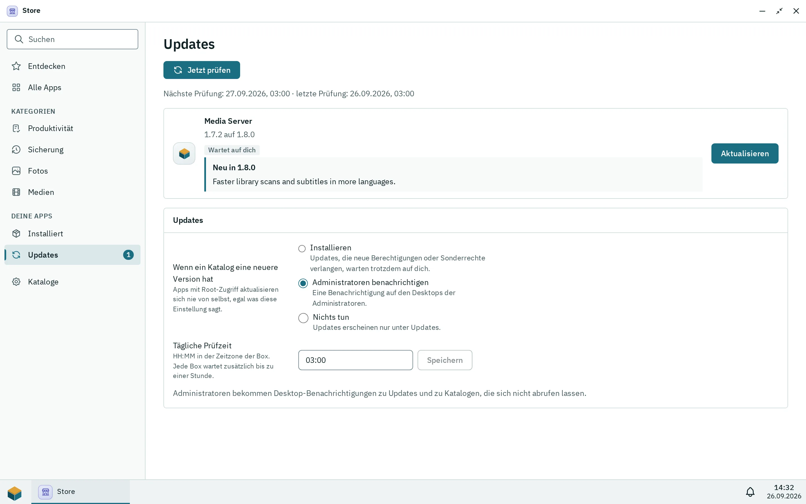

Nur Administratoren installieren Apps, in der App Store. Eine App ist ein Frontend, das der Daemon ausliefert, plus optional ein Backend aus Containern. Apps kommen aus Katalogen (Git-Repositorys mit einem signierten Index) oder aus einer Paketdatei (`.pithyxapp`). Alle App-Daten liegen auf einem Pool, den du bei der ersten Installation wählst, nie auf der Systemplatte.

## Der Store

Der Store hat die Tabs **Installiert**, **Offiziell**, **Community**, **Eigene** und **Updates** (mit der Zahl der wartenden Updates) und ein Zahnrad für die **Store-Einstellungen**. Offizielle Apps werden vom Pithyx-Projekt geprüft, gebaut und signiert; Community-Apps stammen von Entwicklern außerhalb des Projekts und werden vom Projekt geprüft, bevor sie veröffentlicht werden; **Eigene** zeigt Apps von Katalogen, die du hinzugefügt hast und die das Projekt nicht prüft. Die Abzeichen lauten „Pithyx“, „Community“ und „Nicht geprüft“ (auch für Apps, die aus einer Datei installiert wurden). Die Suche umfasst Name, Beschreibung und Entwickler. Benutzer öffnen installierte Apps über das Pithyx-Menü; siehe [Apps](/de/docs/user/apps/).

## Aus einer Datei installieren

Wähle **Aus Datei installieren** im Tab **Installiert** (oder **Aus Datei aktualisieren** in den Details einer App) und wähle ein Paket. Der Dialog listet die Berechtigungen auf, die die App anfordert, die Ordner, die sie braucht, ob sie ein Backend mitbringt, eine Warnung, wenn ein Container als root läuft, besondere Rechte, **Wer sie nutzen darf** und **Pool für App-Daten**. Bei einem Paket aus einer Datei warnt er: „Dieses Paket stammt aus einer Datei und ist nicht geprüft.“

Grenzen eines Uploads: die Datei höchstens 256 MB, entpackt höchstens 512 MB und 10 000 Einträge, das Manifest höchstens 64 KB ([`app.package.too_large`](/de/docs/reference/errors/#app.package.too_large)). Ein geprüftes Paket wartet 15 Minuten auf deine Bestätigung. Die IDs `org.pithyx.*` werden aus Dateien abgelehnt. Eine Version kann installiert, aktualisiert, neu installiert (ersetzt ihre Dateien) oder herabgestuft werden; ein Herabstufen kann abgelehnt werden ([`app.package.downgrade_unsupported`](/de/docs/reference/errors/#app.package.downgrade_unsupported)), nutze dann **Zurück zur vorigen Version**.

**Deinstallieren** verlangt von dir, **Daten behalten** (eine erneute Installation findet sie wieder, mit der Benutzer-ID der App; der Installationsdialog sagt das dann) oder **Daten löschen** (Datenbanken, Einstellungen, Dateien und Snapshots; nicht umkehrbar) zu wählen. Freigegebene Ordner, die in die App eingebunden sind, bleiben in beiden Fällen. Das Deaktivieren einer App („Nutzer können die App öffnen“ aus) behält ihre Daten und ihren Zugriff. Eine App fragt nach Speicher; du ordnest jeden angeforderten Ordner einem Ordner in einem freigegebenen Ordner zu, schreibgeschützt oder mit Lesen und Schreiben, und erforderliche müssen zugeordnet sein, sonst startet das Backend nicht. Der Schalter „Debug-Meldungen an das Protokoll-Center senden“ schaltet das Debug-Logging für eine App ein.

## Der App-Pool

Bei der ersten Installation wählst du **Pool für App-Daten**: „Alle Apps speichern ihre Daten auf diesem Pool. Er lässt sich nicht ändern, solange eine App installiert ist.“ Ohne Pool sagt der Store, dass du zuerst in Speicher einen anlegen sollst. Der Pool muss importiert, online (oder degradiert), beschreibbar, entsperrt und von Pithyx eingerichtet sein.

Jede App bekommt ein Dataset `<pool>/pithyx/apps/<id>`, eingehängt unter `/<pool>/.pithyx/apps/<id>`. Das Datenverzeichnis von Docker ist `/<pool>/.pithyx/docker`. Fehlt der Pool oder ist er gesperrt, zeigen Apps darauf „Pool nicht verfügbar“, und niemand kann sie öffnen, bis er zurück ist. App-Container laufen mit Benutzer-IDs von 40000 bis 49999.

## Updates und Rollback

_Die Store-Einstellungen: was mit neuen Versionen passiert, wann die Box prüft und welchem Kanal sie folgt._

Öffne das Zahnrad, dann **Updates**. Die Regel „Wenn ein Katalog eine neuere Version hat“ ist **Installieren**, **Administratoren benachrichtigen** (Standard) oder **Nichts tun** (das Update wird nur im Tab **Updates** aufgeführt). Ein Update, das neue Berechtigungen oder besondere Rechte verlangt, installiert sich nie von selbst. Die Zeit der täglichen Prüfung ist standardmäßig 03:00 (Zeitzone der Box) plus eine feste zufällige Verzögerung von 0 bis 3600 Sekunden pro Box; **Jetzt prüfen** führt sie sofort aus. Eine App kann in ihren Details einer eigenen Regel folgen. Administratoren bekommen die Benachrichtigungen „App-Updates“ und „Katalog nicht abgerufen“.

Vor einem Update legt Pithyx einen Snapshot des Datasets der App an. Startet die neue Version nicht, kommt die alte zurück. **Zurück zu** und die Versionsnummer (zum Beispiel **Zurück zu 1.2.0**) kehrt zur vorigen Version zurück, mit den Daten der App, wie sie vor dem Update waren; seitdem gemachte Änderungen und Snapshots gehen verloren. Es wird nur die eine vorige Version aufbewahrt.

Der Kanal ist **Stabil** (Versionen, die die Eigentümer der Kataloge freigegeben haben, Standard) oder **Beta** (jede neue Version, sobald ein Katalog sie veröffentlicht, vor ihrer Freigabe).

## Kataloge und Vertrauen

Der offizielle und der Community-Katalog sind standardmäßig beide an; der Tab **Community** sagt, dass seine Apps von Entwicklern außerhalb des Projekts stammen, vom Projekt geprüft, aber nicht wie eigene verbürgt. Schalte den Community-Katalog in den Store-Einstellungen aus, wenn du nur offizielle Apps willst; das erneute Einschalten fragt „Community-Katalog nutzen?“. Keiner von beiden lässt sich entfernen ([`store.catalog.built_in`](/de/docs/reference/errors/#store.catalog.built_in)). Um einen eigenen hinzuzufügen, gib eine **URL des Repositorys** ein: `https://...` für einen öffentlichen Katalog oder `git@host:owner/repository.git` für einen privaten (keine Zugangsdaten in der URL, höchstens 500 Zeichen; [`store.catalog.url_invalid`](/de/docs/reference/errors/#store.catalog.url_invalid)).

Für einen privaten Katalog über SSH erzeugt die Box einen ed25519-Deploy-Key und zeigt seine öffentliche Zeile; füge sie dem Repository als schreibgeschützten Deploy-Key hinzu und wähle **Jetzt abrufen**. Der Host-Schlüssel des Servers wird bei der ersten Verbindung festgehalten. Ein Abruf bricht nach 3 Minuten ab. Der Abrufstatus ist Aus, Noch nicht abgerufen, Aktuell, Abruf fehlgeschlagen oder Wird abgerufen; ein fehlgeschlagener Abruf behält die letzte geprüfte Kopie.

Die Indizes des offiziellen und des Community-Katalogs tragen eine Ed25519-Signatur, die gegen im Daemon eingebaute Schlüssel geprüft wird, und der Hash jeder Datei wird geprüft. Eigene Kataloge sind unsigniert: „Apps aus deinen eigenen Katalogen prüft das Pithyx-Projekt nicht. Füge nur Kataloge hinzu, denen du vertraust.“ Die IDs `org.pithyx.*` kommen nur aus dem offiziellen Katalog.

## Backends und Docker

Ein Backend ist eine Compose-Teilmenge mit Images, die per Digest festgelegt sind, geprüft gegen eine feste Allowlist. Die Box betreibt es in Docker (`docker.io` von Debian), das der Daemon nur startet, solange eine App mit Backend installiert und ihr Pool verfügbar ist. Container laufen in einem User-Namespace, in einem eigenen internen Netzwerk ohne Internet, außer die App hat die Berechtigung „Internet“, und erreichen keine Dienste des Hosts. Version 0.1 lehnt den Docker-Socket und Rechte für den ganzen Host ab ([`app.elevated.unsupported`](/de/docs/reference/errors/#app.elevated.unsupported)). Ein Container als root ist nur erlaubt, wenn die App es angibt, und der Installationsdialog warnt davor.

Ein Backend mit dem Lifecycle `always` läuft, wann immer es kann; `onDemand` startet, wenn ein Benutzer die App öffnet (eine Anfrage wartet bis zu 30 Sekunden), und hält 10 Minuten nach dem Schließen des letzten Fensters an. Ein fehlgeschlagener Start wird nach 1 Minute wiederholt. Die Ausgabe der Container geht ins Protokoll-Center als Quelle `app/<id>`.
