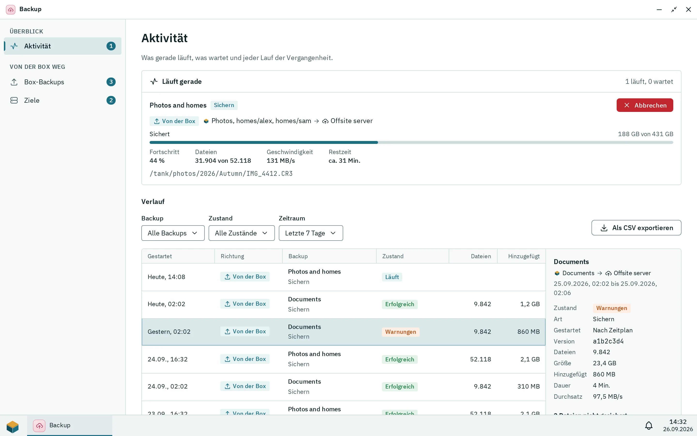

**Aktivität** in der App **Backup** zeigt, was gerade läuft, und jeden bisherigen Lauf und jede Prüfung der [Box-Backups](/de/docs/admin/backup-jobs/). Sie ist wie der Rest der App für Administratoren. Die Zahl neben **Aktivität** in der Navigation zählt die laufenden Läufe.

_Aktivität zeigt oben das laufende Backup und darunter den Verlauf; der ausgewählte Lauf zeigt seine Zahlen und die Dateien, die er nicht sichern konnte._

## Läuft gerade

**Läuft gerade** listet jeden Lauf und jede Prüfung, die gerade läuft, und die, die auf ihre Reihe warten (**Wartet**). Ein laufendes Backup zeigt seinen Weg, einen Fortschrittsbalken mit den bisher gelesenen Daten, den **Fortschritt** in Prozent, die **Dateien**, die **Geschwindigkeit**, die **Restzeit** und die Datei, die es gerade liest. **Abbrechen** hält es an; der Lauf endet dann als **Abgebrochen** und speichert keine Version.

## Verlauf

**Verlauf** listet die Läufe und Prüfungen aller Box-Backups, die neuesten zuerst, mit ihrem Beginn, ihrer Richtung, dem Backup und ob es ein Backup (**Sichern**) oder eine Prüfung (**Prüfen**) war, dem Zustand, den Dateien und den hinzugekommenen Daten.

- **Backup** zeigt nur die Läufe eines Box-Backups.
- **Zustand** zeigt nur Läufe, die erfolgreich waren, mit Warnungen endeten, fehlschlugen, abgebrochen oder unterbrochen wurden oder noch laufen.
- **Zeitraum** zeigt die Läufe von heute, der letzten 7, 30 oder 90 Tage oder alle.
- **Mehr anzeigen** lädt ältere Läufe, bis zu 2.000.
- **Als CSV exportieren** lädt die angezeigten Läufe mit Beginn und Ende, Backup, Art, Zustand, Dateien, Größe und hinzugekommenen Daten in Bytes, Warnungen und Fehlercode für eine Tabellenkalkulation herunter.

Die Läufe eines gelöschten Box-Backups werden mit ihm gelöscht.

## Details eines Laufs

Ein ausgewählter Lauf zeigt seine Zeit, den Fehler eines fehlgeschlagenen Laufs, seinen Zustand, seine Art und wie er gestartet wurde (**Nach Zeitplan** oder **Von Hand**), die **Version** (die kurze Kennung des restic-Snapshots, den er gespeichert hat), die Dateien, die Größe der Version, die hinzugekommenen Daten, die Dauer und den **Durchsatz**.

### Nicht gesicherte Dateien

Ein Lauf mit **Warnungen** hat eine vollständige Version gespeichert, bis auf Dateien, die er nicht lesen konnte. Die Details listen sie mit ihrem Pfad im freigegebenen Ordner oder Home-Ordner und dem Grund: **Keine Rechte** (die Box darf die Datei nicht lesen), **Beim Lesen verschwunden** oder **Nicht lesbar**. Die Box behält die ersten 100 Dateien eines Laufs und zählt den Rest („und 20 weitere Dateien“).

Damit sie beim nächsten Mal gesichert werden, gib der Box Leserechte auf sie, oder schließe sie in den Einstellungen des Backups mit **Bearbeiten** aus (**Weitere Einstellungen** > **Ausnahmen**).
