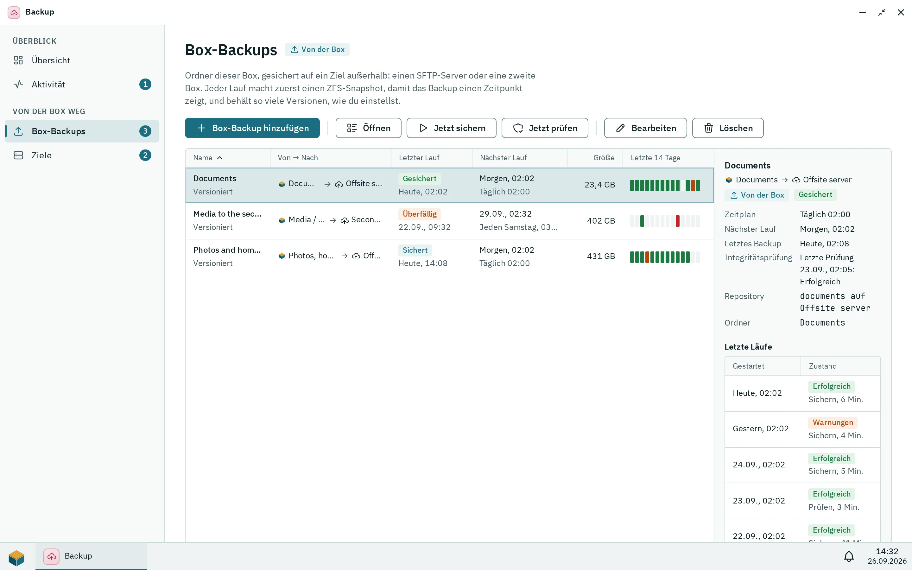
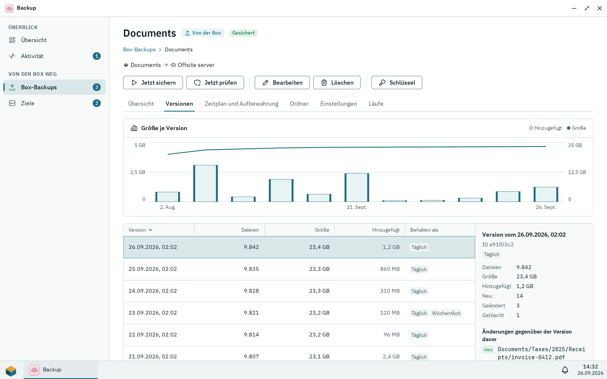

Ein **Box-Backup** in der App **Backup** sichert Ordner aus freigegebenen Ordnern und Home-Ordnern dieser Box nach Zeitplan auf ein [Backup-Ziel](/de/docs/admin/backup-targets/). Jeder Lauf nimmt zuerst einen ZFS-Snapshot, damit ein Backup einen einzigen Moment zeigt, auch wenn weitergearbeitet wird, und speichert mit [restic](https://restic.net/) über SFTP eine neue Version in das eigene Repository des Backups auf dem Ziel. Ältere Versionen dünnt die Aufbewahrung aus, und eine Prüfung liest das Repository nach einem eigenen Zeitplan zurück. Box-Backups sind für Administratoren; die Box meldet ihnen fehlgeschlagene, unvollständige und überfällige Backups.

Die App öffnet mit ihrer [Übersicht](/de/docs/admin/backup-overview/). Ihre Navigation ordnet Backups nach ihrer Richtung: **Von der Box weg** enthält die Box-Backups und ihre Ziele, und jedes Box-Backup trägt die Markierung **Von der Box**. Ein [Spiegel](/de/docs/admin/backup-mirrors/) hält statt Versionen eine einfache Kopie auf dem Ziel. Backups von Linux-Servern auf diese Box stehen unter **Auf die Box**: [Server-Backups](/de/docs/admin/backup-servers/). Was gerade läuft und jeder bisherige Lauf stehen unter [Aktivität](/de/docs/admin/backup-activity/).

_Box-Backups listet jedes Backup mit seinem Ziel, dem letzten und nächsten Lauf, der Größe seiner letzten Version und einem Balken pro Tag; das ausgewählte zeigt rechts seine Details._

## Die Liste

**Box-Backups** ist eine Tabelle mit einer Zeile pro Backup:

- **Name**, darunter die Art: **Versioniert** oder **Spiegel** für einen [Spiegel](/de/docs/admin/backup-mirrors/).
- **Von → Nach**: die Ordner, oder die ersten Ordner, und das Ziel.
- **Letzter Lauf**: sein Zustand (**Gesichert**, **Mit Warnungen gesichert**, **Fehlgeschlagen**, **Überfällig**, **Sichert** und weitere) und wann er begann.
- **Nächster Lauf**, darunter der Zeitplan, oder **Läuft nur von Hand**.
- **Größe**: die Größe der letzten Version.
- **Letzte 14 Tage**: ein Balken pro Tag, grün für ein Backup ohne Probleme, orange für Warnungen, rot für einen Fehlschlag und grau für einen Tag ohne Backup. Ein Screenreader liest stattdessen die Anzahlen vor.

Eine ausgewählte Zeile öffnet rechts ihre Details: den Fortschritt eines laufenden Backups, den Fehler eines fehlgeschlagenen Laufs oder einer Prüfung, den Zeitplan, den nächsten Lauf, das letzte erfolgreiche Backup, die Integritätsprüfung, das Repository, die Ordner und **Letzte Läufe**. Die Werkzeugleiste wirkt auf das ausgewählte Backup: **Öffnen**, **Jetzt sichern** (oder **Abbrechen**, während es läuft), **Jetzt prüfen**, **Bearbeiten** und **Löschen**. **Öffnen**, ein Doppelklick oder Enter auf einer Zeile öffnet die eigene Seite des Backups.

## Die Seite eines Backups

Die Seite eines Backups zeigt im Titel seinen Namen, die Markierung **Von der Box** und seinen Zustand, darunter den Weg zurück zu **Box-Backups** und seinen Weg von den Ordnern zum Ziel. Die Werkzeugleiste hat **Jetzt sichern** (oder **Abbrechen**), **Jetzt prüfen**, **Bearbeiten**, **Löschen** und **Schlüssel**, und die Seite hat diese Reiter:

- **Übersicht**: den Fortschritt eines laufenden Backups, den Fehler eines fehlgeschlagenen Laufs oder einer Prüfung, Zeitplan, nächsten Lauf, letztes Backup, Integritätsprüfung, Repository, Ordner und die letzten Läufe.
- **Versionen**: jede Version im Repository (siehe unten).
- **Zeitplan und Aufbewahrung**: wann es sichert, den nächsten Lauf, die Versionen, die es behält, die Integritätsprüfung und wann es als überfällig gilt.
- **Ordner**: die Ordner, die es sichert, und seine Ausschlüsse.
- **Einstellungen**: Ziel, Repository, ob es nach Zeitplan läuft, und die Grenzen der Bandbreite.
- **Läufe**: seine Läufe und Prüfungen.

**Bearbeiten** auf den Reitern öffnet denselben Dialog wie in der Liste.

_Der Reiter Versionen: was jede Version hinzugefügt hat und wie groß sie ist, warum die Aufbewahrung sie behält, und was sich in der neuesten geändert hat._

### Versionen

**Versionen** listet jede Version im Repository des Backups, die neueste zuerst, mit Zeit, Dateien, Größe, den Daten, die sie dem Repository hinzugefügt hat, und **Behalten als**: warum die Aufbewahrung sie behält (**Neueste**, **Stündlich**, **Täglich**, **Wöchentlich**, **Monatlich**, **Jährlich**) und **Geschützt**. Das Diagramm darüber zeigt die hinzugefügten Daten jeder Version als Balken und ihre Größe als Linie. Eine ausgewählte Version zeigt rechts ihre Zahlen; die neueste auch, wie viele Dateien gegenüber der Version davor neu, geändert und gelöscht sind, mit bis zu 100 von ihnen.

Die Box speichert die Versionen nach jedem Lauf und nach jeder Änderung einer Version, die Liste zeigt das Repository also so, wie die Box es zuletzt gesehen hat, und das Lesen fragt nie beim Ziel nach. Eine außerhalb der Box gelöschte Version verschwindet nach dem nächsten Lauf.

**Vor Löschen schützen** behält eine Version, egal was die Aufbewahrung sagt, zum Beispiel den Stand vor einem großen Aufräumen; **Schutz aufheben** gibt sie der Aufbewahrung zurück. Der Schutz setzt restics Markierung `pithyx-protected` an die Version, die jede spätere Aufbewahrung behält (`--keep-tag`). Er wird abgelehnt, während ein Lauf oder eine Prüfung läuft ([`backup.job.busy`](/de/docs/reference/errors/#backup.job.busy)), und eine Version, die die Aufbewahrung inzwischen entfernt hat, antwortet mit [`backup.version.not_found`](/de/docs/reference/errors/#backup.version.not_found). Beides steht im Log Center in der Quelle **audit**.

**Durchsuchen und wiederherstellen** an einer Version öffnet sie unter [Wiederherstellen](/de/docs/admin/backup-restore/).

## Ein Box-Backup hinzufügen

1. Füge zuerst ein [Ziel](/de/docs/admin/backup-targets/) hinzu und teste seine Verbindung.
2. Öffne **Backup**, wähle **Box-Backups** und **Box-Backup hinzufügen**.
3. Gib einen Namen ein und wähle das Ziel. **Ordner des Repositorys** ist der Ordner unterhalb des Ordners des Ziels, der das Repository dieses Backups enthält; er folgt dem Namen, bis du ihn änderst.
4. Wähle unter **Zu sichernde Ordner** einen freigegebenen Ordner oder Home-Ordner und unter **Ordner darin** einen Ordner darin, oder nichts für alles. **Ordner hinzufügen** fügt weitere hinzu, bis zu 32.
5. Wähle, wann er **Sichert**: stündlich, täglich, wöchentlich oder monatlich zu einer Uhrzeit, oder einen Cron-Ausdruck mit fünf Feldern (Minute, Stunde, Tag des Monats, Monat, Wochentag). Die Zeiten gelten in der Zeitzone der Box. Ohne **Nach Zeitplan ausführen** läuft das Backup nur von Hand.
6. Lege die **Aufzubewahrenden Versionen** und die **Prüfung** fest (siehe unten) und unter **Weitere Einstellungen** die Grenzen, die Zeit bis überfällig und die Ausnahmen.
7. Wähle **Erstellen**. Die Box legt das Repository auf dem Ziel an und zeigt seinen Schlüssel.

Ein neues Box-Backup sichert jeden Tag um 02:00, behält 7 tägliche, 4 wöchentliche und 12 monatliche Versionen und prüft das Repository jeden Sonntag um 05:00, wobei es 5 Prozent der Daten liest.

Sichern lassen sich nur Ordner auf einem Pool, denn jeder Lauf beginnt mit einem Snapshot ([`backup.source.unsupported`](/de/docs/reference/errors/#backup.source.unsupported)). Ein Ordner, dessen Pool fehlt oder gesperrt ist, lässt den Lauf mit [`backup.source.unavailable`](/de/docs/reference/errors/#backup.source.unavailable) fehlschlagen.

Ziel und Repository eines Box-Backups bleiben, wie sie sind; für ein anderes Ziel oder Repository fügst du ein neues Box-Backup hinzu. Alles andere lässt sich mit **Bearbeiten** ändern.

## Der Schlüssel des Repositorys

:::caution[Bewahre den Schlüssel außerhalb der Box auf]
Jedes Repository ist mit einem zufälligen Schlüssel verschlüsselt. Die Box zeigt ihn einmal, direkt nach **Erstellen**: Kopiere ihn oder lade ihn als Textdatei herunter und bewahre ihn an einem anderen Ort als dieser Box auf. Ohne den Schlüssel kann niemand die Backups lesen, auch nicht nach einer Neuinstallation. Der Dialog schließt sich erst, wenn du **Ich habe den Schlüssel außerhalb der Box aufbewahrt** ankreuzt.
:::

**Schlüssel** auf der Seite des Backups zeigt den Schlüssel noch einmal, zum Beispiel wenn die Kopie verloren ging. Er fragt nach deinem Passwort und, mit eingeschalteter Zwei-Faktor-Anmeldung, nach einem Code aus deiner Authenticator-App; falsche Antworten zählen wie fehlgeschlagene Anmeldungen. Jedes Anzeigen steht im Log Center in der Quelle **audit**, ohne den Schlüssel.

Die Box behält den Schlüssel selbst, um das Backup auszuführen, und er kommt in den Teil **App Backup** des [Konfigurations-Backups](/de/docs/admin/backup/), nie in ein [Support-Paket](/de/docs/admin/logs-and-monitoring/).

Um ein Repository zu verwenden, das es schon gibt, zum Beispiel nach einer Neuinstallation, kreuze **Vorhandenes Repository verwenden** an und füge seinen Schlüssel ein. Die Box prüft dann, dass in diesem Ordner ein Repository liegt ([`backup.repository.not_found`](/de/docs/reference/errors/#backup.repository.not_found)) und dass der Schlüssel es öffnet ([`backup.repository.wrong_key`](/de/docs/reference/errors/#backup.repository.wrong_key)). Ein neues Box-Backup lehnt einen Ordner ab, in dem schon ein Repository liegt ([`backup.repository.exists`](/de/docs/reference/errors/#backup.repository.exists)).

## Was ein Lauf sichert

Ein Lauf nimmt einen ZFS-Snapshot von jedem Dataset, auf dem die Ordner liegen, und lässt restic den Snapshot an Stelle des laufenden Ordners lesen. Das Repository speichert die Ordner unter ihren Pfaden auf der Box, mit Eigentümern, Rechten, ACLs und Änderungszeiten. Die Snapshots gibt es nur, solange der Lauf dauert; danach werden sie gelöscht. Jeder Lauf sichert als neue Version in das Repository des Backups; restic speichert nur, was sich seit der letzten geändert hat.

Läufe und Prüfungen sind Aufgaben der Box: Sie zeigen ihren Fortschritt in den Details des Backups, unter [Aktivität](/de/docs/admin/backup-activity/) und in der Aufgabenliste der Box, laufen pro Backup einzeln und lassen sich mit **Abbrechen** abbrechen. **Jetzt sichern** und **Jetzt prüfen** starten sofort einen. Eine Zeit, die die Box verpasst hat, weil sie aus war, wird nicht nachgeholt; die Warnung „überfällig“ deckt das ab.

Der Zustand eines Laufs:

- **Erfolgreich**: Jede Datei wurde gesichert.
- **Warnungen**: Eine neue Version wurde gesichert, aber einige Dateien ließen sich nicht lesen (restic-Exit-Code 3), oder das Entfernen alter Versionen schlug fehl. Die Details des Laufs unter [Aktivität](/de/docs/admin/backup-activity/#nicht-gesicherte-dateien) nennen die Dateien.
- **Fehlgeschlagen**: Es wurde keine neue Version gesichert. Die Details nennen den Grund, zum Beispiel [`backup.target.unreachable`](/de/docs/reference/errors/#backup.target.unreachable), [`backup.repository.locked`](/de/docs/reference/errors/#backup.repository.locked) oder [`backup.run.failed`](/de/docs/reference/errors/#backup.run.failed).
- **Abgebrochen**: Ein Administrator hat ihn abgebrochen.
- **Unterbrochen**: Die Box wurde während des Laufs neu gestartet.

**Letzte Läufe** in den Details listet die letzten Läufe und Prüfungen mit Zustand, Art und Dauer; [Aktivität](/de/docs/admin/backup-activity/) hat jeden Lauf mit seinen Zahlen.

## Aufzubewahrende Versionen

Nach jedem erfolgreichen Backup wendet die Box die Aufbewahrung an: Sie behält die neuesten Versionen, dann je eine Version pro Stunde, Tag, Woche, Monat und Jahr, so viele, wie du jeweils einträgst, und entfernt die anderen aus dem Repository, um ihren Platz freizugeben (`restic forget --prune`). Alle Werte auf 0 behalten jede Version. Eine geschützte Version bleibt immer (siehe [Versionen](#versionen)).

## Prüfung

**Repository nach Zeitplan prüfen** führt `restic check` nach einem eigenen Zeitplan aus. **Zurückzulesende Daten in Prozent** liest jedes Mal diesen Anteil der Daten vom Ziel, bei jeder Prüfung einen anderen Teil; 0 prüft nur die Struktur des Repositorys. Eine fehlgeschlagene Prüfung ist ein eigenes Ereignis ([`backup.check.failed`](/de/docs/reference/errors/#backup.check.failed)): Starte eine weitere Prüfung, und wenn auch sie fehlschlägt, lege für das Backup ein neues Repository an.

## Weitere Einstellungen

- **Upload-Grenze in KiB/s** und **Download-Grenze in KiB/s**: begrenzen die Bandbreite, die restic zum Ziel nutzt; 0 für keine Grenze.
- **Als überfällig melden nach Stunden**: wie lange das Backup ohne erfolgreichen Lauf bleiben darf, bevor es gemeldet wird. Leer heißt das Dreifache der Zeit zwischen zwei geplanten Läufen, mindestens zwei Tage.
- **Ausnahmen**: ein restic-Muster pro Zeile, zum Beispiel `*.tmp` oder `**/cache`, bis zu 100.

restic hält einen Cache des Index des Repositorys auf dem Pool des ersten Ordners des Backups, im Dataset `<pool>/pithyx/backup-cache`, damit nichts davon auf der Systemplatte landet.

## Ereignisse

Diese meldet die Box ihren Administratoren, auf dem Desktop und über die Kanäle, die unter Einstellungen > **Benachrichtigungen** > **Ereignisse** gewählt sind (Gruppe **Backups**):

- **Backup fehlgeschlagen**: Ein Lauf hat nichts gesichert.
- **Backup hat Dateien ausgelassen**: Ein Lauf endete mit Warnungen.
- **Backup überfällig**: Kein erfolgreiches Backup innerhalb der Zeit bis überfällig.
- **Prüfung eines Backups fehlgeschlagen**: Eine Prüfung ist fehlgeschlagen.
- **Host-Schlüssel eines Backup-Ziels geändert**: Der Server des Ziels hat mit einem anderen Host-Schlüssel geantwortet ([Backup-Ziele](/de/docs/admin/backup-targets/#wenn-sich-der-host-schlüssel-ändert)).

## Ein Box-Backup löschen

**Löschen** entfernt das Backup, seine Läufe, seine Versionen, seinen Schlüssel und restics Cache seines Repositorys von der Box. Das Repository bleibt auf dem Ziel; ohne den Schlüssel kann niemand es lesen. Ein laufendes Backup lässt sich nicht löschen ([`backup.job.busy`](/de/docs/reference/errors/#backup.job.busy)); brich den Lauf zuerst ab.

## Wiederherstellen

Dateien und Ordner kommen aus jeder Version unter [Wiederherstellen](/de/docs/admin/backup-restore/) zurück; dort steht auch, wie restic allein ein Repository öffnet, wenn die Box weg ist.
