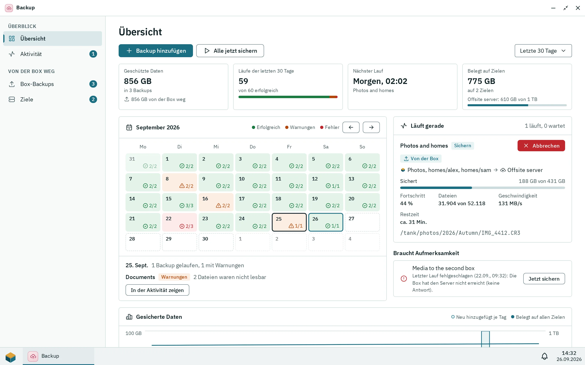

Die App **Backup** öffnet mit ihrer **Übersicht**: alles über deine [Box-Backups](/de/docs/admin/backup-jobs/) auf einer Seite. Sie ist wie der Rest der App für Administratoren.

_Die Übersicht einer Box mit drei Backups: eines läuft gerade, eines ist fehlgeschlagen und steht unter Braucht Aufmerksamkeit, und der Kalender zeigt, wie jeder Tag verlief._

## Werkzeugleiste

- **Backup hinzufügen** fragt, was du sichern möchtest: Ordner dieser Box auf ein Ziel, ein [Box-Backup](/de/docs/admin/backup-jobs/#ein-box-backup-hinzufügen), oder einen Linux-Server auf diese Box, ein [Server-Backup](/de/docs/admin/backup-servers/#ein-server-backup-hinzufügen). Ohne Ziel oder Server fragt die App zuerst nach einem.
- **Alle jetzt sichern** startet jedes eingeschaltete Backup, das gerade weder läuft noch prüft.
- Der Zeitraum rechts (**Letzte 7 Tage**, **Letzte 30 Tage**, **Letzte 90 Tage**) legt fest, was die Kachel der Läufe und das Diagramm zählen.

## Kacheln

- **Geschützte Daten**: die Größe der neuesten Version aller Backups zusammen, wie viele Backups es gibt und wie viel davon von der Box weg geht und wie viel von Servern auf die Box kommt. Server-Backups belegen nichts auf einem Ziel, deshalb lässt **Belegt auf Zielen** sie weg.
- **Läufe der letzten 30 Tage** (oder des gewählten Zeitraums): wie viele Läufe und Prüfungen erfolgreich waren, Warnungen als erfolgreich gezählt, von wie vielen. Der Balken zeigt den Anteil der erfolgreichen, der mit Warnungen und der fehlgeschlagenen. Abgebrochene Läufe zählen nicht.
- **Nächster Lauf**: wann das nächste geplante Backup startet und welches.
- **Belegt auf Zielen**: was die Repositorys aller Backups auf ihren Zielen belegen und auf wie vielen Zielen. Der Balken darunter zeigt das Ziel mit dem wenigsten freien Platz: wie viel davon belegt ist, wie sein Server es gemeldet hat. Die Box fragt den Server bei jedem [Verbindungstest](/de/docs/admin/backup-targets/) und nach jedem Lauf nach seinem freien Platz.

## Kalender

Der Kalender zeigt einen Monat, einen Tag je Feld, in der Zeitzone der Box. Ein Tag, an dem jedes gelaufene Backup erfolgreich war, ist grün, ein Tag mit Warnungen orange, ein Tag mit einem fehlgeschlagenen oder unterbrochenen Lauf oder einer solchen Prüfung rot; das Feld sagt, wie viele der an dem Tag gelaufenen Backups ohne Fehler blieben („5/6“). Tage ohne Lauf bleiben leer, kommende Tage haben einen gestrichelten Rand, und heute hat einen farbigen Rand. Die Pfeile zeigen den vorherigen und den nächsten Monat.

Ein ausgewählter Tag zeigt unter dem Kalender, wie viele Backups gelaufen sind und wie viele Läufe fehlgeschlagen sind oder Warnungen hatten, und listet diese Läufe mit ihrem Fehler oder der Zahl der Dateien, die sie nicht lesen konnten. **In der Aktivität zeigen** öffnet die [Aktivität](/de/docs/admin/backup-activity/) für die Details. Ohne Auswahl nimmt der Kalender den letzten Tag des Monats mit einem Problem, sonst heute.

## Läuft gerade und Braucht Aufmerksamkeit

**Läuft gerade** ist dieselbe Liste wie in der [Aktivität](/de/docs/admin/backup-activity/#läuft-gerade): jeder laufende Lauf und jede laufende Prüfung mit Fortschritt und **Abbrechen**.

**Braucht Aufmerksamkeit** listet jedes Problem mit der Aktion, die es behebt:

- Ein Ziel, dessen letzter Verbindungstest fehlgeschlagen ist, mit seinem Fehler. Hat sich sein Host-Schlüssel geändert, öffnet **Neuen Host-Schlüssel prüfen** den Dialog, um [den neuen Schlüssel zu bestätigen](/de/docs/admin/backup-targets/#wenn-sich-der-host-schlüssel-ändert); sonst öffnet **Ziele zeigen** die Ziele.
- Ein Backup, dessen letzter Lauf fehlgeschlagen ist oder unterbrochen wurde, mit seinem Fehler und **Jetzt sichern**.
- Ein überfälliges Backup, mit dem Zeitpunkt seines letzten Erfolgs und **Jetzt sichern**.
- Ein Backup, dessen letzter Lauf Warnungen hatte, mit der Zahl der Dateien, die er nicht lesen konnte, und **Ansehen**, das die Aktivität öffnet.
- Ein Backup, dessen letzte Integritätsprüfung fehlgeschlagen ist, mit **Jetzt prüfen**.

Braucht nichts Aufmerksamkeit, sagt das Feld das.

## Gesicherte Daten

Das Diagramm zeigt jeden Tag des Zeitraums: Die Balken sind die Daten, die die Backups an dem Tag ihren Repositorys hinzugefügt haben (linke Skala), die Linie ist, was die Repositorys am Ende des Tages auf ihren Zielen belegten (rechte Skala). Die Box misst die Größe eines Repositorys nach jedem Lauf mit der eigenen Statistik von restic; ein Tag ohne Messung behält die letzte. Das Aufräumen alter Versionen zeigt sich als sinkende Linie.
