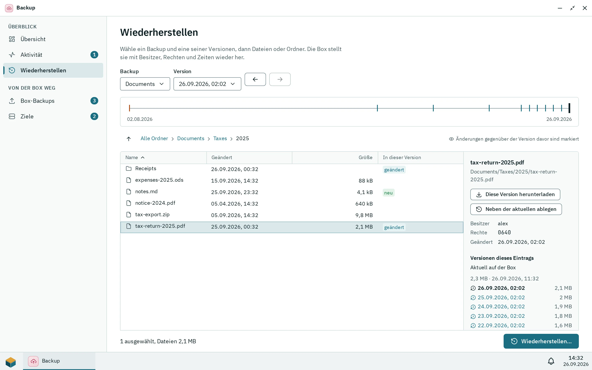

**Wiederherstellen** in der App **Backup** öffnet die Versionen eines [Box-Backups](/de/docs/admin/backup-jobs/), zeigt ihre Ordner und Dateien und holt Dateien und Ordner auf die Box zurück: an ihren Ort oder in einen anderen Ordner. Es steht in der Navigation der App unter **Überblick**; **Durchsuchen und wiederherstellen** an einer Version auf der Seite eines Backups öffnet dieselbe Seite bei dieser Version. Wiederherstellen ist für Administratoren.

_Wiederherstellen zeigt einen Ordner so, wie er in der gewählten Version war; die rechts gewählte Datei zeigt ihre Versionen, und die Leiste unten stellt wieder her, was angehakt ist._

## Eine Version wählen

Die Werkzeugleiste wählt das Backup und seine Version; **Ältere Version** und **Neuere Version** gehen durch die Versionen, und die Zeitleiste darunter zeigt jede Version zu ihrer Zeit, geschützte markiert. Es sind die Versionen, die die Box nach ihrem letzten Lauf gespeichert hat ([Versionen](/de/docs/admin/backup-jobs/#versionen)).

Die Box liest eine Version, indem sie das Repository des Backups schreibgeschützt einhängt. Der erste Ordner eines Backups dauert einen Moment, weil restic den Index des Repositorys vom Ziel liest; danach öffnet jeder Ordner aus dem Einhängepunkt. Das Einhängen endet zehn Minuten nach dem letzten Lesen und vor einem Lauf, einer Prüfung oder einer Änderung des Schutzes dieses Backups; die Seite hängt es dann von selbst wieder ein. Eine Version, die neuer ist als das Einhängen, hängt es ebenfalls neu ein.

## Durchsuchen

Oben zeigt eine Version die Ordner, die sie enthält, benannt nach dem freigegebenen Ordner oder Home und dem Pfad darunter, so wie sie jetzt heißen. Doppelklick oder Enter öffnet einen Ordner; **Einen Ordner nach oben** und der Pfad gehen zurück. Einträge, die gegenüber der Version davor neu sind, tragen **neu**, geänderte (nach Größe oder Zeit) **geändert**; die älteste Version hat keine Markierungen.

Ein gewählter Eintrag erscheint rechts: sein Besitzer, seine Rechte und seine Zeit in der gezeigten Version und seine Versionen: die auf der Box jetzt und jede Version des Backups, mit Größe und Zeit, oder **nicht vorhanden**. Ein Klick auf eine Version öffnet sie. **Diese Version herunterladen** lädt eine Datei herunter, einen Ordner als Zip seiner Dateien und Ordner (symbolische Links und Geräte bleiben weg). **Neben der aktuellen ablegen** stellt ihn mit **Beide behalten** an seinem Ort wieder her.

## Wiederherstellen

Hake Dateien und Ordner an (die Auswahl bleibt beim Wechsel der Version für Einträge, die es in der neuen gibt) und wähle **Wiederherstellen…** in der Leiste unten:

- **Wohin**: **An den ursprünglichen Ort** legt jeden Eintrag zurück in seinen Ordner, und fehlende Ordner darüber werden wieder angelegt. **In einen anderen Ordner** legt jeden Eintrag unter seinem Namen in einen Ordner eines freigegebenen Ordners oder Homes, den du wählst.
- **Wenn eine Datei schon da ist**: **Beide behalten** legt die wiederhergestellte Datei daneben als `<name> (version yyyy-MM-dd HH.mm UTC)<endung>`, so wie [vorherige Versionen](/de/docs/user/files/#frühere-versionen) in Dateien wiederhergestellt werden; **Ersetzen** setzt die wiederhergestellte Datei an ihre Stelle; **Lassen** behält die vorhandene Datei und lässt die wiederhergestellte weg. Ein Ordner, der schon da ist, wird mit dem wiederhergestellten zusammengeführt, und ein Ordner ersetzt nie eine Datei oder umgekehrt: Beide bleiben.

Dateien kommen mit Besitzer, Gruppe, Rechten, ACLs und Zeiten zurück. Eine Wiederherstellung ist eine Aufgabe der Box: Ihr Fortschritt steht in der Aufgabenliste und auf der Seite, und am Ende sagt die Seite, wie viele Einträge sie wiederhergestellt, ersetzt, daneben gelegt und ausgelassen hat. Eine Wiederherstellung wartet, solange ein Lauf oder eine Prüfung desselben Backups läuft ([`backup.job.busy`](/de/docs/reference/errors/#backup.job.busy)).

Die Box stellt in einen versteckten Ordner `.pithyx-restore-<nummer>` im freigegebenen Ordner des Ziels wieder her und verschiebt die Einträge von dort, darum braucht eine Wiederherstellung dort Platz für das, was sie zurückholt. Ein freigegebener Ordner oder Home, den es nicht mehr gibt, kann die Einträge nicht an ihren Ort zurücknehmen ([`backup.restore.failed`](/de/docs/reference/errors/#backup.restore.failed) mit dem Grund place); stelle sie stattdessen in einen anderen Ordner wieder her.

Jede Wiederherstellung und jeder Download steht im Log Center in der Quelle **audit**.

## Ohne die Box

Jedes Repository ist ein gewöhnliches restic-Repository. Ist die Box weg, öffnet restic es mit seinem Schlüssel von jedem Rechner aus, der das Ziel über SFTP mit einem eigenen SSH-Schlüssel erreicht, zum Beispiel `restic -r sftp:<benutzer>@<server>:<ordner>/<repository> restore latest --target <ordner>`. Den Schlüssel gibt es unter **Schlüssel** auf der Seite des Backups.
