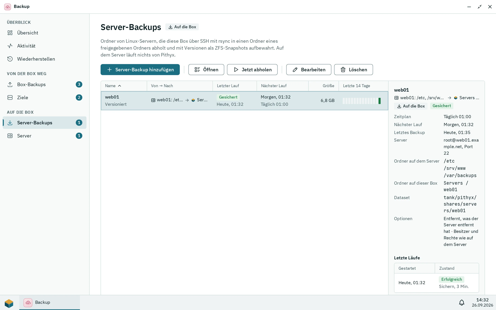
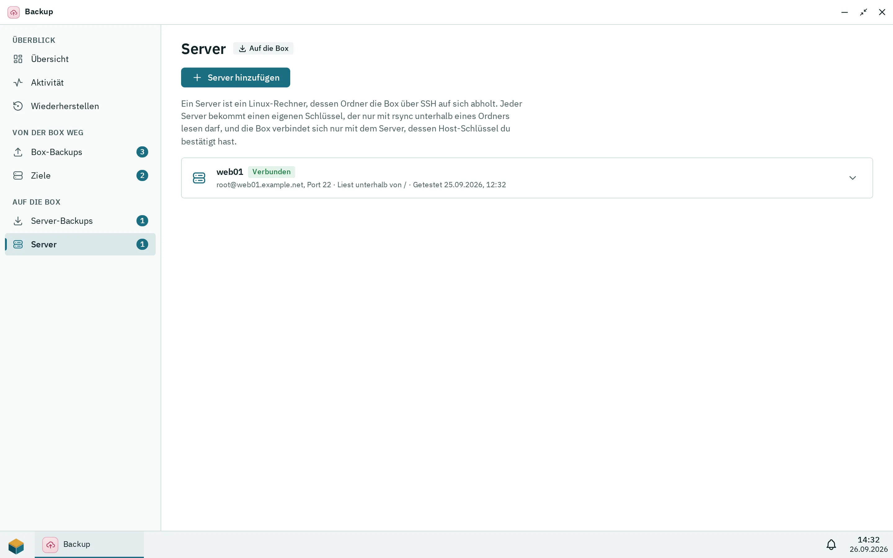

Ein **Server-Backup** in der App **Backup** holt Ordner eines Linux-Servers nach Zeitplan auf diese Box. Die Box meldet sich über SSH an und kopiert mit [rsync](https://rsync.samba.org/) in einen Ordner eines freigegebenen Ordners, den sie als eigenes ZFS-Dataset anlegt. Nach jedem Lauf hält sie den Stand des Ordners als ZFS-Snapshot fest: das ist die Version des Laufs. Auf dem Server läuft nichts von Pithyx; er braucht nur SSH und rsync. Server-Backups sind für Administratoren, und die Box meldet ihnen fehlgeschlagene, unvollständige und überfällige wie bei [Box-Backups](/de/docs/admin/backup-jobs/).

Die Navigation der App führt sie unter **Auf die Box**: **Server-Backups** und **Server**. Jedes Server-Backup trägt die Markierung **Auf die Box**, und sein Weg führt vom Server in den Ordner auf der Box. Ihre Läufe stehen mit den anderen unter [Aktivität](/de/docs/admin/backup-activity/) und in der [Übersicht](/de/docs/admin/backup-overview/).



_Server-Backups listet jedes Backup eines Servers mit seinem Weg, letztem und nächstem Lauf, Größe und den letzten 14 Tagen; das ausgewählte zeigt, was es abholt und wo es landet._

## Einen Server hinzufügen

Ein Server ist der Rechner, von dem ein Server-Backup liest. Jeder Server hat einen eigenen SSH-Schlüssel, den die Box erzeugt, und den Host-Schlüssel, den du bestätigt hast, wie ein [Backup-Ziel](/de/docs/admin/backup-targets/).

1. Öffne **Server** und wähle **Server hinzufügen**.
2. Gib einen Namen, den Server, den SSH-Port (22, wenn leer) und den Benutzer ein. Damit jede Datei mit ihren Besitzern gesichert wird, melde dich als `root` an; der Schlüssel bleibt so oder so nur lesend.
3. **Ordner, den der Schlüssel lesen darf** ist der Ordner, auf den der Schlüssel des Servers beschränkt ist: absolut und ohne Leerzeichen, `/` für den ganzen Server. Die Backups wählen Ordner darunter.
4. Wähle **Weiter**, vergleiche den Fingerabdruck des Host-Schlüssels mit dem des Servers (`ssh-keygen -lf /etc/ssh/ssh_host_ed25519_key.pub` auf dem Server) und wähle **Fingerabdruck stimmt, speichern** nur, wenn er gleich ist.
5. Die Box zeigt die **Zeile für authorized_keys**. Trag sie in die Datei `.ssh/authorized_keys` des Benutzers auf dem Server ein und wähle **Verbindung testen**.

Die Zeile sieht so aus:

```
restrict,command="rrsync -ro /" ssh-ed25519 AAAA... pithyx-backup@box
```

`restrict` schaltet für den Schlüssel Shell, Port- und Agent-Weiterleitung und Terminals ab, und `command` startet nur `rrsync`, das Hilfsskript von rsync für solche Schlüssel, nur lesend (`-ro`) unterhalb des Ordners. So kann der Schlüssel unterhalb dieses Ordners lesen und sonst nichts, auch wenn ihn jemand von der Box nähme. Der Server braucht rsync mit `rrsync`, das aktuelle Distributionen mit rsync installieren. **Verbindung testen** meldet sich an und lässt rsync den Ordner auflisten.

Ein fehlgeschlagener Test oder Lauf nennt den Grund, wie bei Zielen ([`backup.target.unreachable`](/de/docs/reference/errors/#backup.target.unreachable), [`backup.target.auth_failed`](/de/docs/reference/errors/#backup.target.auth_failed), [`backup.target.host_key_changed`](/de/docs/reference/errors/#backup.target.host_key_changed)), und zwei eigene:

- [`backup.server.rsync_missing`](/de/docs/reference/errors/#backup.server.rsync_missing): rsync oder `rrsync` ist auf dem Server nicht installiert, oder nicht dort, wo die Zeile es erwartet.
- [`backup.server.refused`](/de/docs/reference/errors/#backup.server.refused): Der Server hat den Ordner abgelehnt, meist weil er nicht unterhalb des Ordners liegt, den der Schlüssel lesen darf, oder nicht existiert.



## Ein Server-Backup hinzufügen

**Server-Backup hinzufügen** unter **Server-Backups**, oder **Backup hinzufügen** in der Übersicht mit **Einen Linux-Server auf die Box sichern**, öffnet den Dialog:

- **Name** des Backups.
- **Server**: einer der Server.
- **Freigegebener Ordner** und **Name des Ordners**: Die Box legt den Ordner im freigegebenen Ordner als eigenes Dataset an, benannt nach dem Backup, solange du den Namen nicht änderst (Buchstaben, Ziffern, Punkte, Bindestriche und Unterstriche). Der freigegebene Ordner muss die Wurzel seines Datasets sein, wie jeder freigegebene Ordner, den die Box anlegt; ein Ordner, den es dort schon gibt, wird abgelehnt ([`backup.destination.invalid`](/de/docs/reference/errors/#backup.destination.invalid)).
- **Ordner auf dem Server**: ein Pfad pro Zeile, mit `/` am Anfang, ab dem Ordner, den der Schlüssel des Servers lesen darf. Mit `/` als diesem Ordner sind es die Pfade des Servers, zum Beispiel `/etc` oder `/srv/www`; mit `/srv` ist `/www` auf dem Server `/srv/www`. Jeder landet mit diesem Pfad im Ordner auf der Box, aus `/srv/www` wird dort `srv/www`.
- **Entfernen, was auf dem Server entfernt wurde**: an, dann verschwinden Dateien, die auf dem Server weg sind, auch aus dem Ordner auf der Box; aus, dann bleiben sie. Die Versionen behalten sie so oder so.
- **Besitzer und Rechte**: **Wie auf dem Server** übernimmt Benutzer- und Gruppen-IDs, Rechte, ACLs und erweiterte Attribute als Zahlen, sodass die Dateien auf der Box den IDs gehören, die sie auf dem Server haben. **Gehören der Box** gibt sie der Box, mit den Rechten des freigegebenen Ordners.
- **Holt ab**, **Nach Zeitplan ausführen**, **Aufzubewahrende Versionen**, die Download-Grenze, **Als überfällig melden nach Stunden** und **Ausnahmen** (rsync-Muster, zum Beispiel `*.tmp` oder `/var/cache/`) wirken wie bei [Box-Backups](/de/docs/admin/backup-jobs/#ein-box-backup-hinzufügen).

Alle, die den freigegebenen Ordner öffnen dürfen, können lesen, was die Box kopiert hat, über jedes Protokoll, über das er freigegeben ist. Wähl für einen Server mit Geheimnissen, etwa `/etc` mit seinen Schlüsseln, einen freigegebenen Ordner, den nur Administratoren öffnen können.

**Bearbeiten** ändert alles außer dem Server und dem Ordner auf der Box; für andere füge ein neues Backup hinzu.

## Was ein Lauf macht

Ein Lauf kopiert die Ordner mit rsync über den Schlüssel des Servers in den Ordner des Backups, schreibt von geänderten Dateien nur die geänderten Teile neu und behält harte und symbolische Links. Dann nimmt er einen ZFS-Snapshot des Ordners (`pithyx-pull-<Zeit>`) als neue Version und wendet die Aufbewahrung an. Eine Datei, die der Server nicht lesen lässt, macht den Lauf zu **Mit Warnungen gesichert** und steht in seinen Details, wie bei Box-Backups; alles andere, was rsync abbricht, macht ihn zu **Fehlgeschlagen**, und der Ordner behält, was der Lauf bis dahin kopiert hat, ohne neue Version.

## Versionen

Der Reiter **Versionen** auf der Seite eines Server-Backups listet seine Snapshots wie Box-Backups ihre Versionen, mit dem, was jede hinzugefügt hat, den Gründen, aus denen die Aufbewahrung sie behält, und bei der neuesten den Dateien, die rsync hinzugefügt, geändert und entfernt hat. **Vor dem Löschen schützen** setzt einen ZFS-Hold auf den Snapshot, sodass weder die Aufbewahrung noch sonst etwas ihn entfernt, bis du ihn freigibst. Die Aufbewahrung behält Versionen nach denselben Regeln wie bei Box-Backups, in der Zeitzone der Box.

Der Ordner selbst hat immer den neuesten Stand. Um eine Datei aus einer früheren Version zurückzuholen, öffne den Ordner in [Dateien](/de/docs/user/files/) und nimm seine früheren Versionen, das sind die Snapshots des Backups. Ein Server-Backup auf der Seite **Wiederherstellen** der App und zurück auf den Server wiederherzustellen kommt in einer späteren Version.

## Ein Server-Backup löschen

**Löschen** entfernt das Backup und seine Läufe. Der Ordner auf der Box bleibt mit seinen Versionen, außer du wählst **Auch den Ordner und alle seine Versionen löschen**; das zerstört das Dataset des Backups mit jedem Snapshot und seinen Holds. Die Box zerstört nur ein Dataset, das sie für dieses Backup angelegt hat.

Einen Server, den noch Server-Backups nutzen, kannst du nicht löschen ([`backup.target.in_use`](/de/docs/reference/errors/#backup.target.in_use)). Entferne nach dem Löschen eines Servers auch seine Zeile aus der `authorized_keys` des Servers.

## Konfigurations-Backup

Server, ihre Schlüssel und Host-Schlüssel und die Server-Backups stehen im Teil **App Backup** des [Konfigurations-Backups](/de/docs/admin/backup/). Die Daten eines Server-Backups liegen in seinem Ordner auf dem Pool, nicht im Konfigurations-Backup.
