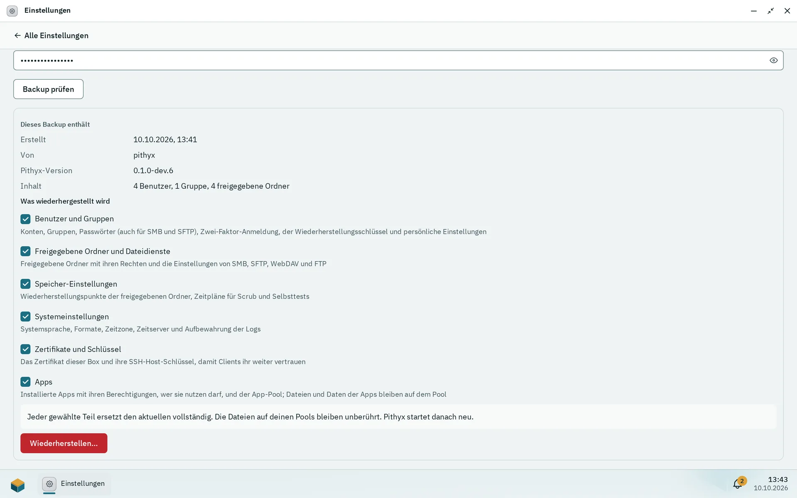

Einstellungen > **Backup und Wiederherstellung** sichert die Konfiguration der Box (Benutzer, freigegebene Ordner, Dateidienste, Zeitpläne und mehr) in einer passwortgeschützten Datei und stellt sie später wieder her. Die Dateien auf deinen Pools sichert es nicht. Backups sind manuell: Es gibt keinen Zeitplan.

## Ein Backup erstellen

1. Öffne Einstellungen > **Backup und Wiederherstellung** und wähle „Backup erstellen“.
2. Gib ein Backup-Passwort ein und wiederhole es. Es muss die üblichen Passwortregeln erfüllen (mindestens 8 Zeichen, kein allgemein bekanntes Passwort).
3. Wähle **Erstellen und herunterladen**. Die Datei heißt `pithyx-config-<host>-<yyyyMMdd-HHmm>.pithyxbackup`.

:::caution[Das Passwort lässt sich nicht wiederherstellen]
Ohne das Backup-Passwort lässt sich das Backup nicht wiederherstellen. Pithyx bewahrt es nicht auf, und niemand kann es zurückholen. Bewahre es und die Datei an einem anderen Ort als dieser Box auf.
:::

Die Datei ist mit AES-256-GCM verschlüsselt, unter einem Schlüssel, der aus dem Passwort mit Argon2id abgeleitet wird (64 MiB, 3 Durchgänge). Das Archiv darf bis zu 16 MB groß sein und entpackt 256 MB ([`system.backup.too_large`](/de/docs/reference/errors/#system.backup.too_large)). Es enthält Passwort-Hashes und Schlüssel, schütze es also wie ein Geheimnis.

## Was es enthält

Kategorien, die du bei der Wiederherstellung wählen kannst:

- **Benutzer und Gruppen**: Konten, Gruppen, Passwörter (auch für SMB und SFTP), Zwei-Faktor-Anmeldung, der Wiederherstellungsschlüssel, persönliche Einstellungen, Desktop-Anordnungen und die Benachrichtigungskanäle der Benutzer und der Box.
- **Freigegebene Ordner und Dateidienste**: freigegebene Ordner mit ihren Rechten und die Einstellungen für SMB, SFTP, WebDAV und FTP.
- **Speicher-Einstellungen**: Snapshot-Zeitpläne (Wiederherstellungspunkte), Scrub- und Selbsttest-Zeitpläne.
- **Systemeinstellungen**: Sprache, Formate, Zeitzone, Zeitserver, Aufbewahrung der Logs, die USV und der E-Mail-Server für Benachrichtigungen.
- **Zertifikate und Schlüssel**: die Zertifizierungsstelle und die Zertifikate der Box, hochgeladene Zertifikate von Hosts des Reverse Proxys und die SSH-Host-Schlüssel, soweit vorhanden.
- **Reverse Proxy**: Proxy-Hosts (mit Basic-Auth-Benutzern als Hashes), Weiterleitungs-Hosts, Streams, was unbekannte Namen bekommen, die Anmeldeadresse und das Let's-Encrypt-Konto (seine Zertifikate kommen mit **Zertifikate und Schlüssel**).
- **Apps**: die App-Registry, Berechtigungen, Ordnerzuordnungen, Kataloge und der App-Pool. Die Dateien und Daten der Apps bleiben auf dem Pool.

Nicht enthalten: Dateien auf Pools, App-Daten, Logs, Docker-Daten, Sitzungen, Jobs, Benachrichtigungen, der Index des Papierkorbs und die Netzwerkeinstellungen (Karten heißen auf anderer Hardware anders).

## Wiederherstellen

_Backup prüfen zeigt, was die Datei enthält; geändert wird erst, wenn du Wiederherstellen wählst._

1. Wähle die Datei, gib ihr Passwort ein und wähle **Backup prüfen**. Noch ändert sich nichts.
2. Die Seite zeigt „Dieses Backup enthält“: wann es erstellt wurde, von welchem Host, die Pithyx-Version und Zahlen zu Benutzern, Gruppen und freigegebenen Ordnern.
3. Hake unter „Was wiederhergestellt wird“ die Teile an, wähle dann **Wiederherstellen…** und **Jetzt wiederherstellen**.

Ein geprüftes Backup wartet 15 Minuten ([`system.backup.restore_expired`](/de/docs/reference/errors/#system.backup.restore_expired)). Jeder gewählte Teil ersetzt den aktuellen vollständig; Dateien auf deinen Pools bleiben unberührt; Pithyx startet danach neu. Das Wiederherstellen der Benutzer meldet alle ab, auch dich; melde dich mit einem Konto und Passwort aus dem Backup an. Vor der Wiederherstellung wird die Datenbank nach `pithyx.db.pre-restore-<zeit>.bak` daneben kopiert. Schlägt die Wiederherstellung fehl, wird nichts geändert. Einige Schritte (Linux-Konten, Passwörter für SFTP, SSH und SMB, Zeitzone, Zertifikate, SSH-Host-Schlüssel) können Probleme melden; das Protokoll-Center hat die Details.

Ein Backup einer neueren Pithyx-Version lässt sich nicht wiederherstellen ([`system.backup.too_new`](/de/docs/reference/errors/#system.backup.too_new)); ein falsches Passwort ergibt [`system.backup.password_wrong`](/de/docs/reference/errors/#system.backup.password_wrong). Die Wiederherstellung funktioniert in den Einstellungen einer Box, die die Ersteinrichtung abgeschlossen hat; sie ist nicht Teil der Einrichtung selbst.
