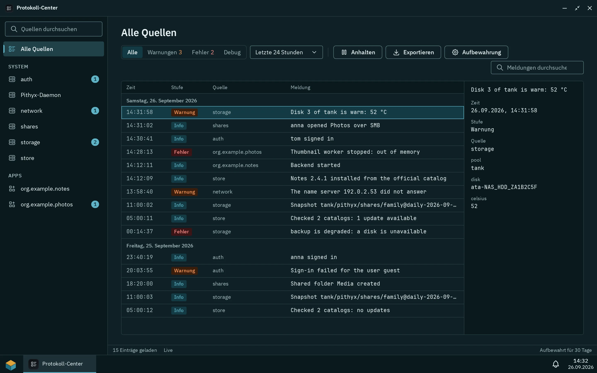
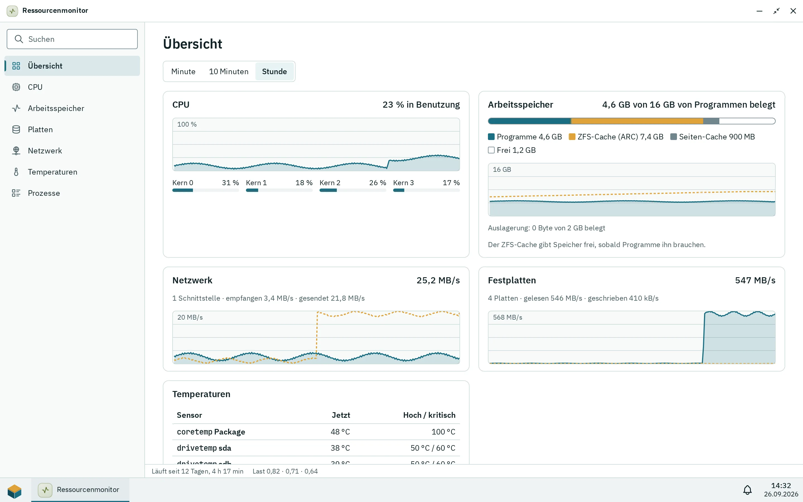

Zwei Administrator-Apps zeigen, was die Box tut: das Protokoll-Center (Meldungen des Daemons, des Systems und der Apps) und der Ressourcenmonitor (CPU, Arbeitsspeicher, Netzwerk, Platten und Temperaturen). Benachrichtigungen erreichen Menschen im Desktop und über [Benachrichtigungskanäle](/de/docs/admin/notifications/) per E-Mail oder Webhook.

## Das Protokoll-Center

_Das Protokoll-Center mit Suche, Filtern für Stufe und Zeitraum und den Details des gewählten Eintrags._

Im Protokoll-Center kannst du Meldungen oder eine Request-ID suchen und nach **Stufen** (Debug, Info, Warnung, Fehler), nach Zeitraum (letzte Stunde, 24 Stunden, 7 Tage, 30 Tage, gesamte Zeit) und nach Quelle filtern: „Pithyx-Daemon“, „Audit-Protokoll“ (Bestätigungen und Sonderrechte von Apps, siehe [Apps und Store](/de/docs/admin/apps-and-store/#sonderrechte)), „System · {name}“ für Journal-Units (Kernel, Samba, SSH, ZFS, systemd-networkd, timesyncd, Docker, smartmontools und andere) und „App · {name}“. Die Details zeigen Zeit, Stufe, Quelle, Benutzer, Request-ID und ob der Eintrag im Archiv liegt. Seiten fassen standardmäßig 200 Einträge, höchstens 1000. **Als Text exportieren** (`.log`) und **Als JSON-Zeilen exportieren** (`.jsonl`) schreiben bis zu 1 000 000 Einträge.

Logs liegen in einer Datenbank auf der Systemplatte unter `/var/log/pithyx/`, funktionieren also ohne Pool. Die Aufbewahrung stellst du mit **Aufbewahrung** ein: standardmäßig 30 Tage (1 bis 365) und höchstens 4 GB (64 MB bis 4 GB); die ältesten Einträge gehen zuerst. Das optionale Archiv auf einem Pool ist standardmäßig aus. Wenn es an ist, werden Einträge einmal am Tag auf den Pool kopiert, und zwar bevor die aktuellen Logs welche verwerfen, was die Platten des Pools etwa einmal am Tag weckt. Archivtage: 1 bis 3650 (Standard 365); Größe 0,25 bis 1024 GB (Standard 10 GB). Ist der Pool nicht verfügbar, warten Einträge auf der Systemplatte.

Der Daemon schreibt außerdem JSON-Dateien `/var/log/pithyx/daemon.json*`, die bei 20 MB rotieren, mit 10 Dateien. Geheimnisse werden in Logs maskiert.

App-Meldungen kommen über das SDK an: `info`, `warn` und `error` immer, `debug` nur, solange ein Administrator es in den Details der App eingeschaltet hat. Eine Meldung hat höchstens 4000 Zeichen und höchstens 20 Datenfelder; eine App darf 20 Meldungen pro Sekunde loggen (Spitze 200). Die Ausgabe von Backend-Containern landet in der Quelle `app/<id>`. Eine Zeile auf stdout ist Info, eine Zeile auf stderr eine Warnung, und eine Zeile, die ein JSON-Objekt mit einem Text `level` ist (`debug` oder `trace`, `info`, `warn` oder `warning`, `error`, `fatal` oder `critical`), behält diese Stufe. Eine solche JSON-Zeile zeigt ihr `message` (oder `msg`) als Meldung und ihre übrigen Felder (höchstens 32, jedes auf 1024 Zeichen gekürzt) als Daten; ein W3C-Feld `traceparent` verbindet sie mit der Anfrage, sodass die Suche nach der Request-ID sie neben den Zeilen des Daemons findet. Eine `debug`-Zeile bleibt nur, solange ein Administrator die Debug-Meldungen der App eingeschaltet hat.

## Der Ressourcenmonitor

_Die Ansicht Leistung über die letzte Minute, hier während eines Scrubs._

Der Ressourcenmonitor hat die Ansichten **Leistung** und **Prozesse**, mit Zeiträumen von einer Minute, 10 Minuten und einer Stunde. Er misst jede Sekunde, und nur, solange jemand zuschaut; der Verlauf wird eine Stunde lang im Arbeitsspeicher gehalten. Der Verlauf deckt also nur die Zeit ab, in der der Monitor irgendwo geöffnet war: Solange niemand zuschaut, wird nichts gemessen.

Er zeigt die CPU insgesamt und pro Kern sowie den Arbeitsspeicher aufgeteilt in Programme, ZFS-Cache (ARC), Seiten-Cache und Frei, dazu Swap. Der ZFS-Cache gibt Speicher sofort ab, sobald Programme ihn brauchen. Der Netzwerkverkehr wird pro Schnittstelle gezeigt, Lesen, Schreiben und Auslastung pro Platte (aus den Zählern des Kernels, sodass eine schlafende Platte weiterschläft) und Temperaturen von den Sensoren; Plattentemperaturen werden hier nicht gelesen. Die Prozessliste zeigt Name, PID, Benutzer, CPU (Anteil aller Kerne zusammen) und Speicher, mit einem Filter. Einstellungen > **Info-Center** zeigt Version, Hostname, Kernel, CPU, Arbeitsspeicher und Laufzeit.

## Benachrichtigungen

Jeder Benutzer hat im Desktop eine Liste (bis zu 200 Einträge, 30 Tage aufbewahrt). Administratoren bekommen Speicherwarnungen (beeinträchtigte oder ausgefallene Pools, fehlende Platten, Datenfehler, 80 und 90 Prozent voll, ausfallende SMART-Werte), Job-Ergebnisse und die Store-Hinweise „App-Updates“ und „Katalog nicht abgerufen“. Apps mit der Berechtigung, Benachrichtigungen zu zeigen, können an den Benutzer senden, der sie nutzt. Administratoren erfahren außerdem von wiederholt falschen Anmeldungen (fünf für einen Namen oder dreißig von einer Adresse innerhalb von fünf Minuten), höchstens einmal pro Stunde je Adresse und Name. Kanäle senden all das per E-Mail oder Webhook: siehe [Benachrichtigungen per E-Mail und Webhook](/de/docs/admin/notifications/).
