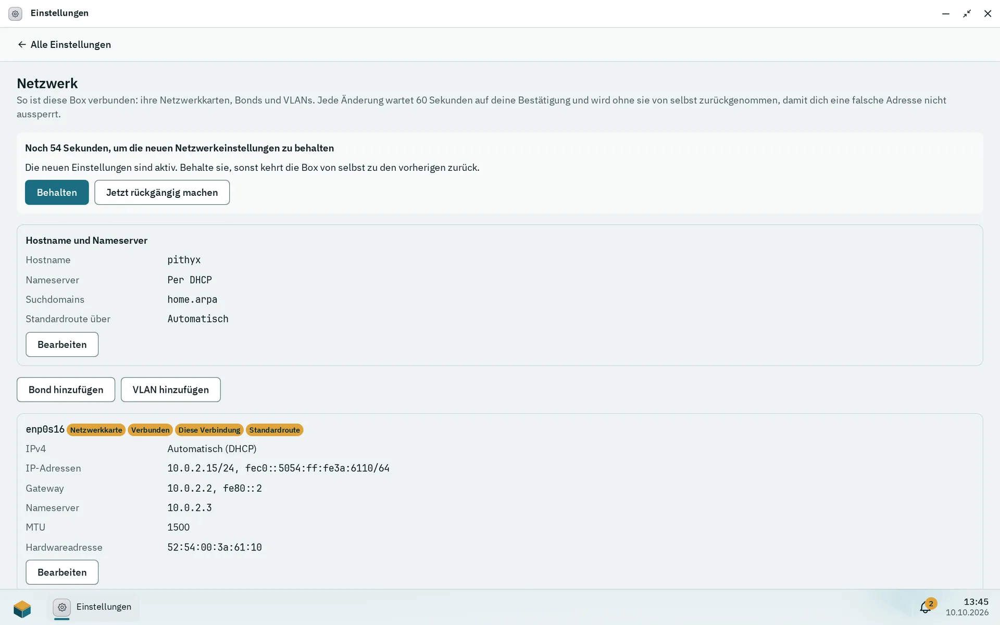

Einstellungen > **Netzwerk** (nur für Administratoren) zeigt die Netzwerkkarten der Box und ändert ihre Adressen, Bonds, VLANs, den Hostnamen, die Nameserver und die Standardroute. Jede Änderung wartet 60 Sekunden auf deine Bestätigung und wird ohne sie von selbst zurückgenommen, sodass eine falsche Adresse dich nicht aussperren kann. Wenn du dich doch aussperrst, setzt das Konsolenmenü auf der Box selbst das Netzwerk zurück.

## Karten und Adressen

Die Seite listet Netzwerkkarten, Bonds und VLANs mit ihrem Zustand (Verbunden, Kein Kabel, Aus), der IPv4-Methode (Automatisch (DHCP), Statisch, Aus, Außerhalb von Pithyx eingestellt), Adressen, Gateway, Nameservern, Hardware-Adresse, MTU, Geschwindigkeit und Duplex. Eine Karte ohne Einstellungen nutzt DHCP.

Pro Schnittstelle kannst du sie ein- oder ausschalten, IPv4 per DHCP, statisch oder aus wählen sowie IPv6 automatisch (Router und DHCPv6), statisch oder aus. Eine statische Adresse wird mit ihrer Präfixlänge geschrieben, zum Beispiel `192.168.1.10/24` oder `2001:db8::10/64`; das Gateway ist optional und muss im Netzwerk liegen. Die MTU liegt zwischen 1280 und 9000 (576 bis 9000 bei ausgeschaltetem IPv6); leer bedeutet 1500. **Zurück zu DHCP** entfernt die eigenen Einstellungen einer Karte.

Änderungen werden als Entwurf gesammelt („Noch nicht angewendete Änderungen“) und gemeinsam mit **Anwenden …** übernommen oder mit **Änderungen verwerfen** verworfen. Pithyx lehnt eine Änderung ab, die die Box ohne jede Schnittstelle mit Adresse zurückließe ([`network.config.unreachable`](/de/docs/reference/errors/#network.config.unreachable)). Pithyx schreibt dafür Dateien für systemd-networkd und systemd-resolved; es gibt keine Einstellung für WLAN, Bridge oder Firewall.

## Bonds

**Bond hinzufügen** fasst mindestens eine Karte zusammen (Karten mit eigenen Einstellungen müssen vorher zurück zu DHCP) und zwar in einem Modus:

- **Active-Backup**: Eine Karte trägt den Verkehr, eine andere übernimmt, wenn ihr Kabel ausfällt. Funktioniert mit jedem Switch; du kannst eine primäre Karte wählen.
- **LACP (802.3ad)**: alle Karten gemeinsam; die Switch-Ports müssen eine LACP-Gruppe bilden. Die LACP-Rate ist Langsam (alle 30 Sekunden) oder Schnell (jede Sekunde).
- **Adaptiver Lastausgleich**: Alle Karten senden und empfangen ohne Hilfe des Switches.

Namen von Bonds und VLANs haben bis zu 15 Kleinbuchstaben, Ziffern, Punkte, Bindestriche oder Unterstriche, beginnen mit einem Buchstaben und dürfen nicht mit einem Präfix beginnen, das Docker, die Netzwerke der Apps, Container oder VPNs nutzen: `px-`, `veth`, `docker`, `br-`, `ve-`, `vb-`, `vz-`, `vt-`, `virbr`, `tun`, `tap` oder `wg`.

## VLANs

**VLAN hinzufügen** braucht ein Elternteil (eine Karte oder einen Bond) und eine VLAN-ID von 1 bis 4094, so wie der Switch-Port sie markiert (802.1Q).

## DNS, Suchdomains und die Standardroute

Die Karte „Hostname und Nameserver“ enthält:

- **Hostname**: Buchstaben, Ziffern und Bindestriche, 1 bis 63 Zeichen, kein Bindestrich am Anfang oder Ende. Windows-Netzwerke sehen die ersten 15 Zeichen.
- **Nameserver**: bis zu 4. Leer nutzt die, die DHCP bekannt gibt; gesetzte ersetzen sie.
- **Suchdomains**: bis zu 6.
- **Standardroute über**: Automatisch oder eine gewählte Schnittstelle, die eingeschaltet ist und Einstellungen und ein Gateway hat.

## Der Bestätigungs-Timer

_Nach Anwenden zählt die Seite herunter. Ohne Behalten kehrt die Box zu den vorherigen Einstellungen zurück._

Nach **Anwenden …** zeigt ein Banner „Noch {seconds} Sekunden, um die neuen Netzwerkeinstellungen zu behalten“ mit **Behalten** und **Jetzt rückgängig machen**. Ohne Bestätigung innerhalb von 60 Sekunden, nach **Jetzt rückgängig machen**, nach einem fehlgeschlagenen Anwenden ([`network.apply.failed`](/de/docs/reference/errors/#network.apply.failed)) oder nach einem Neustart des Daemons kommen die vorherigen Einstellungen zurück. Es kann immer nur eine Änderung warten. Wenn die Seite nicht mehr antwortet, weil sich die Adresse geändert hat, öffne die Box unter ihrer neuen Adresse und behalte die Änderung dort; der Dialog listet die Adressen auf.

:::note
Backups enthalten keine Netzwerkeinstellungen (siehe [Backup und Wiederherstellung](/de/docs/admin/backup/)), weil Karten auf anderer Hardware anders heißen.
:::

## Ausgesperrt: das Konsolenmenü

Auf dem eigenen Bildschirm der Box zeigt die Konsole die Adressen und ein Menü, das kein Passwort braucht, weil der physische Zugang der Beweis ist:

- `[s]` Eine statische Adresse setzen: Kartennummer, Adresse mit Präfixlänge, Gateway (leer für keines) und Nameserver (leer behält sie). Es gilt derselbe 60-Sekunden-Timer.
- `[r]` Das Netzwerk auf DHCP zurücksetzen: Nach „Reset every network card to DHCP and remove bonds, VLANs and name servers? [y/N]“ geht jede Karte zurück auf DHCP. Der Hostname bleibt. Kein Timer.
- Solange eine Änderung wartet: `[k]` behalten, `[u]` rückgängig machen.

Von der Konsole aus lassen sich nur statische IPv4-Adressen setzen.
