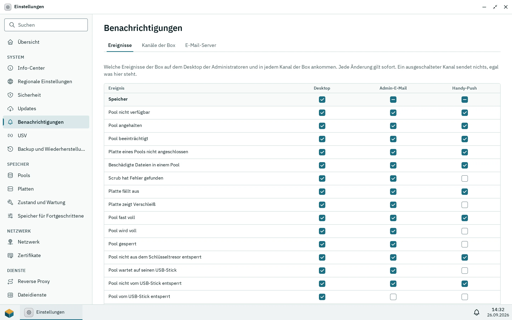

Benachrichtigungen erscheinen im Desktop von allen, für die sie gedacht sind. Kanäle tragen sie weiter: als E-Mail oder als HTTP-POST an einen Webhook, etwa einen selbst betriebenen [ntfy](https://ntfy.sh)- oder Gotify-Server. So erreicht dich ein beeinträchtigter Pool oder ein fehlgeschlagenes Update auch, wenn kein Desktop offen ist.

Es gibt zwei Arten von Kanälen:

- **Kanäle der Box** unter Einstellungen > **Benachrichtigungen** (nur Administratoren) bekommen die eigenen Warnungen des Systems einmal für alle Administratoren: Speicherprobleme, Updates, die USV, wiederholt falsche Anmeldungen, Zertifikate, die sich nicht erneuern ließen, und mehr.
- **Eigene Kanäle eines Benutzers** in **Persönliche Einstellungen** unter **Benachrichtigungskanäle** bekommen, was diesen Benutzer im Desktop erreicht: seine Aufgabenergebnisse, Warnungen für Administratoren und Nachrichten von Apps, die über den Desktop hinaus senden dürfen. Jeder Benutzer kann bis zu 10 anlegen, auch Administratoren.

## Der E-Mail-Server

E-Mail-Kanäle senden über einen SMTP-Server, den ein Administrator unter Einstellungen > **Benachrichtigungen** > **E-Mail-Server** einträgt: seinen Namen, den Port, die Verschlüsselung (**TLS**, meist Port 465, **STARTTLS**, meist 587, oder **Keine**, nur für einen Server im lokalen Netz), Benutzername und Passwort, falls er sie braucht, und die Absenderadresse; **Übernehmen** in der Leiste unten speichert sie, **Verwerfen** verwirft die Änderungen. Das Passwort wird nie wieder angezeigt; lass das Feld leer, um es zu behalten. Ein leerer Servername entfernt den Server; E-Mail-Kanäle schlagen dann mit [`notifications.smtp.missing`](/de/docs/reference/errors/#notifications.smtp.missing) fehl, und ein neuer lässt sich nicht anlegen.

Unter **Test-E-Mail** schickt **Test-E-Mail senden** eine kurze E-Mail an die Adresse, die du eingibst, über den Server so, wie er oben im Formular steht, vor oder nach dem Übernehmen; ein leeres Passwortfeld nutzt das gespeicherte Passwort. Klappt es nicht, zeigt Pithyx die Worte des Servers, etwa ein falsches Passwort oder einen abgelehnten Absender.

## Einen Kanal hinzufügen

**Kanal hinzufügen** fragt nach:

- **Name**, um Kanäle auseinanderzuhalten.
- **Art**: **E-Mail** mit bis zu 10 Adressen oder **Webhook** mit einer `http`- oder `https`-Adresse. Die Art lässt sich später nicht ändern.
- **Format** eines Webhooks: **JSON** sendet `title`, `message` und `priority` (so, wie Gotify sie liest, eine Gotify-URL mit `?token=...` funktioniert also direkt) sowie `level`, `category`, `code`, `params`, `app`, `box` und `time`. **ntfy** sendet den Text als Body mit den Headern `Title`, `Priority` (3, 4 oder 5) und `Tags`; nimm die URL des Themas, zum Beispiel `https://ntfy.example.com/meine-box`.
- **Header** eines Webhooks, zum Beispiel `Authorization` mit einem Token. Ihre Werte verlassen die Box nie wieder: Die Liste zeigt nur ihre Namen, und ein leerer Wert behält den gespeicherten.
- **Ereignisse** und **Mindestens**, für einen eigenen Kanal eines Benutzers: Speicher, Updates, Backups, Sicherheit, Apps, System, und **Alles**, **Warnungen und Fehler** oder **Nur Fehler**. Das Ergebnis einer Aufgabe zählt für ihren Bereich (eine Pool-Aufgabe für Speicher, eine App-Installation für Apps); kritische Benachrichtigungen zählen als Fehler. Ein Kanal der Box hat beides nicht: Was er bekommt, legst du pro Ereignis in der Matrix fest (siehe unten).

**Test senden** schickt sofort eine Testnachricht, auch über einen ausgeschalteten Kanal. Der Kanal zeigt, wann er zuletzt etwas gesendet hat, und bis wieder eine Zustellung klappt, warum die letzte fehlschlug, mit den Worten des Servers ([`notifications.channel.failed`](/de/docs/reference/errors/#notifications.channel.failed)).

## Welches Ereignis wohin geht

Einstellungen > **Benachrichtigungen** > **Ereignisse** ist eine Matrix aller Ereignisse, die die Box ihren Administratoren meldet, gruppiert nach Speicher, Updates, Sicherheit, Apps und System: ein beeinträchtigter oder fast voller Pool, eine ausfallende Platte, ein Scrub mit Fehlern, ein verfügbares, installiertes oder zurückgerolltes Update, wiederholt fehlgeschlagene Anmeldungen, die USV auf Batterie, ein nicht erneuertes Zertifikat, eine fehlgeschlagene Aufgabe der Box und mehr. Sie hat eine Spalte für den **Desktop** der Administratoren und eine pro Kanal der Box. Ein Kontrollkästchen gilt sofort; das Kästchen in der Zeile einer Gruppe setzt alle Ereignisse der Gruppe für diese Spalte und zeigt einen Strich, wenn nur einige an sind.

_Die Matrix: jedes Ereignis nach Desktop und den Kanälen der Box._

- Ein Ereignis, das für **Desktop** aus ist, erreicht den Desktop keines Administrators und damit auch keinen ihrer eigenen Kanäle; die Kanäle der Box bekommen es trotzdem, wenn ihre Spalte das sagt.
- Solange du eine Zelle nicht änderst, bekommt der Desktop jedes Ereignis und ein Kanal, was seine Ereignisse und seine Mindeststufe vor der Matrix nahmen (ein neuer Kanal der Box beginnt mit Speicher, Updates, Sicherheit und System ab Warnungen). Ein ausgeschalteter Kanal sendet nichts, egal was in seiner Spalte steht.
- Die eigenen Kanäle der Benutzer und die Benachrichtigungen von Apps stehen nicht in der Matrix; sie behalten ihre Ereignisse, ihre Mindeststufe und ihre App-Kategorien.

## Was ein Kanal bekommt

- Die Texte sind in der Sprache des Desktops des Benutzers (die Box merkt sich die zuletzt benutzte) und für die Kanäle der Box in der Systemsprache aus Einstellungen > **Regionale Einstellungen**. E-Mails enden mit dem Namen der Box, die sie geschickt hat.
- Dieselbe Benachrichtigung geht pro Kanal höchstens einmal in 15 Minuten hinaus, und ein Kanal sendet höchstens 20 in einer Stunde. Was zurückgehalten wird, bleibt im Desktop.
- Die Benachrichtigung einer App verlässt den Desktop nur, wenn die App die Berechtigung **E-Mail und Webhooks** (`notifications.external`) hat, und nur an die Kanäle des Benutzers, für den sie ist, nie an die Kanäle der Box. Apps sehen die Kanäle und ihre Adressen nie.

## Datenschutz und Sicherheit

- Die Box verbindet sich nur mit dem E-Mail-Server und den Webhook-Adressen, die du einträgst; nichts geht an das Pithyx-Projekt.
- Ein Webhook erreicht nie die Box selbst: `localhost`, Loopback- und Link-Local-Adressen werden abgelehnt ([`notifications.channel.invalid`](/de/docs/reference/errors/#notifications.channel.invalid)), auch wenn ein Name auf sie zeigt, und einer Weiterleitung folgt die Box nicht. Adressen im lokalen Netz sind erlaubt, damit ein selbst betriebener Push-Server funktioniert.
- Passwörter und Header-Werte erscheinen nie in den Protokollen, von einem Webhook höchstens Host und Port. Die Kanäle und der E-Mail-Server gehören zum Konfigurations-Backup (die Kanäle und die Matrix zu **Benutzer und Gruppen**, der E-Mail-Server zu **Systemeinstellungen**).
