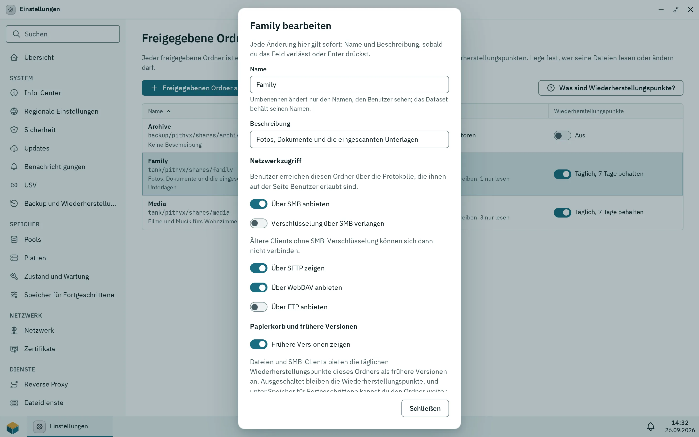

Ein freigegebener Ordner ist ein eigenes ZFS-Dataset auf einem Pool, mit eigenem Platz, eigenen Rechten und eigenen Snapshots. Administratoren legen sie unter Einstellungen > **Freigegebene Ordner** an; Benutzer sehen nur die Ordner, für die sie ein Recht haben. Gelöschte Dateien landen in einem Papierkorb (standardmäßig 30 Tage), und tägliche Wiederherstellungspunkte halten ältere Versionen sieben Tage lang vor.

## Einen freigegebenen Ordner anlegen

1. Öffne Einstellungen > **Freigegebene Ordner** und wähle **Freigegebenen Ordner anlegen…**.
2. Gib einen **Name** ein, wähle den **Pool** und, wenn du magst, eine **Beschreibung (optional)**.
3. Hake **Befehle anzeigen** an, wenn du sehen willst, was ausgeführt wird, und wähle dann **Freigegebenen Ordner anlegen**.

Gibt es keinen Pool, sagt der Dialog: „Noch kein Pool ist für freigegebene Ordner bereit. Lege zuerst unter Speicher einen Pool an.“ **Zu den Pools…** öffnet Einstellungen > **Pools**.

Der Name hat 1 bis 64 Zeichen: Buchstaben, Ziffern, Leerzeichen, Punkte, Bindestriche und Unterstriche, er beginnt nicht mit einem Punkt und ist ohne Beachtung der Groß- und Kleinschreibung eindeutig ([`fs.share.invalid`](/de/docs/reference/errors/#fs.share.invalid), [`fs.share.exists`](/de/docs/reference/errors/#fs.share.exists)). Die Beschreibung hat höchstens 200 Zeichen in einer Zeile. Die Namen `global`, `home`, `homes`, `apps`, `printers`, `print$` und `ipc$` sind reserviert ([`fs.share.name_reserved`](/de/docs/reference/errors/#fs.share.name_reserved)); `home` und `homes` sind die [Home-Ordner](/de/docs/admin/home-folders/), `apps` ist der [Ordner Apps](#der-ordner-apps). Das Dataset bekommt einen aus dem Ordnernamen abgeleiteten Namen (Kleinbuchstaben, Akzente aufgelöst, andere Zeichen zu `-`) unter `<pool>/pithyx/shares/<name>`, eingehängt unter `/<pool>/<dataset-name>`.

Neue Ordner starten mit eingeschalteten Wiederherstellungspunkten. Um die Größe eines freigegebenen Ordners zu begrenzen, setze unter Einstellungen > **Speicher für Fortgeschrittene** > **Datasets anzeigen** ein Kontingent auf sein Dataset (**Grenzen…**); der Dialog hat kein Größenfeld.

:::note
Einen vorhandenen Ordner als freigegebenen Ordner einzutragen, funktioniert nur auf Entwicklungsmaschinen ([`fs.share.folder_dev_only`](/de/docs/reference/errors/#fs.share.folder_dev_only)). Auf einer normalen Box ist jeder freigegebene Ordner ein neues Dataset.
:::

## Regeln für Ordner

_Der Bearbeiten-Dialog einer Freigabe: Netzwerkzugriff pro Protokoll und Rechte pro Gruppe und Benutzer._

Der Bearbeiten-Dialog hat drei Teile.

- **Name und Beschreibung.** Das Umbenennen ändert nur den Namen, den Benutzer sehen; das Dataset behält seinen Namen. Wie alles andere im Dialog gelten sie sofort: sobald du das Feld verlässt oder Enter drückst.
- **Rechte.** Pro Benutzer und pro Gruppe: Kein Zugriff, Lesen oder Lesen und schreiben. Ein Benutzer bekommt das Meiste, was ihm selbst oder einer seiner Gruppen gegeben ist, und Administratoren können immer alles lesen und ändern. Jeder Benutzer ist in der Gruppe users, angezeigt als „alle Benutzer“. Änderungen gelten sofort. Siehe [Berechtigungen](/de/docs/admin/permissions/).
- **Netzwerkzugriff.** Die Schalter **Über SMB anbieten**, **Über SFTP zeigen**, **Über WebDAV anbieten** und **Über FTP anbieten**, standardmäßig alle an, und **Verschlüsselung über SMB verlangen** (standardmäßig aus; ältere Clients ohne SMB-Verschlüsselung können sich dann nicht verbinden). Ein Benutzer braucht sowohl das Protokollrecht als auch den Schalter am Ordner. Siehe [Dateidienste](/de/docs/admin/file-services/).

Die Tabelle zeigt für jeden Ordner den Namen mit Pfad und Beschreibung, den Pool mit dem belegten Platz, die Rechte und die Wiederherstellungspunkte und sortiert per Klick auf eine Überschrift. Wähle einen Ordner für **Bearbeiten** und **Löschen…** in der Werkzeugleiste aus, oder doppelklicke ihn zum Bearbeiten. Ein Benutzer ohne jedes Recht sieht den Ordner gar nicht ([`fs.share.not_found`](/de/docs/reference/errors/#fs.share.not_found)). Ist sein Pool nicht angeschlossen, angehalten oder nicht eingehängt, ist der Ordner nicht verfügbar ([`fs.share.unavailable`](/de/docs/reference/errors/#fs.share.unavailable)).

:::danger[Einen freigegebenen Ordner löschen]
Beim Löschen musst du den Ordnernamen eingeben und wählen: **Daten behalten** (das Dataset und die Dateien bleiben und sind weiter unter Speicher sichtbar) oder **Daten endgültig löschen** (Dataset, Dateien und jeder Snapshot, kein Rückgängigmachen).
:::

## Papierkorb und Aufbewahrung

Jeder freigegebene Ordner hat an seiner Wurzel einen versteckten Ordner `.pithyx-trash`. Löschen in Dateien verschiebt Elemente dorthin, ebenso Löschen über SMB, WebDAV und FTP. Löschen über SFTP entfernt Dateien endgültig. Der Papierkorb listet, woher jedes Element kam, wann es gelöscht wurde und wann es endgültig verschwindet, und bietet **Wiederherstellen**, **Endgültig löschen** und **Papierkorb leeren**. Wie Benutzer damit arbeiten, steht unter [Dateien](/de/docs/user/files/#der-papierkorb).

Die Aufbewahrung gilt pro Ordner: standardmäßig 30 Tage, 0 behält Elemente, bis der Papierkorb geleert wird, höchstens 3650 Tage. Eine Bereinigung läuft stündlich. Nur Administratoren können die Aufbewahrung ändern, und der Desktop hat dafür heute keine Einstellung; sie lässt sich nur über die API setzen (`PUT /api/shares/{shareId}/trash`, [`fs.trash.retention_invalid`](/de/docs/reference/errors/#fs.trash.retention_invalid) bei einem ungültigen Wert). Der Papierkorb zeigt „Gelöschte Elemente bleiben {days} Tage erhalten.“

## Wiederherstellungspunkte

Wiederherstellungspunkte sind tägliche Snapshots; die neuesten 7 bleiben erhalten (eine Box, die eine Weile aus war, behält ihre letzten Punkte, statt sie zu verlieren). Sie brauchen nur Platz für Dateien, die sich geändert haben oder gelöscht wurden, und eine gelöschte Datei gibt ihren Platz frei, sobald der letzte Punkt, der sie hält, abläuft. Jeder Ordner hat in der Spalte **Wiederherstellungspunkte** einen Schalter („Täglich, 7 Tage behalten“ oder „Aus“); **Was sind Wiederherstellungspunkte?** erklärt sie den Benutzern. Benutzer stellen ältere Versionen mit **Frühere Versionen** in Dateien wieder her, und Windows zeigt sie als „Vorgängerversionen“. Sie helfen gegen versehentliches Löschen und Ransomware, ersetzen aber kein Backup auf einem anderen Gerät, weil sie auf denselben Platten liegen. Ein freigegebener Ordner, der aus einem vorhandenen Ordner registriert wurde (nur auf Entwicklungsmaschinen), hat keine Wiederherstellungspunkte, weil er kein eigenes Dataset hat.

## Verschlüsselung über SMB

Der Schalter **Verschlüsselung über SMB verlangen** pro Ordner setzt `server smb encrypt = required` für diesen Ordner; sonst wird verschlüsselt, wenn der Client es verlangt. Der Server verlangt immer SMB 3 und Signierung. Das ist getrennt von der Pool-Verschlüsselung, die die Daten auf den Platten verschlüsselt (siehe [Speicher](/de/docs/admin/storage/#verschlüsselung)).

## Der Ordner Apps

**Apps** ist ein freigegebener Ordner, den die Box selbst anlegt: ein Ordner pro App auf dem App-Pool, benannt nach der ID der App (`com.example.chat`), mit den Daten der App und sonst nichts von ihr (das `volumes/` der App; Versionen und ihre Compose-Datei bleiben verborgen). Er erscheint, sobald eine App installiert ist, in Dateien und über SMB, nie über SFTP, WebDAV oder FTP. Einstellungen > **Freigegebene Ordner** führt ihn mit dem Abzeichen **System**; er lässt sich nicht umbenennen, beschreiben oder löschen ([`fs.share.system`](/de/docs/reference/errors/#fs.share.system)), und sein Bearbeiten-Dialog bietet nur **Über SMB anbieten**, **Verschlüsselung über SMB verlangen** und die Rechte.

Nur Administratoren haben Apps. Gibst du ihn einem Benutzer oder einer Gruppe oder hebst du Lesen auf Lesen und Schreiben an, fragt Pithyx zuerst: Apps enthält die Daten aller Apps, darunter womöglich persönliche Daten aller Benutzer. **Zugriff geben** übernimmt die Änderung, und jeder andere Administrator bekommt eine Benachrichtigung; eine Anfrage ohne die Bestätigung scheitert mit [`fs.apps.confirmation_required`](/de/docs/reference/errors/#fs.apps.confirmation_required). Dieselbe Frage kommt aus den Dialogen für Benutzer und Gruppen unter Einstellungen > **Benutzer und Gruppen**.

Was im Ordner einer App anders ist:

- **Die oberste Ebene gehört der Box.** Die Ordner kommen und gehen mit den Apps; daneben lässt sich nichts anlegen, umbenennen oder löschen ([`fs.apps.root_fixed`](/de/docs/reference/errors/#fs.apps.root_fixed)). Im Ordner einer App kann ändern, wer schreiben darf.
- **Kein Papierkorb und keine früheren Versionen.** Löschen in Apps ist endgültig, in Dateien nach einer Rückfrage, über SMB sofort ([`fs.apps.trash_unsupported`](/de/docs/reference/errors/#fs.apps.trash_unsupported) für ein Verschieben in den Papierkorb). Die Spalte **Wiederherstellungspunkte** zeigt "Keine".
- **Neue Dateien gehören der App.** Was Dateien oder SMB im Ordner einer App anlegt, bekommt den Besitzer des Ordners, die Benutzer-ID der App (oder das umgemappte root einer App, die als root läuft), und keine Rechte für andere, damit die App es nutzen kann. Von einem SMB-Client aus kann niemand Besitzer, Modi oder ACLs ändern.
- **Links bleiben drinnen.** Ein Link, den eine App angelegt hat, zeigt irgendwohin in ihrem Container; weder Dateien noch SMB folgen ihm, und kein Pfad führt aus dem Ordner einer App in einen anderen oder aus Apps hinaus.
- **Verschieben zwischen Apps ist eine Kopie.** Der Ordner jeder App ist ein eigenes Dateisystem, daher kopiert ein Verschieben aus dem Ordner einer App in den einer anderen die Dateien und löscht danach die Originale: in Dateien dauert das so lange wie eine Kopie, und über SMB macht der Computer dasselbe oder lehnt das Verschieben ab (dann von Hand kopieren und löschen). Die Kopien gehören der anderen App.
- **Deinstallierte Apps.** Behält eine Deinstallation die Daten, bleibt der Ordner, und Dateien kennzeichnet ihn mit **Nicht installiert**. Löschen der Daten entfernt ihn.

Dateien warnt, bevor im Ordner einer App, deren Backend läuft, etwas geändert wird, weil die App diese Dateien offen haben kann; über SMB kann nichts warnen, und der Dialog, der Zugriff gibt, sagt das. Bevor die Daten einer App gelöscht oder ihr Pool exportiert oder zerstört wird, trennt die Box jede SMB-Verbindung zu Apps, sodass dort geöffnete Dateien ohne Speichern geschlossen werden; der Deinstallationsdialog sagt es, wenn jemand verbunden ist.
