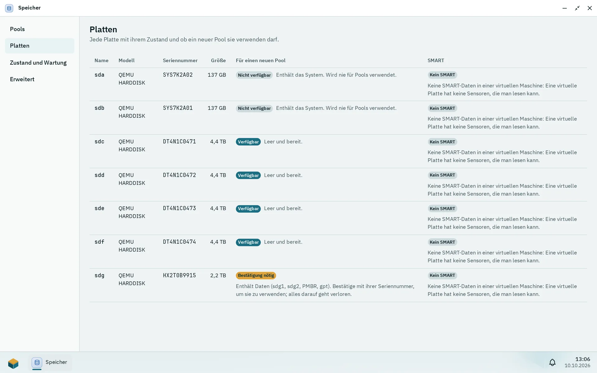
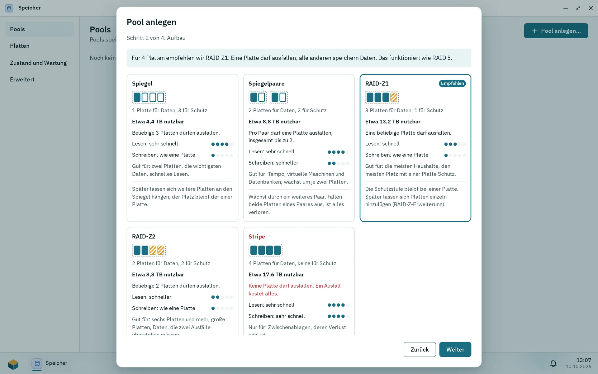

Die App Speicher (nur für Administratoren) legt die ZFS-Pools an, die alle Daten der Box enthalten, und verwaltet sie. Pithyx nutzt die Systemplatte nie für einen Pool, zeigt für jede Platte, ob sie verwendet werden darf, und verlangt die Eingabe der Seriennummer, bevor eine Platte mit Daten gelöscht wird. Änderungen laufen im Hintergrund, und **Befehle anzeigen** listet die genauen Befehle auf, bevor etwas ausgeführt wird.

## Bewertung der Platten

_Der Reiter Platten sagt für jede Platte, ob ein neuer Pool sie verwenden darf._

Die Spalte **Für einen neuen Pool** zeigt pro Platte eine von drei Bewertungen: **Verfügbar**, **Bestätigung nötig** oder **Nicht verfügbar**. Pithyx prüft die Bewertung direkt vor jedem Befehl eines Plans erneut, sodass eine Platte, die sich nach deinem Blick geändert hat, erkannt wird.

Eine Platte ist **Nicht verfügbar**, wenn:

- sie das System enthält (`/`, `/boot`, `/boot/efi` oder `/var/lib/pithyx`, auch über Partitionen, LVM, md oder einen anderen Pool): „Enthält das System. Wird nie für Pools verwendet.“
- sie schreibgeschützt ist oder ein Dateisystem darauf in Benutzung ist;
- sie schon zu einem Pool gehört;
- eine andere Platte dieselbe Seriennummer meldet, sodass sich beide nicht unterscheiden lassen;
- sie Daten enthält, aber keine Seriennummer zum Bestätigen hat.

Bei einer Platte ist **Bestätigung nötig**, wenn sie Partitionen, Dateisysteme oder andere Signaturen hat oder noch nicht geprüft wurde. Bei einer Platte mit Inhalt sagt Pithyx „Enthält Daten“ und listet die gefundenen Partitionen, Dateisysteme und Signaturen auf. Gib ihre Seriennummer genau so ein, wie sie angezeigt wird, um sie zu verwenden. Leere Platten sind **Verfügbar**. Eine Ersatzplatte (siehe unten) braucht immer ihre Seriennummer, auch wenn sie leer ist.

:::danger[Alles auf einer bestätigten Platte geht verloren]
Die Bestätigung mit der Seriennummer löscht die Platte: Pithyx führt bei Pool-Mitgliedern `zpool labelclear -f` aus, danach `wipefs --all` auf den Partitionen und der Platte. Es gibt kein Rückgängigmachen. Vergleiche die Seriennummer mit dem Aufkleber auf der Platte.
:::

Wenn sich eine Platte geändert hat, nachdem der Plan angezeigt wurde, wird nichts geändert, und du bekommst [`storage.plan.stale`](/de/docs/reference/errors/#storage.plan.stale). Ein Plan läuft nach 10 Minuten ab ([`storage.plan.expired`](/de/docs/reference/errors/#storage.plan.expired)); zeige ihn dann erneut an.

## Einen Pool anlegen

_Schritt 2 des Assistenten vergleicht die Aufbauten für die gewählten Platten und markiert den empfohlenen._

Öffne Speicher und wähle **Pool anlegen…**. Der Assistent hat vier Schritte: **Platten**, **Aufbau**, **Verschlüsselung** und **Name und Prüfung**. Platten werden über ihre Namen unter `/dev/disk/by-id` angesprochen, sodass ein Pool einen geänderten Anschluss oder ein anderes Kabel übersteht.

| Aufbau                            | Mindestanzahl Platten | Hinweise                                    |
| --------------------------------- | --------------------- | ------------------------------------------- |
| Einzelne Platte (keine Redundanz) | 1                     | genau eine Platte                           |
| Stripe                            | 2                     | fällt eine Platte aus, ist alles verloren   |
| Spiegel                           | 2                     |                                             |
| Spiegelpaare                      | 4                     | eine gerade Anzahl Platten                  |
| RAID-Z1 / RAID-Z2 / RAID-Z3       | 3 / 4 / 5             | eine / zwei / drei Platten dürfen ausfallen |

Der Assistent empfiehlt einen Aufbau: bei einer Platte einzeln, bei zwei Platten Spiegel, bei drei bis fünf Platten RAID-Z1, bei sechs oder mehr RAID-Z2. Bei Platten unterschiedlicher Größe zählt jede Platte so groß wie die kleinste, und der Assistent sagt dir, wie viel ungenutzt bleibt.

Der Pool-Name beginnt mit einem Kleinbuchstaben, danach folgen Kleinbuchstaben, Ziffern, `-` oder `_`, höchstens 32 Zeichen. Die Namen `mirror`, `raidz`, `raidz1` bis `raidz3`, `draid`, `spare`, `log`, `cache`, `special`, `dedup` und `pithyx` sowie Namen, die mit `c0` beginnen, sind reserviert.

Jeder neue Pool bekommt dieselben Optionen: `ashift=12`, `compression=lz4`, `xattr=sa`, `acltype=posixacl`, `atime=off`, `normalization=formD`. Danach legt Pithyx seine Dataset-Struktur unter `<pool>/pithyx` an: `shares`, `homes`, `apps`, `system` und `cache` (Kontingent 2,5 GB, keine Kompression, keine automatischen Snapshots). Ein Pool, den Pithyx nicht angelegt hat, hat kein Dataset `pithyx`, und Pithyx legt darauf nichts an ([`storage.pool.not_prepared`](/de/docs/reference/errors/#storage.pool.not_prepared)).

Weitere Pool-Aktionen: **Ersetzen…** (fragt immer nach der Seriennummer), **Hot Spare hinzufügen…**, **Spare entfernen**, **Offline nehmen**, **Online bringen** und **Pool löschen…**.

:::danger[Einen Pool löschen]
**Pool löschen…** listet jedes Dataset auf, das mit dem Pool verschwindet, und verlangt die Eingabe des Pool-Namens ([`storage.pool.name_mismatch`](/de/docs/reference/errors/#storage.pool.name_mismatch), wenn er abweicht). Löschen und Exportieren werden abgelehnt, solange Platten fehlen ([`storage.pool.disks_missing`](/de/docs/reference/errors/#storage.pool.disks_missing)) oder der Pool angehalten ist.
:::

Ein Pool zeigt einen dieser Zustände: Intakt, Beeinträchtigt, Ausgefallen, Offline, Nicht erreichbar, Entfernt, Angehalten, Unbekannt oder „Nicht angeschlossen“. Bei einem beeinträchtigten Pool wird eine Platte, die zurückkommt, von selbst neu aufgebaut (Resilver). Der Daemon holt eine zurückkehrende Platte mit `zpool online` und danach `zpool clear` zurück, jeweils mit 30 Sekunden Zeitlimit.

## Datasets und Snapshots

Unter **Erweitert** listet **Datasets** > **Datasets anzeigen** die Datasets mit Name, Belegt, Frei, Limit, Kompression und dem Ordner oder der Größe. Dataset-Namen bestehen aus Buchstaben, Ziffern, `.`, `-` und `_`, beginnen mit einem Buchstaben oder einer Ziffer und sind höchstens 64 Zeichen lang.

- **Umbenennen…** verschiebt den Ordner; freigegebene Ordner folgen.
- **Grenzen…** setzt Kontingent, Reservierung, Kompression und Record-Größe. Ein leeres Kontingent oder eine leere Reservierung bedeutet kein Limit. Kompression: aus, lz4, zle, zstd (Stufen 1 bis 19) oder gzip (1 bis 9). Record-Größe: eine Zweierpotenz von 4 KiB bis 1 MiB, Standard 128 KiB.
- **Löschen…** verlangt den vollständigen Dataset-Namen und listet untergeordnete Datasets und Snapshots auf.

Datasets für Home-Ordner, Apps und das System lassen sich weder umbenennen noch löschen ([`storage.dataset.managed`](/de/docs/reference/errors/#storage.dataset.managed)), und ein Dataset, das ein freigegebener Ordner nutzt, muss zuerst diesen freigegebenen Ordner verlieren. **Volume anlegen…** erstellt ein Block-Volume auf Pools, die Pithyx eingerichtet hat; die Größe beträgt mindestens 1 MiB und wird auf 16-KiB-Blöcke aufgerundet. Ein Sparse-Volume kann Schreibzugriffe verlieren, wenn der Pool voll wird.

Der Tab **Snapshots** listet Snapshots mit Name, Angelegt und Platz. Snapshots von Pithyx heißen `pithyx-<kind>-<yyyyMMddTHHmmssZ>` mit der Art Stündlich, Täglich, Wöchentlich, Monatlich, Von Hand oder „Vor einem App-Update“; andere erscheinen als „Fremd“. Du kannst einen **Snapshot anlegen**, festhalten und freigeben, **Zurücksetzen** und löschen. Pithyx löscht nur seine eigenen Snapshots, und festgehaltene werden abgelehnt ([`storage.snapshot.held`](/de/docs/reference/errors/#storage.snapshot.held)).

:::caution[Zurücksetzen]
Beim Zurücksetzen musst du den Dataset-Namen eingeben, und alle neueren Snapshots werden gelöscht. Jede Änderung seit dem Snapshot geht für alle verloren, die das Dataset nutzen.
:::

Zeitpläne (stündlich, täglich, wöchentlich ab Montag, monatlich) legen pro Zeitraum einen Snapshot in UTC an und behalten eine Anzahl ihrer eigenen Snapshots, 1 bis 1000. Die Vorgaben beim Einschalten: stündlich 24, täglich 7, wöchentlich 4, monatlich 6. Neue Zeitpläne sind zunächst ausgeschaltet. Die Aufbewahrung zählt Snapshots, nicht das Alter, und festgehaltene oder fremde Snapshots werden nie entfernt. Benutzer bekommen ältere Dateiversionen über **Frühere Versionen** in Dateien. Freigegebene Ordner haben einen eigenen täglichen Zeitplan, siehe [Freigegebene Ordner](/de/docs/admin/shared-folders/).

## Importieren und exportieren

**Pool importieren…** durchsucht die Labels aller Platten, wenn du **Platten durchsuchen** drückst; die Suche kann schlafende Platten wecken und läuft nie von selbst. Ein Pool wird zuerst schreibgeschützt als Vorschau importiert (angezeigt als „Schreibgeschützt (Vorschau)“): Es wird nichts eingehängt und nichts geändert. Wähle dann **Zur Nutzung importieren…**, was ihn erneut importiert und die Datasets einhängt, die sicher einzuhängen sind, oder **Exportieren**, um die Vorschau zu beenden ([`storage.import.preview_required`](/de/docs/reference/errors/#storage.import.preview_required), wenn du die Vorschau überspringst).

Datasets, die sich nicht sicher einhängen lassen, bleiben ausgehängt (`canmount=noauto`) und nennen einen Grund: Sie würden einen Systemordner überdecken, etwas verdecken, das dort eingehängt ist, einen Ordner mit einem anderen Dataset teilen oder sind verschlüsselt und gesperrt. Freigegebene Ordner und Apps darauf halten an.

Ein Pool, der zuletzt von einem anderen System benutzt wurde, zeigt „Von einem anderen System benutzt“. Er braucht **Trotzdem importieren (erzwingen)** und die Eingabe des Pool-Namens ([`storage.import.force_required`](/de/docs/reference/errors/#storage.import.force_required)). Ist der Name vergeben, wähle **Neuer Name für den Pool**. **Exportieren…** hängt die Datasets aus und listet auf, was dadurch nicht mehr verfügbar ist; die Daten bleiben auf den Platten, und der Pool kann in ein anderes System umziehen.

## Einen Pool erweitern

**Platten hinzufügen…** fügt dem Pool eine neue Gruppe von Platten (ein Vdev) hinzu: einzeln, Spiegel (2 Platten), RAID-Z1 (3), RAID-Z2 (4) oder RAID-Z3 (5). Der Dialog warnt, wenn die neue Gruppe die Redundanz senkt, wenn sich ihr Aufbau von den vorhandenen unterscheidet (dafür muss der Pool-Name eingegeben werden) und dass sich die Platten nie wieder aus dem Pool entfernen lassen.

**Um eine Platte erweitern…** erweitert eine RAID-Z-Gruppe um eine Platte. Der Pool bleibt nutzbar, der Schritt ist nicht umkehrbar und verlangt den Pool-Namen, es läuft immer nur eine Erweiterung ([`storage.pool.expanding`](/de/docs/reference/errors/#storage.pool.expanding)), und Daten, die schon auf dem Pool liegen, behalten ihr altes Verhältnis von Daten zu Parität, bis sie neu geschrieben werden.

:::note
Die App Speicher hat keine Schaltfläche, um eine einzelne Platte später in einen Spiegel zu verwandeln.
:::

## Verschlüsselung

Die Pool-Verschlüsselung ist in dieser Version nicht verfügbar. Der Assistent fragt „Soll der Pool verschlüsselt werden?“, und die Antwort ist Pflicht; **Keine Verschlüsselung** funktioniert, und **Mit einem Schlüssel verschlüsseln** wird mit [`storage.encryption.unavailable`](/de/docs/reference/errors/#storage.encryption.unavailable) abgelehnt. Ein Pool lässt sich nachträglich nicht verschlüsseln.

## Zustand und Warnungen

Administratoren bekommen eine Desktop-Benachrichtigung, wenn eine Speicherwarnung auftritt oder sich verschlimmert, und eine zweite, die mit „Behoben:“ beginnt und das Problem nennt, wenn es verschwindet. Die Warnungen betreffen: Pool angehalten, beeinträchtigt, ausgefallen oder offline, eine fehlende Platte, Datenfehler, Scrub-Fehler, einen zu 80 Prozent gefüllten Pool (Warnung) oder zu 90 Prozent gefüllten Pool (kritisch) und ausfallende oder bedenkliche SMART-Werte. Du kannst eine Warnung für dich stummschalten.

- **Jetzt prüfen** (Scrub), anhalten, fortsetzen und stoppen. Ein Zeitplan pro Pool: Aus, Wöchentlich oder Monatlich (Standard Monatlich).
- SMART wird mit `smartctl -n standby` gelesen (30 Sekunden Zeitlimit), sodass schlafende Platten weiterschlafen. Zustände: Gesund, Warnung, Fällt aus, Kein SMART, Unbekannt. Kurze Selbsttests laufen standardmäßig wöchentlich und lange monatlich; eine schlafende Platte wird übersprungen und später erneut versucht, nie geweckt.
