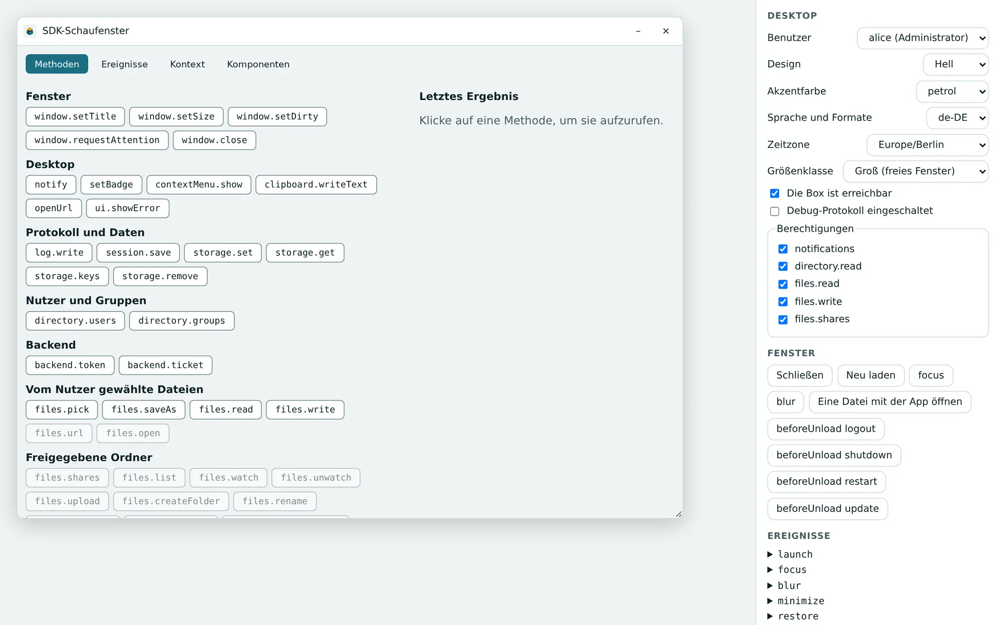
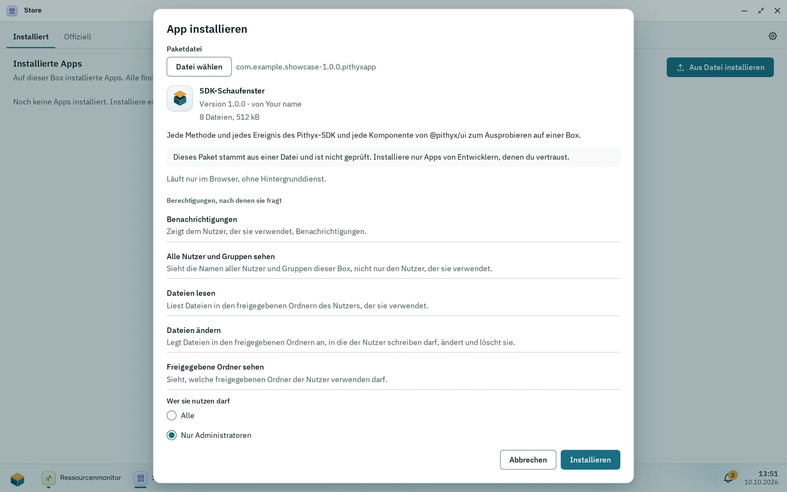

Diese Seite führt eine App von einem leeren Projekt zu einem installierbaren Paket: das Frontend bauen, es mit dem Mock-Desktop von `pithyx dev` auf deinem Rechner ausprobieren, mit `pithyx validate` prüfen und mit `pithyx pack` das Paket schreiben. Auf der Box gibt es keinen Entwicklungsmodus; dort testest du, indem du das Paket installierst.

## Das Projekt einrichten

Der Befehl `pithyx` hat keinen Befehl, der ein Projekt anlegt. Beginne mit einem beliebigen Frontend-Projekt (die Beispiele nutzen Vite) und lege die Dateien, die das CLI erwartet, im Projektstamm an:

- `pithyx.json`, das [Manifest](/de/docs/developers/apps/manifest/). Füge `"$schema": "./node_modules/@pithyx/sdk/schema/manifest.v1.schema.json"` für die Editor-Unterstützung hinzu.
- `icon.svg`. Das CLI-Paket bringt ein `template-icon.svg` mit; `pithyx validate` warnt, solange `icon.svg` noch dieses Icon ist.
- Das gebaute Frontend in `dist/` (den Ordner änderst du mit `--frontend <folder>`). Dein `entry` muss `frontend/<file>.html` sein; der Inhalt von `dist/` wird im Paket zu `frontend/`.

Installiere die Pakete und verbinde dich:

```sh
npm install @pithyx/sdk@next
npm install --save-dev @pithyx/cli@next
```

```ts
import { connect } from '@pithyx/sdk';

const app = await connect();
```

Das CLI braucht Node.js 22.12 oder neuer. Sein Vite-Plugin (`@pithyx/cli/vite`, Vite 7 oder neuer) setzt den Basispfad des Builds auf `./`, damit relative Asset-Pfade unter `/apps/<id>/` funktionieren:

```ts
import pithyx from '@pithyx/cli/vite';
import { defineConfig } from 'vite';

export default defineConfig({ plugins: [pithyx()] });
```

## pithyx dev



_Der Test-Desktop von pithyx dev: Die Seitenleiste ändert Benutzer, Design, Sprache und Berechtigungen, die die App sieht._

`pithyx dev` startet einen Mock-Desktop auf `http://127.0.0.1:7400/` (änderbar mit `--port` und `--host`), öffnet dein gebautes Frontend in derselben Sandbox, die auch die Box nutzt, und leitet `/apps/<id>/api*` an dein Backend weiter. Nach einer Änderung baust du das Frontend neu und lädst die Seite neu.

Mit dem Vite-Plugin kannst du stattdessen `vite` starten: Der Mock-Desktop hängt sich an den Dev-Server, die Basis wird `/apps/<id>/` und Hot Reload funktioniert.

Der Mock-Desktop hat drei Benutzer (alice, eine Administratorin; bob, in zwei Gruppen; carol, in keiner) und ein Panel, mit dem du Theme, Akzent, Sprache, Zeitzone, Größenklasse, Online-Status und Berechtigungen änderst und Backend-Status, Speicher und Ereignisse siehst.

Ein Backend läuft mit `docker compose up --wait --build`. Das CLI nutzt `backend/compose.dev.yaml`, falls vorhanden, sonst die festgelegte `backend/compose.yaml`, und veröffentlicht den Port jedes Endpunkts auf `127.0.0.1` für den Proxy. (Die Box veröffentlicht nie Ports.) Ohne Docker:

- `--endpoint name=url` (wiederholbar) schickt einen Endpunkt an einen Server, den du selbst gestartet hast, und startet dafür kein Docker.
- `--no-docker` startet das Backend nicht; Endpunkte ohne `--endpoint` antworten mit 503.

Mit Strg+C beendest du es; das CLI führt `docker compose down` aus und behält die Volumes.

## Das Paket bauen

1. Baue das Frontend (zum Beispiel `vite build`).
2. `pithyx validate` prüft `pithyx.json`, das Icon, das Layout, die Entry-Datei im gebauten Frontend, die Compose-Datei und die Image-Sperrdatei. Es gibt `<level> <code>: <text>` aus und endet bei Fehlern mit 1. Es nutzt dieselben Validatoren wie die Box und dieselben Fehlercodes. Vor `pithyx build` (das Docker braucht) prüft es stattdessen `backend/compose.dev.yaml` und warnt mit `cli.backend.unbuilt`.
3. Mit einem Backend machst du die Compose-Datei per Digest fest: entweder mit `pithyx lock` (löst die Images aus `backend/compose.yaml` auf und schreibt `backend/images.lock.json` für amd64 und arm64; die Registries werden anonym oder mit den Zugangsdaten aus `~/.docker/config.json` gefragt) oder mit `pithyx build` (baut die Services aus `backend/compose.dev.yaml`, die `build:` haben, und schreibt beide Dateien).
4. `pithyx pack [--out <file.pithyxapp or folder>] [--images]` validiert noch einmal und schreibt das Paket. `--images` fügt die Images für Offline-Installationen hinzu und braucht Docker.

Die Details zu jedem Befehl stehen auf [@pithyx/cli](/de/docs/sdk/cli/).

## Auf einer Box installieren



_Aus Datei installieren zeigt das Paket vor der Installation: den Hinweis, dass es nicht geprüft ist, seine Berechtigungen und wer es nutzen darf._

Nur ein Administrator kann ein Paket installieren.

1. Öffne den Store und den Tab **Installiert** und wähle **Aus Datei installieren**.
2. Wähle die `.pithyxapp`-Datei. Der Dialog **App installieren** zeigt die Version und ob es sich um eine Installation, ein Update, eine Neuinstallation oder ein Downgrade handelt, außerdem den Autor, die Dateianzahl und die Größe sowie die Warnung "Dieses Paket stammt aus einer Datei und ist nicht geprüft."
3. Sieh dir die Berechtigungen an, die die App anfordert, die Ordner, die sie haben will, ob sie ein Backend hat, ob sie als root läuft und wer sie nutzen darf.
4. Bei der ersten App-Installation der Box wählst du den Pool für die App-Daten; jede App legt ihre Dateien dort ab. Ohne Pool sagt der Dialog, dass du zuerst im Speicher einen anlegen sollst.
5. Bestätige. Die Installation läuft als Job.

Nach der Installation ordnet ein Administrator die Speicheranforderungen der App freigegebenen Ordnern zu und kann Berechtigungen entziehen. Ein Update, das eine neue Berechtigung anfordert, wartet auf die Bestätigung des Administrators, und die alte Version läuft weiter. Ein Update erstellt einen Snapshot der App-Daten; ein Rollback kehrt mit den Daten zur vorherigen Version zurück. Siehe [Apps und der Store](/de/docs/admin/apps-and-store/).

### Aus einem Skript installieren

Der Store tut nichts, was ein Skript nicht auch mit der [REST-API](/de/docs/reference/api/apps/) kann. Melde dich als Administrator an, lade das Paket hoch und installiere es dann als Job:

```sh
BOX=https://box.local:7484
curl -sS --cacert root-ca.crt -c cookies -H 'X-Pithyx-Request: 1' -H 'Content-Type: application/json' \
  -d '{"username":"admin","password":"..."}' "$BOX/api/auth/login"
curl -sS --cacert root-ca.crt -b cookies -H 'X-Pithyx-Request: 1' -H 'Content-Type: application/gzip' \
  -X PUT --data-binary @com.example.notes-1.0.0.pithyxapp "$BOX/api/apps/packages"
# The answer is the preview: packageId, action, permissions, keptData, suggestedAccess, pool.
curl -sS --cacert root-ca.crt -b cookies -H 'X-Pithyx-Request: 1' -H 'Content-Type: application/json' \
  -d '{"pool":"tank","access":"everybody"}' "$BOX/api/apps/packages/<packageId>/install"
# 202 with the job; follow it with GET /api/jobs/<id> until its state is succeeded or failed.
```

- `root-ca.crt` ist die eigene Zertifizierungsstelle der Box unter `$BOX/api/system/tls/root-ca.crt` (siehe [Zertifikate](/de/docs/admin/certificates/)).
- Ein Konto mit Zwei-Faktor-Anmeldung bekommt vom ersten Aufruf eine `challenge` und schließt sie mit `POST /api/auth/login/totp` ab.
- `pool` braucht es nur für die erste App der Box; `access` (`everybody` oder `admins`) ist ohne Angabe der `suggestedAccess` der Vorschau. Ein geprüftes Paket wartet 15 Minuten auf seine Installation.
