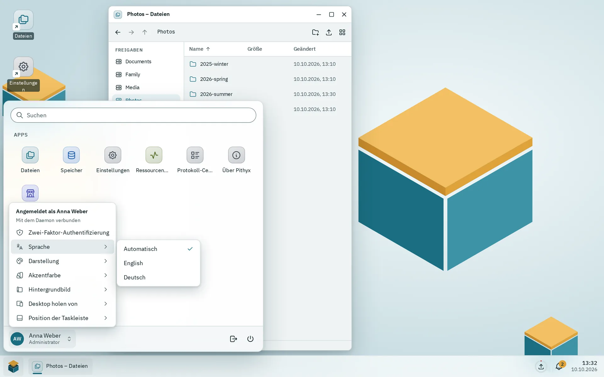

Aller sichtbare Text im Desktop stammt aus Übersetzungsdateien in `i18n/`, mit Englisch als Referenz und Deutsch als verpflichtender zweiter Sprache. Nachrichten nutzen ICU MessageFormat, der Build kompiliert sie vorab, und Tests schlagen fehl, wenn ein Schlüssel in einer Sprache existiert, in der anderen aber nicht.

## Schlüssel

- Dateien sind `i18n/<locale>/<namespace>.json`. Heute sind die Locales `en` und `de`, und die Namespaces sind `auth`, `cli`, `desktop`, `errors`, `files`, `installer`, `jobs`, `logs`, `monitor`, `network`, `notifications`, `settings`, `storage`, `store`, `ui`, `users` und `viewer`.
- Schlüssel sind Punktpfade in verschachteltem JSON, benannt nach `area.screen.element`, zum Beispiel `menu.themeChoice.system`. Fehlertexte liegen unter `errors.<code>`.
- TypeScript prüft Schlüssel gegen die englischen Dateien. Es gibt keine String-Literale in JSX (ESLint, Modus `jsx-text-only`).
- Deutsch nutzt das informelle "du". Texte nennen nie Firmen oder deren Produkte.
- `ui.json` gehört zu `@pithyx/ui` und `cli.json` zum Mock-Desktop von `pithyx dev`; der Desktop lädt sie nicht.
- **Chunking.** Die Namespaces `desktop`, `auth` und `errors` laden vor dem ersten Rendern, `notifications` und `jobs` laden mit dem Desktop-Chunk, und jeder andere Namespace lädt, wenn seine App geöffnet wird (`loadTranslations('files')`). Es wird nur die aktive Sprache geladen. Es gibt keine Fallback-Sprache, also braucht jede Sprache jeden Schlüssel.

## ICU-Nachrichten



_Das Untermenü Sprache bietet Automatisch und jede Sprache in ihrem eigenen Namen._

Nachrichten nutzen ICU-Syntax mit Parametern, Plural und Select:

```json
"windowCount": "{count, plural, one {# window} other {# windows}}"
```

- Der Build kompiliert Nachrichten zu einem kleinen Syntaxbaum (`desktop/scripts/compile-messages.ts`), sodass das Produktions-Bundle den ICU-Parser nicht ausliefert.
- Zur Laufzeit zeigt ein fehlender oder falscher Parameter den Schlüssel als Text. Ein Text, der seinen Schlüssel zeigt, kann auch bedeuten, dass der Namespace nicht geladen ist.
- Tags in Nachrichten bleiben reiner Text; nutze `<Trans>` für Markup.
- Der Daemon rendert dieselben Nachrichten für Texte, die die API verlassen (Kanäle außerhalb der Anwendung), mit `IcuMessageFormatter`. Eine gemeinsame Testdatei, `tools/i18n/icu-golden.json`, muss im Desktop (Vitest) und im Daemon (xUnit) dasselbe Ergebnis liefern.
- Daten und Zahlen nutzen `Intl` mit der Format-Locale: der Sprache plus der Region des Systems, zum Beispiel `de-AT`. Plural-Regeln folgen nur der Sprache. Daten werden in UTC gespeichert und pro Zeitzone des Benutzers formatiert.

**Die Sprache wählen.** In dieser Reihenfolge: die gespeicherte Wahl (`localStorage`-Schlüssel `pithyx.language`, pro Browser), die Sprachliste des Browsers, die Systemsprache aus den Setup-Informationen, dann Englisch. Das Untermenü **Sprache** im Konto-Menü bietet **Automatisch** plus jede Sprache in ihrem eigenen Namen. Die Systemsprache stellst du in den Einstellungen unter **Regionale Einstellungen** ein.

## Eine Sprache hinzufügen

Es gibt keine einzelne Liste der Sprachen. Eine hinzuzufügen heißt heute, diese Stellen zu bearbeiten:

1. Lege `i18n/<code>/` mit jeder Datei an, die `i18n/en` hat.
2. Füge den Code zu `languages` in `desktop/src/i18n.ts` hinzu und aktualisiere die zwei Stellen dort, die `'en'` und `'de'` fest eincodieren (Spracherkennung und gespeicherte Wahl).
3. Füge die Locale zu `ariaLocales` in `desktop/vite.config.ts` hinzu (Texte von React Aria).
4. Füge sie im Daemon zu `SystemRegion.Languages` hinzu (`SystemSettings/SystemContracts.cs`).
5. Aktualisiere die übrigen Listen: die Matrix in `tools/design-shots/matrix.ts` und den Test `sdk/src/i18n.test.ts`.

Die Website hat eigene Sprachdateien (`website/src/content/i18n/` und `website/src/content/docs/de/`).

Prüfungen, die in `pnpm test` laufen: dieselben Schlüssel in jeder Sprache, dieselben Dateien in jeder Sprache, ein Text für jeden SDK-Transportcode und jeden API-Fehlercode, ein Text für jede Kern-App und überall gültige ICU-Syntax. Die Daemon-Tests prüfen, dass jeder Fehlercode einen englischen und einen deutschen Text hat.

## Fehlertexte

Die API liefert einen Code und Parameter, nie übersetzten Text. Der Desktop schlägt den Code als `errors.<code>` mit den Parametern nach (`translateError`). Der JSON-Pfad folgt dem Code, also ist `app.app.busy` gleich `errors.app.app.busy`. Ein fehlgeschlagener `fetch` nutzt den Code `network`. Die Fehlermeldung wird mit `role="alert"` angekündigt und schreibt Code und Request-ID in die Konsole.

SDK-Transportcodes (`sdk.*`) haben ihre Texte unter `errors.sdk.*`. Der englische Text jedes Codes ist auch das, was der Daemon als `detail` zurückgibt.
