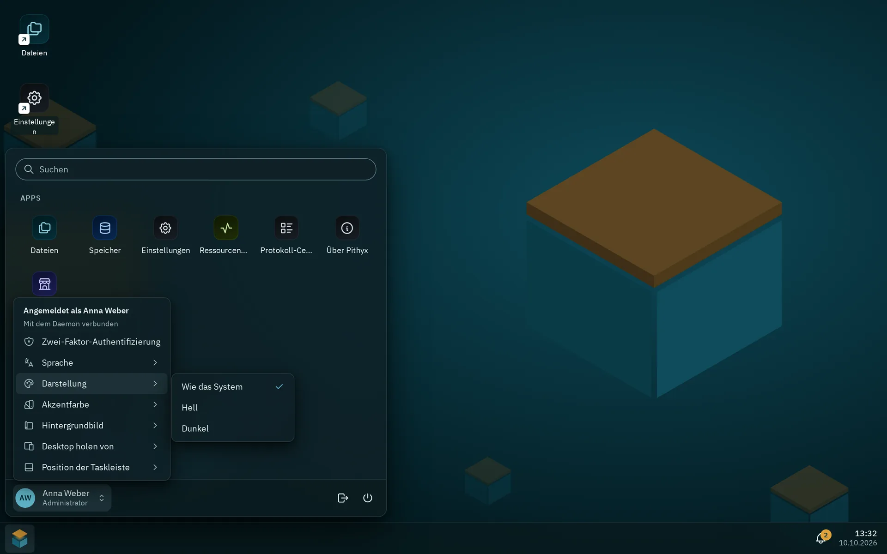

Alle Farben, Abstände, Schriftgrößen, Radien, Schatten und Bewegungen des Desktops stammen aus einer Datei, `packages/ui/tokens.css`, als CSS Custom Properties. Die Datei passt sich mit `light-dark()` an Hell und Dunkel an, bietet sechs Akzent-Presets und funktioniert ohne React.

## Tokens

`tokens.css` ist die einzige Token-Datei. Der Desktop importiert sie über `desktop/src/theme/index.css`; andere Projekte importieren `@pithyx/ui/tokens.css`. Komponenten-Styles sind CSS-Module.

| Gruppe   | Namen                                                                                                                                                          |
| -------- | -------------------------------------------------------------------------------------------------------------------------------------------------------------- |
| Palette  | `--petrol-50` bis `--petrol-950`, `--amber-*`, `--neutral-*`, Statusfarben                                                                                     |
| Farbe    | `--color-bg`, `--color-surface-1` bis `-3`, `--color-text`, `--color-border`, `--color-focus`, `--color-success`, `--color-warning`, `--color-danger` und mehr |
| Shell    | `--color-desktop`, `--color-taskbar`, `--color-window-border`, `--color-titlebar`, `--color-note`                                                              |
| Akzent   | `--color-accent`, `-hover`, `-pressed`, `-contrast`, `-subtle`                                                                                                 |
| Schrift  | `--font-sans`, `--font-display`, `--font-mono`, `--font-size-xs` (0,75 rem) bis `--font-size-display-2` (2,5 rem)                                              |
| Abstand  | `--space-0` (2 px), `--space-1` (4 px) bis `--space-7` (48 px)                                                                                                 |
| Radius   | `--radius-xs` (4 px) bis `--radius-lg` (14 px), `--radius-full`                                                                                                |
| Bewegung | `--duration-instant` (100 ms) bis `--duration-slow` (400 ms), `--ease-standard`                                                                                |
| Ebenen   | `--z-*` von Desktop (0) und Fenstern (100) bis Tooltip (9000)                                                                                                  |
| Größen   | `--touch-target` 44 px, `--control-height` 36 px, `--taskbar-size` 52 px, `--titlebar-height` 40 px                                                            |

Anpassungen in der Datei: Auf Geräten mit `(pointer: coarse)` wachsen Steuerelemente und Titelleisten auf 44 px und die Taskleiste auf 60 px. Mit `prefers-reduced-motion: reduce` sinken die Dauern auf 1 ms. Mit `prefers-reduced-transparency: reduce` oder erzwungenen Farben sind Taskleiste und Menüs deckend.

**Für Apps von Drittanbietern.** Apps in der Sandbox lesen diese Namen nicht. Das SDK setzt einen eigenen, stabilen Satz von `--pithyx-*`-Eigenschaften auf das Wurzelelement der App (zum Beispiel `--pithyx-color-background`, `--pithyx-color-accent`, `--pithyx-font-ui`, `--pithyx-space`). Siehe [@pithyx/sdk](/de/docs/sdk/sdk/). Die internen `--color-*`-Namen können sich ändern.

Ein Test (`packages/ui/src/contrast.test.ts`) parst `tokens.css`, löst jedes Theme und jeden Akzent auf und verlangt einen Kontrast von mindestens 4,5 für Text und 3 für Grafiken (WCAG 2.2 AA).

## Hell und dunkel

_Darstellung im Kontomenü; Akzentfarbe und Hintergrundbild sind die Einträge darunter._

Das Wurzelelement hat `color-scheme: light dark`, und jede semantische Farbe ist ein Paar `light-dark(a, b)`. Setzt du `data-theme="light"` oder `data-theme="dark"` auf `<html>`, erzwingt das ein Schema.

Das Konto-Menü hat **Darstellung** mit **Wie das System**, **Hell** und **Dunkel**. Die Wahl wird pro Browser in `localStorage` gespeichert (`pithyx.theme`); "Wie das System" entfernt den Schlüssel. Die gespeicherte Wahl wird vor dem ersten Rendern angewendet, damit die Seite nicht aufblitzt.

## Akzente

Es gibt sechs Presets: Petrol (der Standard), Ocean, Indigo, Plum, Moss und Graphite. Der Eintrag im Konto-Menü heißt **Akzentfarbe**. Das Preset wird mit `<html data-accent="...">` gesetzt. Die Liste ist absichtlich kuratiert: keine freie Farbauswahl, weil jedes Preset in beiden Themes auf Kontrast geprüft ist, und kein rotes Preset, damit ein Akzent nie wie ein Fehler aussieht.

Der Akzent und das Hintergrundbild (**Pithyx-Boxen** oder **Schlicht**) werden pro Benutzer im Daemon gespeichert und sind auf jedem Gerät gleich (`PUT /api/desktop/appearance`). Der Browser behält eine Kopie, damit das erste Zeichnen passt. Um einen Akzent hinzuzufügen, trägst du ihn in `ACCENTS` in `desktop/src/theme/appearance.ts` ein, fügst in `tokens.css` einen Block `[data-accent='x']` mit den fünf Akzent-Tokens hinzu und ergänzt `menu.accents.x` auf Englisch und Deutsch.

## Schriften

Der Desktop nutzt drei Familien, alle unter der SIL Open Font License 1.1, selbst gehostet als woff2-Dateien in `desktop/public/fonts/` und unverändert ausgeliefert:

- **IBM Plex Sans** für die Oberfläche (400, kursiv, 500, 600),
- **Sora** für die Wortmarke und große Überschriften (600, 700),
- **JetBrains Mono** für das Terminal, Logs und Pfade (400, 600).

Nichts wird von einem externen Schriftdienst geladen. Der reservierte Schriftname von Plex bedeutet, dass die Dateien nie als Teilmenge erzeugt, konvertiert oder umbenannt werden dürfen. `tools/fonts/fetch-fonts.sh` lädt festgelegte Versionen mit Prüfsummenkontrolle herunter und wird nur zum Aktualisieren gebraucht. Die Lizenzen sind in der App "Über Pithyx" aufgeführt.
