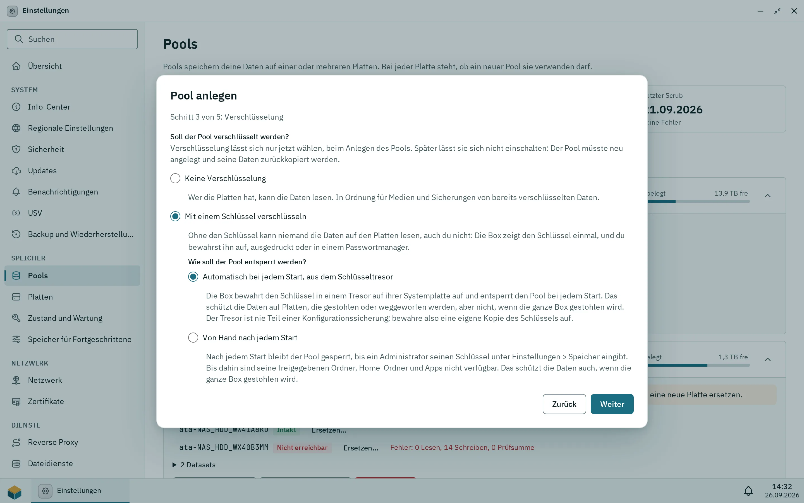

Der Installer legt das Owner-Konto an, deshalb hat eine frisch installierte Box keinen eigenen Einrichtungsassistenten: Du meldest dich unter `https://<box-address>:7484` an. Der Browser warnt einmal vor dem eigenen Zertifikat der Box; fahre fort und lies unter [Zertifikate](/de/docs/admin/certificates/), wie deine Geräte der Box vertrauen. Übrig bleibt, den Wiederherstellungsschlüssel sicher aufzubewahren, einen Pool für deine Daten anzulegen und Benutzer hinzuzufügen. Einen Pool gibt es nach der Installation noch nicht.

## Das Owner-Konto

Das Owner-Konto ist der Administrator, den du in Schritt 4 des Installers angelegt hast. Er darf alles und ist zunächst das einzige Konto. Root bleibt gesperrt, und SSH ist aus.

Zum Anmelden gibst du auf der Seite **Willkommen zurück** deinen **Benutzernamen** und dein **Passwort** ein und klickst auf **Anmelden**. Nach fünf falschen Versuchen für denselben Benutzernamen und dieselbe Adresse innerhalb von fünf Minuten pausiert die Anmeldung für kurze Zeit.

Es gibt auch eine Einrichtungsseite (**Pithyx einrichten**, **Administrator anlegen**). Sie erscheint nur, wenn eine Box überhaupt keine Benutzer hat, zum Beispiel nach einem Zurücksetzen. Auf einer Box, die mit dem Installer installiert wurde, siehst du sie nicht.

Die Zwei-Faktor-Anmeldung ist optional. Um sie einzuschalten, öffne das Pithyx-Menü, klicke auf deinen Namen, wähle **Persönliche Einstellungen** und dann **Zwei-Faktor-Authentifizierung**. Siehe [Dein Konto](/de/docs/user/account/).

## Der Wiederherstellungsschlüssel

Der Wiederherstellungsschlüssel wird einmal angezeigt, am Ende der Installation. Er sieht aus wie `PTHX-`, gefolgt von Buchstaben und Ziffern in Vierergruppen. Er ist der einzige Weg, ein Administratorpasswort ohne einen anderen Administrator zurückzusetzen. Die Box speichert nur einen Hash davon, deshalb kann ihn niemand noch einmal anzeigen.

- Drucke ihn aus oder speichere ihn in einem Passwortmanager.
- Bewahre ihn nicht nur auf der Box auf.
- Es gibt einen Schlüssel für die ganze Box. Er funktioniert für jedes Administratorkonto.
- Wenn du ihn benutzt, wird er ersetzt: Das Zurücksetzen zeigt einen neuen Schlüssel an, und der alte gilt nicht mehr. Das Zurücksetzen schaltet außerdem die Zwei-Faktor-Anmeldung des Administrators aus und beendet seine Sitzungen.
- Das Konfigurationsbackup enthält den Wiederherstellungsschlüssel.

Wenn du den Schlüssel und das Passwort verlierst, muss das System neu installiert werden. Siehe [Wiederherstellen und neu installieren](/de/docs/install/recovery/).

## Der erste Pool

_Schritt 3 des Pool-Assistenten: Verschlüsselung lässt sich nur beim Anlegen des Pools wählen._

Alle deine Daten liegen auf ZFS-Pools, und die Box startet ohne einen. Lege den ersten Pool in der Speicher-App an, die nur Administratoren öffnen können:

1. Öffne das Pithyx-Menü und starte **Speicher**.
2. Klicke auf **Pool anlegen…**.
3. Wähle die Platten, einen Aufbau, ob verschlüsselt werden soll, und einen Namen. Die Schritte heißen **Platten**, **Aufbau**, **Verschlüsselung**, **Name und Prüfung**, und **Schlüssel** für einen verschlüsselten Pool.
4. Klicke auf **Pool anlegen**.

Hinweise:

- Bei einer Platte mit Daten musst du ihre Seriennummer eintippen, bevor sie genutzt werden kann. Die Systemplatte wird nie angeboten.
- Verschlüsselung lässt sich nur jetzt wählen. **Mit einem Schlüssel verschlüsseln** zeigt den Schlüssel des Pools einmal: Bewahre ihn getrennt von der Box auf, bevor es weitergeht, denn ohne ihn sind die Daten verloren. Siehe [Verschlüsselung](/de/docs/admin/storage/#verschlüsselung).
- Der Assistent kann die Befehle anzeigen, die er ausführt: **Befehle anzeigen**.
- Pool-Namen beginnen mit einem Kleinbuchstaben und dürfen Kleinbuchstaben, Ziffern, Bindestriche und Unterstriche enthalten.
- Du kannst das Fenster schließen, während der Pool angelegt wird; eine Benachrichtigung sagt dir, wann er fertig ist.

Benutzer bekommen einen Home-Ordner auf dem ersten Pool mit dem Pithyx-Layout, sobald es einen gibt ([Home-Ordner](/de/docs/admin/home-folders/)). Apps brauchen einen App-Pool, den ein Administrator bei der Installation der ersten App wählt. Auch freigegebene Ordner liegen auf einem Pool. Siehe [Speicher und Pools](/de/docs/admin/storage/) und [Freigaben](/de/docs/admin/shared-folders/).

## Benutzer hinzufügen

Pithyx kennt keine Einladungslinks. Ein Administrator legt jedes Konto an:

1. Öffne Einstellungen > **Benutzer und Gruppen**.
2. Klicke auf **Benutzer anlegen** und gib einen Benutzernamen, einen optionalen Anzeigenamen und ein Passwort ein. Jeder Benutzer ist außerdem in der Gruppe `users`.
3. Gib der Person das Passwort persönlich oder über einen anderen sicheren Kanal weiter.
4. Stelle die Rechte im Dialog **Rechte** ein.

Ein neuer Benutzer kann sich am Desktop anmelden, SMB nutzen und die Apps Dateien und Betrachter öffnen. Alles andere muss vergeben werden: andere Dateidienste (SFTP, WebDAV, FTP), SSH, Neustarten und Herunterfahren, die anderen Apps und der Zugriff auf jeden freigegebenen Ordner. Administratoren haben alle Rechte.

Benutzer können ihr eigenes Passwort nicht ändern. Ein Administrator setzt ein neues mit **Neues Passwort**. Siehe [Benutzer und Gruppen](/de/docs/admin/users-and-groups/) und [Rechte](/de/docs/admin/permissions/).

Ein guter letzter Schritt ist ein Konfigurationsbackup. Siehe [Konfigurationsbackup](/de/docs/admin/backup/).
