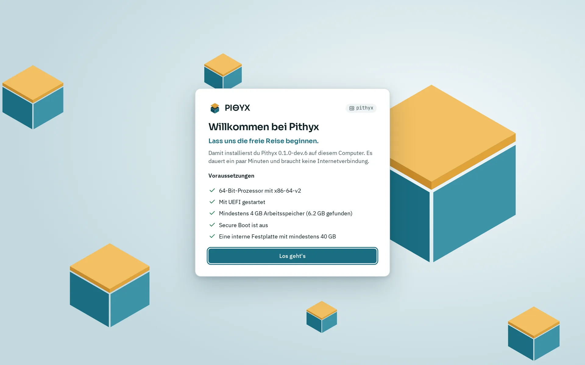
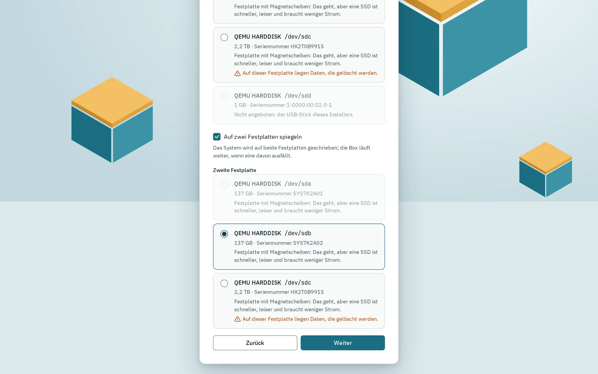
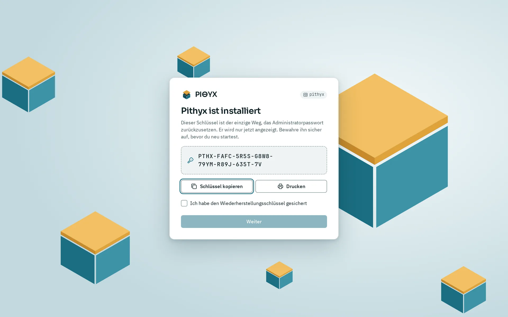

Der Installer läuft in einem Browser auf einem anderen Gerät, nicht auf dem Computer, den du installierst. Du startest den Computer vom USB-Stick, öffnest die Adresse, die seine Konsole zeigt, und beantwortest fünf Schritte: Name und Region, Netzwerk, Systemfestplatte, Administratorkonto und eine Zusammenfassung. Der Installer löscht die Systemfestplatten, die du wählst, installiert Pithyx und zeigt dir einen Wiederherstellungsschlüssel. Das dauert ein paar Minuten und braucht keine Internetverbindung.

## Den Installer öffnen

1. Starte den Computer vom Stick (siehe [Firmware und Boot](/de/docs/install/firmware-and-boot/)).
2. Lies die Adresse auf der Konsole ab, zum Beispiel `http://192.168.1.50:7484`. IPv6-Adressen erscheinen als `http://[address]:7484`. Port 80 leitet auf Port 7484 weiter.
3. Öffne die Adresse in einem Browser auf einem Handy, Tablet oder Computer im selben Netzwerk. Die Konsole zeigt auch einen QR-Code für die erste Adresse.
4. Die Seite öffnet sich mit **Willkommen bei Pithyx** auf Englisch oder Deutsch, je nach deinem Browser; die Sprachauswahl unter der Karte ändert sie. Prüfe die Voraussetzungen und klicke auf **Los geht's**. Die gewählte Sprache übernimmt Schritt 1, wo du die Sprache der Box wählst.

Der erste Browser, der die Seite öffnet, besitzt die Installation. Ein anderer Browser sieht **Installation läuft woanders** und kann nicht weitermachen. Die Konsole nennt die Adresse, der die Installation gehört. Um neu zu beginnen, starte den Computer erneut vom Stick. Schließe den Browser während der Installation nicht.

## Was die Prüfungen bedeuten

_Der Installer zeigt seine fünf Prüfungen vor dem ersten Schritt._

Die erste Seite, **Voraussetzungen**, zeigt fünf Prüfungen. **Los geht's** bleibt deaktiviert, bis alle bestanden sind.

| Prüfung                                      | Was sie braucht                                      |
| -------------------------------------------- | ---------------------------------------------------- |
| 64-Bit-Prozessor mit x86-64-v2               | Einen Prozessor mit SSE4.2 und POPCNT                |
| Mit UEFI gestartet                           | Firmware im UEFI-Modus, nicht im Legacy-Modus (BIOS) |
| Mindestens 4 GB Arbeitsspeicher              | Die Seite zeigt, wie viel sie gefunden hat           |
| Secure Boot ist aus                          | Schalte es in der Firmware aus                       |
| Eine interne Festplatte mit mindestens 40 GB | USB-Festplatten und der Stick selbst zählen nicht    |

Jede fehlgeschlagene Prüfung zeigt, was zu tun ist. Siehe [Hardware-Anforderungen](/de/docs/getting-started/requirements/).

## Name und Region (Schritt 1)

- **Name des NAS**: der Name der Box, Standard `pithyx`. Kleinbuchstaben, Ziffern und Bindestriche, 1 bis 63 Zeichen, kein Bindestrich am Anfang oder Ende.
- **Sprache**: Englisch oder Deutsch für die Box.
- **Formate**: die Region für Datums- und Zahlenformate, oder **Der Sprache jedes Benutzers folgen**.
- **Zeitzone**: aus deinem Browser vorbelegt.
- **Zeitserver (optional)**: durch Kommas getrennt. Leer lassen für die Standardserver.
- **Tastaturlayout der Konsole**: gilt für die installierte Box.

## Netzwerk (Schritt 2)

Die Seite listet jede Netzwerkkarte mit ihrem Zustand: **Verbunden**, **Kein Kabel** oder **Noch keine Adresse**. Standardmäßig bekommt jede verbundene Karte ihre Adresse per DHCP. Öffne bei einer Karte **Einstellungen von** und den Namen der Karte, um **Feste Adresse** und bei Bedarf **Nameserver (optional)** zu wählen. Klicke auf **Verbindung testen**, um die Einstellungen kurz auszuprobieren: Die Seite kann für ein paar Sekunden die Verbindung verlieren, und das Ergebnis sagt, ob das Gateway antwortet. Die Einstellungen werden nach dem Test immer zurückgenommen, egal ob er gelungen ist oder nicht. Ohne Änderungen prüft der Test die Karten so, wie sie sind. Darunter zeigt **Nach der Installation antwortet die Box unter** die Adresse, die du benutzen wirst.

Bonds, VLANs und weitere Optionen kommen nach der Installation, in den Einstellungen unter Netzwerk. Siehe [Netzwerk](/de/docs/admin/network/).

## Systemfestplatte und Spiegel (Schritt 3)

_Schritt 3 mit eingeschaltetem Spiegel: Die zweite Festplatte wählst du aus derselben Liste._

Wähle die Festplatte für das System. Jede Festplatte wird mit Modell, Größe und Seriennummer aufgelistet. Festplatten, die nicht genutzt werden können, sind ausgegraut und nennen den Grund (USB-Festplatte, Wechseldatenträger, der USB-Stick dieses Installers, schreibgeschützt, in Benutzung, zu klein). Eine Festplatte mit Daten zeigt „Auf dieser Festplatte liegen Daten, die gelöscht werden.“

- Um auf zwei Festplatten als Spiegel zu installieren, schalte **Auf zwei Festplatten spiegeln** ein und wähle eine **Zweite Festplatte**. Das System wird auf beide Festplatten geschrieben, und die Box läuft weiter, wenn eine ausfällt. Die Option erscheint nur, wenn zwei nutzbare Festplatten vorhanden sind.
- Mit einer Festplatte wird das System trotzdem als Spiegel mit einem Mitglied gebaut.

Deine Daten kommen nicht auf die Systemfestplatte. Pools legst du später auf anderen Festplatten im Speicher an.

## Administratorkonto (Schritt 4)

Das ist der erste Benutzer der Box. Fülle aus:

- **Benutzername**: Kleinbuchstaben, Ziffern, Bindestriche und Unterstriche, beginnend mit einem Buchstaben oder Unterstrich, höchstens 32 Zeichen. Namen wie `root` und `docker` sind reserviert.
- **Anzeigename (optional)**
- **Passwort** und **Passwort wiederholen**: mindestens 8 Zeichen und kein weit verbreitetes Passwort.

Root bleibt gesperrt. Dieses Konto bekommt Administratorrechte, ist das Owner-Konto und darf über SSH `sudo` verwenden. Siehe [Erste Einrichtung](/de/docs/install/first-setup/).

## Zusammenfassung und Installation (Schritt 5)

Die Zusammenfassung listet Name, Sprache, Zeitzone, Tastatur und Administrator auf, und unter **Diese Festplatten werden gelöscht** die Festplatten, die gelöscht werden. Hake **Alle Daten auf diesen Festplatten werden gelöscht** an und klicke auf **Pithyx installieren**. Festplatten, die du nicht gewählt hast, bleiben unberührt.

Die Seite zeigt dann **Pithyx wird installiert** mit diesen Schritten: **Festplatten werden partitioniert**, **Spiegel wird angelegt**, **Dateisysteme werden angelegt**, **System wird kopiert**, **Einstellungen werden geschrieben**, **Bootloader wird installiert** und **Abschluss**. Lass den Computer eingeschaltet. Der Schritt **Spiegel wird angelegt** erscheint auch mit einer Festplatte.

Schlägt ein Schritt fehl, zeigt die Seite **Die Installation ist fehlgeschlagen**, welcher Schritt fehlgeschlagen ist, und den Befehl mit seinem Exit-Code. Klicke auf **Einstellungen ändern**, um zurückzugehen. Nach einem Fehlschlag ist nichts vollständig installiert, und du kannst es erneut versuchen.

## Nach dem Neustart

_Der Wiederherstellungsschlüssel erscheint einmal, wenn die Installation endet. Dieser gehört zu einer gelöschten Testmaschine._

Wenn die Installation endet, zeigt die Seite **Pithyx ist installiert** und deinen Wiederherstellungsschlüssel. Kopiere oder drucke ihn, hake **Ich habe den Wiederherstellungsschlüssel gesichert** an und klicke auf **Weiter**. Dann sagt die Seite **USB-Stick entfernen**. Entferne den Stick und klicke auf **Jetzt neu starten**.

Die Seite zeigt dann **Pithyx startet** und öffnet das neue System von selbst, sobald es antwortet. Die installierte Box spricht HTTPS mit einem selbst erstellten Zertifikat, deshalb warnt der Browser einmal; fahre zur Seite fort. Das kann ein paar Minuten dauern. Passiert nichts, öffne die Adresse `https://<box-address>:7484` selbst. Die Box behält ihre Adresse meistens, weil sich die Netzwerkkarte auf dieselbe Weise ausweist, aber ein Router könnte eine andere vergeben. Die Konsole der installierten Box zeigt die aktuellen Adressen.

Melde dich mit dem Administratorkonto an, das du angelegt hast. Mach dann weiter mit [Erste Einrichtung](/de/docs/install/first-setup/).
