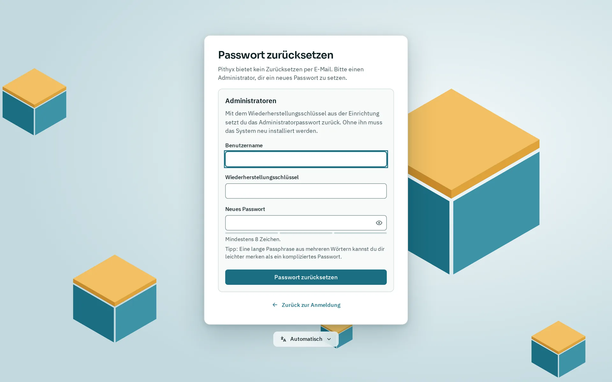

Pithyx hat kein Zurücksetzen des Passworts per E-Mail. Ein Benutzer, der sein Passwort vergessen hat, fragt einen Administrator; ein Administrator nutzt den Wiederherstellungsschlüssel aus der Installation. Ist auch der Schlüssel verloren, muss das System neu installiert werden. Eine Neuinstallation löscht nur die Systemfestplatte oder -festplatten, die du wählst, und deine Pools lassen sich danach wieder importieren.

## Passwort vergessen

_Passwort vergessen? öffnet dieses Formular. Nur Administratoren setzen hier ihr Passwort zurück, mit dem Wiederherstellungsschlüssel._

**Ein normaler Benutzer** fragt einen Administrator. Der Administrator öffnet Einstellungen > **Benutzer und Gruppen** und nutzt für diesen Benutzer **Neues Passwort**. Der Benutzer wird überall abgemeldet und meldet sich mit dem neuen Passwort an. Auch die Dateidienste (SMB und SFTP) bekommen das neue Passwort.

**Ein Administrator** nutzt den Wiederherstellungsschlüssel:

1. Klicke auf der Anmeldeseite auf **Passwort vergessen?**.
2. Gib deinen **Benutzernamen**, den **Wiederherstellungsschlüssel** und ein **Neues Passwort** ein.
3. Klicke auf **Passwort zurücksetzen**.
4. Die Seite zeigt einen neuen Wiederherstellungsschlüssel. Bewahre ihn auf. Der alte funktioniert nicht mehr.
5. Melde dich mit dem neuen Passwort an.

Was das Zurücksetzen bewirkt: Es ändert das Passwort, schaltet die Zwei-Faktor-Anmeldung dieses Administrators aus, entfernt seine Passkeys und beendet seine Sitzungen. Es funktioniert für jedes Administratorkonto, auch für ein deaktiviertes. Bei jedem Fehler (Benutzername, Schlüssel oder ein Konto, das kein Administrator ist) erscheint dieselbe Meldung: „Benutzername oder Wiederherstellungsschlüssel ist falsch.“ Nach fünf fehlgeschlagenen Versuchen innerhalb von fünf Minuten pausieren weitere Versuche für kurze Zeit.

**Ein anderer Administrator** kann dein Passwort auch unter Einstellungen > **Benutzer und Gruppen** setzen, wenn noch einer angemeldet ist.

Hast du den Wiederherstellungsschlüssel verloren und kann sich kein Administrator anmelden, setzt nichts das Passwort zurück. Installiere neu (siehe unten). Auf der Konsole gibt es kein Zurücksetzen des Passworts.

**Authenticator-App verloren?** Melde dich mit **Stattdessen einen Wiederherstellungscode verwenden** und einem deiner 10 Wiederherstellungscodes an. Siehe [Dein Konto](/de/docs/user/account/).

## Systemfestplatte ausgefallen

- **Spiegel:** Wenn du auf zwei Festplatten installiert hast, startet die Box auch mit einer fehlenden Festplatte, weil der Bootloader auf beiden liegt und nach jedem Update abgeglichen wird. Die Administratoren bekommen pro Ausfall einmal die Benachrichtigung „Eine Systemplatte fehlt“. Die Oberfläche kann eine ausgefallene Systemfestplatte nicht ersetzen; der Weg zurück zu zwei Festplatten ist eine Neuinstallation.
- **Einzelne Festplatte:** Das System ist verloren, aber deine Pools liegen auf anderen Festplatten und sind nicht betroffen. Installiere neu.

Die Systemfestplatte enthält nur das System und die Einstellungen, daher ist ihr Neuaufbau mit einem Konfigurationsbackup einfach gedacht. Deine Dateien, die Daten der Apps und die Daten von Docker liegen auf den Pools, nicht auf der Systemfestplatte.

## Ein gescheitertes Update oder ein kaputtes System

Bevor du neu installierst, versuch es über das Bootmenü: **Pithyx recovery** (Taste `r`) kehrt zu einem der letzten drei System-Snapshots zurück, installiert eine Update-Datei von einem USB-Stick oder setzt das Netzwerk auf DHCP zurück, und jeder behaltene Snapshot hat einen eigenen Eintrag. Ein gescheitertes Update kehrt von selbst zu seinem Snapshot zurück. Siehe [Systemupdates](/de/docs/install/updates/#das-recovery-menü).

## Neu installieren

1. Wenn die Box noch funktioniert, erstelle zuerst ein Konfigurationsbackup: Einstellungen > **Backup und Wiederherstellung**, dann **Erstellen und herunterladen**. Wähle ein Passwort; ohne es lässt sich das Backup nicht wiederherstellen, und Pithyx kann es nicht zurückholen. Bewahre die Datei nicht auf der Box auf. Das Backup enthält Benutzer, Gruppen und Passwörter, Zwei-Faktor-Einstellungen, den Wiederherstellungsschlüssel, freigegebene Ordner, Einstellungen der Dateidienste, Zeitpläne, Systemeinstellungen, die Zertifikate und SSH-Host-Schlüssel und die Liste der installierten Apps. Es enthält nicht die Dateien auf deinen Pools. Die Datei endet auf `.pithyxbackup` und darf bis zu 16 MB groß sein.
2. Schreibe einen neuen Stick und starte den [Web-Installer](/de/docs/install/installer/). Wähle nur dieselben Systemfestplatten. Der Installer warnt vor Festplatten, auf denen Daten liegen. Wähle nicht die Festplatten deiner Pools. Festplatten, die du nicht wählst, bleiben unberührt.
3. Melde dich mit dem neuen Administratorkonto an und bewahre den neuen Wiederherstellungsschlüssel auf.
4. Importiere deine Pools (nächster Abschnitt).
5. Stelle das Backup wieder her: Einstellungen > **Backup und Wiederherstellung**, **Datei auswählen…**, gib das **Backup-Passwort** ein und klicke auf **Backup prüfen**. Wähle die Teile unter **Was wiederhergestellt wird**, klicke auf **Wiederherstellen…** und bestätige mit **Jetzt wiederherstellen**. Jeder Teil, den du wählst, ersetzt den aktuellen vollständig. Das Wiederherstellen der Benutzer meldet alle ab, und Pithyx startet neu.

Ein Backup, das eine neuere Version von Pithyx erstellt hat, lässt sich nicht wiederherstellen. Pithyx behält eine Kopie der ersetzten Datenbank neben der neuen.

Der Installer selbst stellt kein Backup wieder her und importiert keine Pools. Netzwerkeinstellungen, Hostname und Region gibst du im Installer erneut ein.

## Die Pools wieder importieren

Ein frisches System kennt deine Pools nicht. Importiere sie in der Speicher-App:

1. Öffne **Speicher** und gehe zu den Pools.
2. Klicke auf **Pool importieren…**.
3. Klicke auf **Platten durchsuchen**. Die Suche liest die Labels jeder Platte und kann eine schlafende Platte aufwecken. Sie läuft nur, wenn du sie startest.
4. Beginne mit **Schreibgeschützt importieren**: Nichts wird eingehängt und nichts ändert sich. Prüfe die Datasets auf der Karte des Pools.
5. Klicke dann auf **Zur Nutzung importieren…**.

Ein Pool, der zuletzt von einem anderen System benutzt und nicht exportiert wurde, ist mit „Von einem anderen System benutzt“ markiert. Nach einer Neuinstallation ist das normal: Das alte System hat den Pool nie exportiert, und das neue gilt als anderes System. Wähle **Trotzdem importieren (erzwingen)** und tippe den Pool-Namen ein. Tu das nie, solange ein anderes System den Pool noch benutzt: Zwei Systeme, die auf einen Pool schreiben, zerstören ihn.

Ist der Name schon vergeben, wähle einen **Neuer Name für den Pool**. Ein Pool, der sich nicht importieren lässt, hat meist fehlende Platten: Schließe sie an und durchsuche erneut. Siehe [Speicher und Pools](/de/docs/admin/storage/).
