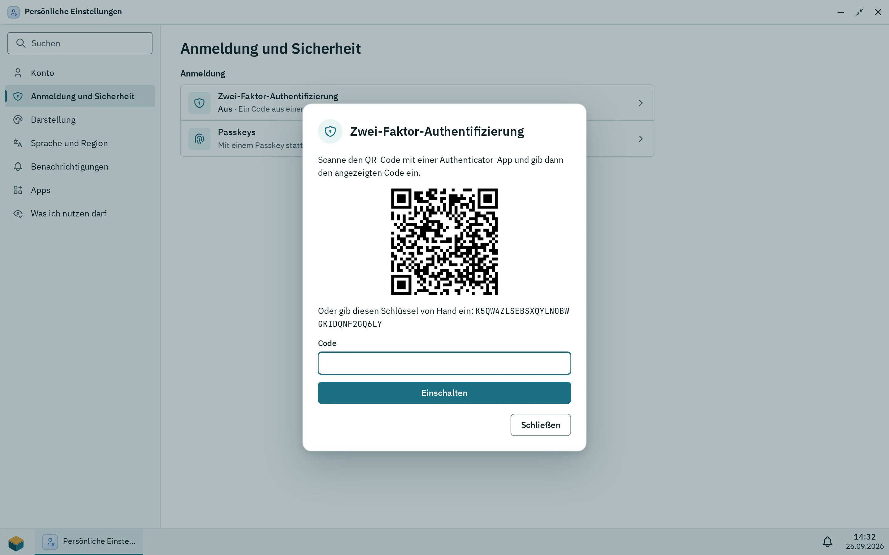
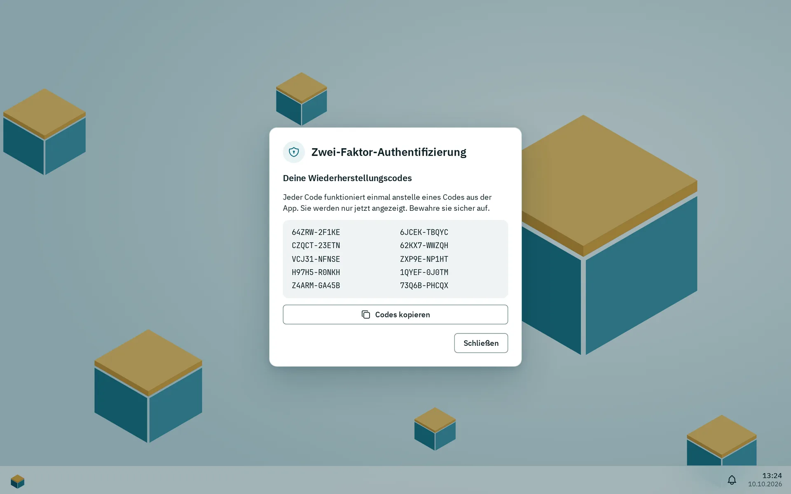

Dein Konto sind dein Benutzername und dein Passwort auf der Box. Dasselbe Passwort meldet dich am Desktop und an Dateidiensten wie SMB und SFTP an. Du kannst dein eigenes Passwort nicht selbst ändern: Ein Administrator setzt ein neues. Du kannst die Zwei-Faktor-Anmeldung einschalten und Sprache, Theme, Akzentfarbe und Hintergrundbild wählen.

## Das Passwort ändern

Pithyx kennt keinen Weg, dass Benutzer ihr eigenes Passwort ändern, und kein Zurücksetzen per E-Mail. Bitte einen Administrator, ein neues zu setzen. Der Administrator macht das unter Einstellungen > **Benutzer** mit **Neues Passwort**. Du wirst dann überall abgemeldet und meldest dich mit dem neuen Passwort an. Auch die Dateidienste nutzen das neue Passwort.

Ein Passwort muss haben:

- mindestens 8 und höchstens 1024 Zeichen,
- keine Übereinstimmung mit der eingebauten Liste weit verbreiteter Passwörter.

Es gibt keine Regeln zu Großbuchstaben oder Sonderzeichen. Eine lange Passphrase aus mehreren Wörtern lässt sich leichter merken als ein kompliziertes Passwort. Tippt ein Administrator ein neues Passwort ein, zeigt die Seite eine Stärkeanzeige (**Schwach**, **Mittel**, **Stark**) und Hinweise. Die Anzeige rät nur; ein schwaches Passwort, das lang genug ist, wird akzeptiert.

Wenn du Administrator bist und dein Passwort vergessen hast, nutze den Wiederherstellungsschlüssel. Siehe [Wiederherstellen und neu installieren](/de/docs/install/recovery/).

## Zwei-Faktor-Anmeldung

_Scanne den QR-Code mit einer Authenticator-App und gib dann den Code ein, den sie zeigt._

_Nach dem ersten Code zeigt der Dialog einmalig zehn Wiederherstellungscodes. Diese gehören zu einer gelöschten Testmaschine._

Die Zwei-Faktor-Anmeldung verlangt zusätzlich zu deinem Passwort einen Code aus einer Authenticator-App auf deinem Handy. Sie ist optional und gilt pro Benutzer. Jede App für zeitbasierte Codes funktioniert (6 Ziffern, 30 Sekunden).

So schaltest du sie ein:

1. Öffne das Pithyx-Menü, klicke auf deinen Namen und wähle **Zwei-Faktor-Authentifizierung**.
2. Klicke auf **Einrichten**.
3. Scanne den QR-Code mit deiner Authenticator-App, oder gib den darunter angezeigten Schlüssel von Hand ein.
4. Tippe den Code, den die App zeigt, in **Code** ein und klicke auf **Einschalten**.
5. Bewahre die Wiederherstellungscodes auf. Pithyx zeigt 10 Codes einmal an. Jeder funktioniert ein Mal anstelle eines Codes aus der App. Klicke auf **Codes kopieren** und bewahre sie sicher auf.

Wenn du dich anmeldest, fragt Pithyx nach dem Passwort zusätzlich nach dem Code. Klicke auf **Stattdessen einen Wiederherstellungscode verwenden**, wenn du dein Handy nicht hast. Ein Code lässt sich nur einmal benutzen. Du hast fünf Minuten, um den zweiten Schritt abzuschließen.

Um sie auszuschalten, öffne denselben Dialog, tippe **Dein Passwort** ein und klicke auf **Ausschalten**. Richtest du sie erneut ein, ersetzt das den alten Schlüssel und erzeugt neue Wiederherstellungscodes.

:::note
Die Zwei-Faktor-Anmeldung schützt nur den Desktop. SMB, SFTP, WebDAV und FTP nutzen allein dein Passwort.
:::

Bewahre die Wiederherstellungscodes sicher auf. Wenn du sowohl dein Handy als auch die Codes verlierst, bitte einen Administrator um Hilfe.

## Sitzungen und Geräte

Pithyx zeigt keine Liste deiner Sitzungen und kann deine anderen Geräte nicht vom Desktop aus abmelden. Das passiert stattdessen:

- Du bleibst bis zu 7 Tage angemeldet, ohne den Desktop zu benutzen, und höchstens 30 Tage insgesamt. Ein offener Desktop hält die Sitzung bis zur 30-Tage-Grenze am Leben.
- **Abmelden** beendet nur die Sitzung dieses Browsers.
- Setzt ein Administrator ein neues Passwort für dich oder deaktiviert er dein Konto, enden alle deine Sitzungen.
- Jeder Browser wird über ein Cookie als Gerät erkannt, mit dem die Box sich deine Fenster merkt. Um die Anordnung eines anderen Geräts zu übernehmen, öffne dein Kontomenü und wähle **Desktop holen von**. Siehe [Layout pro Gerät](/de/docs/user/desktop/#layout-pro-gerät).
- Eine abgelaufene Sitzung zeigt „Deine Sitzung ist abgelaufen. Melde dich bitte erneut an.“

## Sprache, Theme und Akzentfarbe

Öffne das Pithyx-Menü, klicke auf deinen Namen und wähle:

- **Sprache**: **Automatisch** (folgt deinem Browser, Englisch oder Deutsch) oder eine Sprache mit ihrem eigenen Namen. Die Wahl gehört zu diesem Gerät. Die Anmeldeseite hat eine eigene Sprachauswahl.
- **Darstellung**: **Wie das System**, **Hell** oder **Dunkel**. Auch das gehört zu diesem Gerät.
- **Akzentfarbe**: **Petrol**, **Ozean**, **Indigo**, **Pflaume**, **Moos** oder **Graphit**. Sie wird für dein Konto gespeichert und ist auf allen deinen Geräten gleich.
- **Hintergrundbild**: **Pithyx-Boxen** oder **Schlicht**, ebenfalls für dein Konto gespeichert.

Datum, Uhrzeit und Zahlenformate folgen der Region und Zeitzone, die ein Administrator in den Einstellungen gesetzt hat.

Deinen Anzeigenamen legt ein Administrator fest; du kannst ihn nicht selbst bearbeiten.

## Benachrichtigungen per E-Mail oder Push

Öffne das Pithyx-Menü, klick auf deinen Namen und wähle **Benachrichtigungskanäle**, um deine Benachrichtigungen auch ohne offenen Desktop zu bekommen: per **E-Mail** (sobald ein Administrator den E-Mail-Server eingerichtet hat) oder als **Webhook** an einen Push-Dienst wie ntfy oder Gotify. Jeder Kanal wählt seine **Ereignisse** und die am wenigsten ernste Benachrichtigung, die er bekommt (**Mindestens**); **Test senden** prüft ihn sofort. Bis zu 10 Kanäle pro Benutzer. Die Nachrichten sind in der Sprache deines Desktops. Details, Formate und Grenzen: [Benachrichtigungen per E-Mail und Webhook](/de/docs/admin/notifications/).
