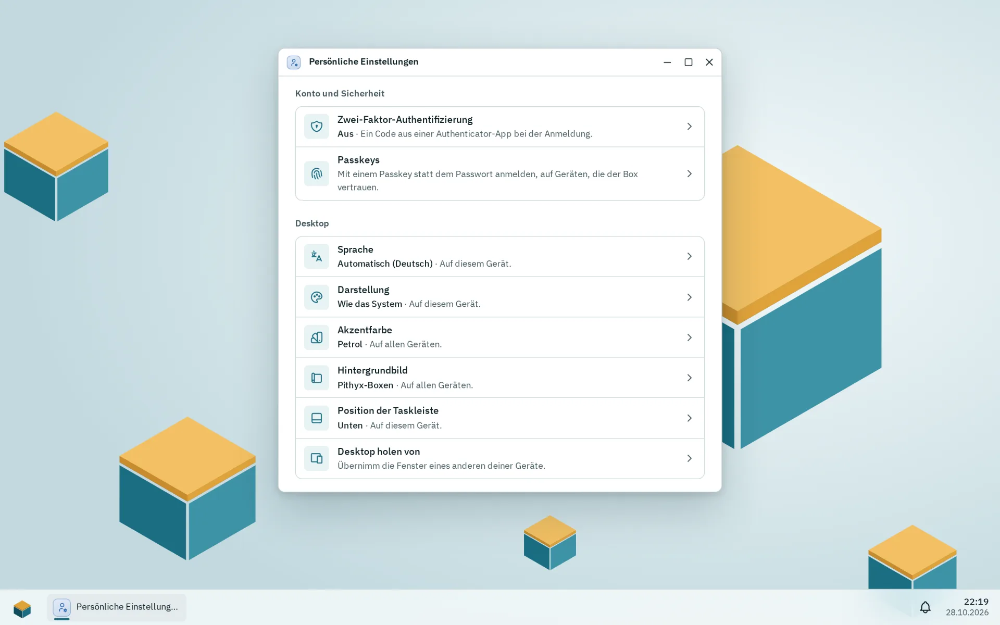

Dein Konto sind dein Benutzername und dein Passwort auf der Box. Dasselbe Passwort meldet dich am Desktop und an Dateidiensten wie SMB und SFTP an. Du kannst dein eigenes Passwort nicht selbst ändern: Ein Administrator setzt ein neues. Du kannst die Zwei-Faktor-Anmeldung einschalten, dich auf einem Gerät, das der Box vertraut, mit einem Passkey anmelden und Sprache, Theme, Akzentfarbe und Hintergrundbild wählen.

## Persönliche Einstellungen

_Persönliche Einstellungen; Apps und Benachrichtigungen folgen weiter unten._

Alles, was du für dich selbst einstellst, steht in **Persönliche Einstellungen**: Öffne das Pithyx-Menü und klicke in seiner linken Leiste auf **Persönliche Einstellungen**, oder klicke dort auf deine Initialen und wähle **Persönliche Einstellungen**. Es ist eine App wie die anderen und steht deshalb auch im Pithyx-Menü. Seine Navigation links (mit einem Suchfeld) hat eine Seite pro Bereich; auf dem Handy ist die Navigation eine Liste, aus der du eine Seite öffnest, und **Zurück** führt wieder hin:

- **Konto**: dein Name, Anmeldename, deine Rolle und Gruppen. Ein Administrator ändert sie.
- **Anmeldung und Sicherheit**: **Zwei-Faktor-Authentifizierung** (mit **An** oder **Aus**), **Passkeys** und, solange dieses Gerät der Box nicht vertraut, **Diesem Gerät vertrauen**.
- **Darstellung**: **Farbschema**, **Akzentfarbe** und **Hintergrundbild** als Bilder zur Auswahl, **Position der Taskleiste** (nicht auf Handys) und **Desktop holen von**. Jede Wahl gilt sofort.
- **Sprache und Region**: **Sprache**.
- **Benachrichtigungen**: **Benachrichtigungskanäle**.
- **Apps**: **Standard-Apps** und **Beim Anmelden öffnen** ([Der Desktop](/de/docs/user/desktop/#die-taskleiste)).
- **Was ich nutzen darf**: die freigegebenen Ordner, die du erreichst, mit deinem Zugriff, die Dateidienste, die Apps, die du öffnen darfst, und deine besonderen Rechte, so wie die Box sie entscheidet. Administratoren dürfen alles nutzen.

Das Kontomenü selbst hat nur noch **Persönliche Einstellungen** und **Darstellung**, damit du schnell zwischen hell und dunkel wechseln kannst.

## Das Passwort ändern

Pithyx kennt keinen Weg, dass Benutzer ihr eigenes Passwort ändern, und kein Zurücksetzen per E-Mail. Bitte einen Administrator, ein neues zu setzen. Der Administrator macht das unter Einstellungen > **Benutzer** mit **Neues Passwort**. Du wirst dann überall abgemeldet und meldest dich mit dem neuen Passwort an. Auch die Dateidienste nutzen das neue Passwort.

Ein Passwort muss haben:

- mindestens 8 und höchstens 1024 Zeichen,
- keine Übereinstimmung mit der eingebauten Liste weit verbreiteter Passwörter.

Es gibt keine Regeln zu Großbuchstaben oder Sonderzeichen. Eine lange Passphrase aus mehreren Wörtern lässt sich leichter merken als ein kompliziertes Passwort. Tippt ein Administrator ein neues Passwort ein, zeigt die Seite eine Stärkeanzeige (**Schwach**, **Mittel**, **Stark**) und Hinweise. Die Anzeige rät nur; ein schwaches Passwort, das lang genug ist, wird akzeptiert.

Wenn du Administrator bist und dein Passwort vergessen hast, nutze den Wiederherstellungsschlüssel. Siehe [Wiederherstellen und neu installieren](/de/docs/install/recovery/).

## Zwei-Faktor-Anmeldung

_Scanne den QR-Code mit einer Authenticator-App und gib dann den Code ein, den sie zeigt._

_Nach dem ersten Code zeigt der Dialog einmalig zehn Wiederherstellungscodes. Diese gehören zu einer gelöschten Testmaschine._

Die Zwei-Faktor-Anmeldung verlangt zusätzlich zu deinem Passwort einen Code aus einer Authenticator-App auf deinem Handy. Sie ist optional und gilt pro Benutzer. Jede App für zeitbasierte Codes funktioniert (6 Ziffern, 30 Sekunden).

So schaltest du sie ein:

1. Öffne **Persönliche Einstellungen** und wähle **Zwei-Faktor-Authentifizierung**.
2. Klicke auf **Einrichten**.
3. Scanne den QR-Code mit deiner Authenticator-App, oder gib den darunter angezeigten Schlüssel von Hand ein.
4. Tippe den Code, den die App zeigt, in **Code** ein und klicke auf **Einschalten**.
5. Bewahre die Wiederherstellungscodes auf. Pithyx zeigt 10 Codes einmal an. Jeder funktioniert ein Mal anstelle eines Codes aus der App. Klicke auf **Codes kopieren** und bewahre sie sicher auf.

Wenn du dich anmeldest, fragt Pithyx nach dem Passwort zusätzlich nach dem Code. Klicke auf **Stattdessen einen Wiederherstellungscode verwenden**, wenn du dein Handy nicht hast. Ein Code lässt sich nur einmal benutzen. Du hast fünf Minuten, um den zweiten Schritt abzuschließen.

Um sie auszuschalten, öffne denselben Dialog, tippe **Dein Passwort** ein und klicke auf **Ausschalten**. Richtest du sie erneut ein, ersetzt das den alten Schlüssel und erzeugt neue Wiederherstellungscodes.

:::note
Die Zwei-Faktor-Anmeldung schützt nur den Desktop. SMB, SFTP, WebDAV und FTP nutzen allein dein Passwort.
:::

Bewahre die Wiederherstellungscodes sicher auf. Wenn du sowohl dein Handy als auch die Codes verlierst, bitte einen Administrator um Hilfe.

## Der Box auf diesem Gerät vertrauen

Die Box stellt ihr Zertifikat selbst aus, deshalb warnt ein Browser davor, bis das Gerät dem Root-Zertifikat der Box vertraut. Solange er warnt, zeigt der Desktop den Hinweis „Dieses Gerät vertraut der Box noch nicht, deshalb warnt der Browser und Passkeys bleiben aus.“ mit **Diesem Gerät vertrauen**; **Auf diesem Gerät nicht mehr zeigen** blendet ihn in diesem Browser aus. Dieselben Schritte findest du in **Persönliche Einstellungen** unter **Diesem Gerät vertrauen**, solange das Gerät der Box nicht vertraut.

Der Dialog bietet **Root-Zertifikat herunterladen** und die Schritte für Windows, macOS, iPhone und iPad, Android, Linux und Firefox. Starte nach der Installation den Browser neu, öffne die Box wieder über ihren Namen und wähle **Erneut prüfen**; dann steht dort „Dieses Gerät vertraut der Box.“ Administratoren finden dieselben Schritte mit dem Fingerabdruck des Zertifikats unter Einstellungen > **Zertifikate** ([Zertifikate](/de/docs/admin/certificates/#der-box-auf-einem-gerät-vertrauen)).

Sobald das Gerät der Box vertraut, behält der Browser die Dateien des Desktops in seinem Cache, und Passkeys lassen sich nutzen.

## Passkeys

Mit einem Passkey meldest du dich ohne Passwort und ohne Zwei-Faktor-Code am Desktop an: Dein Gerät fragt stattdessen nach PIN, Fingerabdruck oder Gesicht. SMB, SFTP, WebDAV und FTP nutzen weiter dein Passwort.

Passkeys brauchen:

- ein Gerät, das der Box vertraut (siehe oben),
- die Box über ihren Namen geöffnet, etwa `https://pithyx.local:7484`, nicht über eine Adresse wie `https://192.168.1.20:7484`,
- einen Browser mit Passkeys (aktuelle Versionen von Chrome, Edge, Firefox und Safari haben sie).

So fügst du einen hinzu:

1. Öffne **Persönliche Einstellungen** und wähle **Passkeys**.
2. Klicke auf **Passkey hinzufügen**.
3. Gib ihm einen **Namen**, zum Beispiel das Gerät oder den Passwortmanager, in dem er liegt, tippe dein **Aktuelles Passwort** ein und klicke auf **Hinzufügen**.
4. Bestätige auf deinem Gerät. Die Liste zeigt den Passkey dann mit dem Namen der Box, zu dem er gehört.

Zum Anmelden klickst du auf der Anmeldeseite auf **Mit Passkey anmelden** oder wählst den Passkey, den dir dein Browser im Feld **Benutzername** anbietet. Der Knopf erscheint nur, wo Passkeys funktionieren.

Ein Passkey gehört zu dem Namen, unter dem du die Box geöffnet hast: Einer von `https://pithyx.local:7484` funktioniert nicht unter `https://pithyx.lan:7484`. Jeder Eintrag der Liste zeigt seinen Namen hinter **Für**, wann er hinzugefügt und wann er zuletzt benutzt wurde; **Synchronisiert** kennzeichnet einen, den dein Passwortmanager oder Handy auf mehreren Geräten hält. **Entfernen** löscht einen Passkey von der Box; er meldet dich dann nicht mehr an. Du kannst bis zu 20 haben.

Es gelten dieselben Grenzen für Fehlversuche wie beim Passwort. Ein deaktiviertes Konto oder eines ohne das Recht, sich am Desktop anzumelden, kann sich auch mit einem Passkey nicht anmelden. Setzt ein Administrator sein Passwort mit dem Wiederherstellungsschlüssel zurück, werden seine Passkeys entfernt.

## Sitzungen und Geräte

Pithyx zeigt keine Liste deiner Sitzungen und kann deine anderen Geräte nicht vom Desktop aus abmelden. Das passiert stattdessen:

- Du bleibst bis zu 7 Tage angemeldet, ohne den Desktop zu benutzen, und höchstens 30 Tage insgesamt. Ein offener Desktop hält die Sitzung bis zur 30-Tage-Grenze am Leben.
- **Abmelden** beendet nur die Sitzung dieses Browsers.
- Setzt ein Administrator ein neues Passwort für dich oder deaktiviert er dein Konto, enden alle deine Sitzungen. Deine Passkeys bleiben; ein deaktiviertes Konto kann sie nicht nutzen.
- Jeder Browser wird über ein Cookie als Gerät erkannt, mit dem die Box sich deine Fenster merkt. Um die Anordnung eines anderen Geräts zu übernehmen, öffne **Persönliche Einstellungen** und wähle **Desktop holen von**. Siehe [Layout pro Gerät](/de/docs/user/desktop/#layout-pro-gerät).
- Eine abgelaufene Sitzung zeigt „Deine Sitzung ist abgelaufen. Melde dich bitte erneut an.“

## Sprache, Theme und Akzentfarbe

In **Persönliche Einstellungen** auf den Seiten **Darstellung** und **Sprache und Region**:

- **Sprache**: **Automatisch** (folgt deinem Browser, Englisch oder Deutsch) oder eine Sprache mit ihrem eigenen Namen. Die Wahl gehört zu diesem Gerät. Die Anmeldeseite hat eine eigene Sprachauswahl.
- **Farbschema**: **Hell**, **Dunkel** oder **Wie das System**. Auch das gehört zu diesem Gerät.
- **Akzentfarbe**: **Petrol**, **Ozean**, **Indigo**, **Pflaume**, **Moos** oder **Graphit**. Sie wird für dein Konto gespeichert und ist auf allen deinen Geräten gleich.
- **Hintergrundbild**: **Pithyx-Boxen** oder **Schlicht**, ebenfalls für dein Konto gespeichert.

Datum, Uhrzeit und Zahlenformate folgen der Region und Zeitzone, die ein Administrator in den Einstellungen gesetzt hat.

Deinen Anzeigenamen legt ein Administrator fest; du kannst ihn nicht selbst bearbeiten.

## Benachrichtigungen per E-Mail oder Push

Öffne **Persönliche Einstellungen** und wähle **Benachrichtigungskanäle**, um deine Benachrichtigungen auch ohne offenen Desktop zu bekommen: per **E-Mail** (sobald ein Administrator den E-Mail-Server eingerichtet hat) oder als **Webhook** an einen Push-Dienst wie ntfy oder Gotify. Jeder Kanal wählt seine **Ereignisse** und die am wenigsten ernste Benachrichtigung, die er bekommt (**Mindestens**); **Test senden** prüft ihn sofort. Bis zu 10 Kanäle pro Benutzer. Die Nachrichten sind in der Sprache deines Desktops. Unter **Benachrichtigungen von Apps** im selben Dialog schaltest du einzelne Arten von Benachrichtigungen deiner Apps aus, etwa die Erwähnungen eines Chats, wenn die App sie nach Arten sortiert: Sie landen weiter als gelesen in deiner Liste, aber ohne Toast, E-Mail oder Webhook. Details, Formate und Grenzen: [Benachrichtigungen per E-Mail und Webhook](/de/docs/admin/notifications/).
