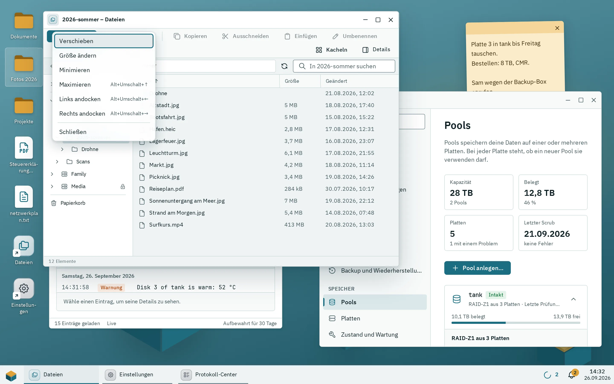
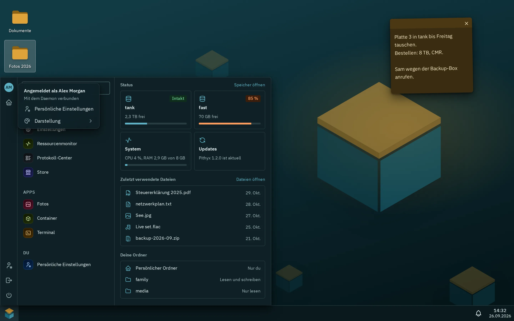

Der Pithyx-Desktop ist die Seite, die du im Browser unter `https://<box-address>:7484` öffnest. Er funktioniert wie ein gewöhnlicher Computer-Desktop: Apps öffnen sich in Fenstern, eine Taskleiste zeigt, was läuft, und du kannst Verknüpfungen und Notizzettel auf den Desktop legen. Die Box merkt sich deine Fenster für jedes Gerät, das du benutzt.

## Anmelden

1. Öffne `https://<box-address>:7484` in deinem Browser. Port 80 leitet dorthin weiter.
2. Gib deinen **Benutzernamen** und dein **Passwort** ein und klicke auf **Anmelden**.
3. Wenn du die Zwei-Faktor-Anmeldung eingeschaltet hast, gib den Code aus deiner Authenticator-App ein und klicke auf **Bestätigen**. Wenn du dein Handy verloren hast, klicke auf **Stattdessen einen Wiederherstellungscode verwenden**.

:::caution
Beim ersten Mal warnt der Browser vor dem eigenen Zertifikat der Box; fahre zur Seite fort. Ein Administrator kann die Warnung mit dem Root-Zertifikat der Box dauerhaft beseitigen ([Zertifikate](/de/docs/admin/certificates/)).
:::

Du brauchst das Recht **Am Desktop anmelden**. Ist dein Konto deaktiviert oder fehlt das Recht, muss ein Administrator das ändern.

Nach fünf falschen Versuchen für denselben Benutzernamen von derselben Adresse innerhalb von fünf Minuten pausiert die Anmeldung für kurze Zeit und sagt dir, wie viele Sekunden du warten musst.

Zum Abmelden öffnest du das Pithyx-Menü und klickst unten neben dem Ein/Aus-Knopf auf **Abmelden**.

Passwort vergessen? Klicke auf der Anmeldeseite auf **Passwort vergessen?**. Pithyx kann ein Passwort nicht per E-Mail zurücksetzen: Bitte einen Administrator, ein neues zu setzen. Administratoren können den Wiederherstellungsschlüssel nutzen. Siehe [Wiederherstellen und neu installieren](/de/docs/install/recovery/).

Die Anmeldeseite hat in der Fußzeile eine eigene Sprachauswahl. Wenn die Box zum ersten Mal eingerichtet wird, legt der Installer das Owner-Konto an; siehe [Erste Einrichtung](/de/docs/install/first-setup/).

## Fenster und Andocken

_Das App-Symbol in der Titelleiste öffnet das Fenstermenü mit den Tastenkürzeln zum Andocken._

Jede App öffnet sich in einem Fenster. Was du mit einem Fenster tun kannst, hängt von der Breite deines Browsers ab:

- **1024 Pixel oder breiter:** freie Fenster. Du kannst sie verschieben, in der Größe ändern und an den Bildschirmrändern andocken.
- **600 bis 1023 Pixel (Tablets):** Fenster füllen den Bildschirm. Angedockte Fenster teilen sich den Bildschirm als linke und rechte Hälfte.
- **Unter 600 Pixel (Handys):** immer nur eine App, im Vollbild.

Auf einem breiten Bildschirm:

- Ziehe die Titelleiste, um ein Fenster zu verschieben. Ziehe an einer Kante oder Ecke, um die Größe zu ändern.
- Doppelklicke auf die Titelleiste, um das Fenster zu maximieren, und noch einmal, um es wiederherzustellen.
- Ziehe ein Fenster an den linken oder rechten Rand, damit es die halbe Breite füllt, oder an den oberen Rand, um es zu maximieren. Auf sehr breiten Bildschirmen (2400 Pixel oder mehr) ergeben die Ränder Drittel.
- Ziehe ein maximiertes oder angedocktes Fenster vom Rand weg, um seine freie Größe zurückzubekommen.
- Die Titelleiste hat die Schaltflächen **Minimieren**, **Maximieren** (oder **Wiederherstellen**) und **Schließen**.
- Klicke auf das App-Symbol links in der Titelleiste, um das Fenstermenü zu öffnen: **Wiederherstellen**, **Verschieben**, **Größe ändern**, **Minimieren**, **Maximieren**, **Links andocken**, **Rechts andocken** und **Schließen**. Bei **Verschieben** und **Größe ändern** kannst du die Pfeiltasten benutzen (16 Pixel pro Druck, mit Umschalt 1 Pixel), mit **Enter** bestätigen und mit **Esc** abbrechen.

Neue Fenster öffnen sich leicht versetzt zueinander. Du kannst höchstens 50 Fenster gleichzeitig offen haben. Darüber hinaus tut das Öffnen einer weiteren App nichts.

Antwortet eine App fünf Sekunden lang nicht, sagt ein Dialog, dass die App nicht reagiert. Klicke auf **Warten** oder **Trotzdem schließen**; beim Trotzdem-Schließen gehen Änderungen verloren, die die App noch nicht gespeichert hat.

## Die Taskleiste

_Das Kontomenü öffnet sich, wenn du unten im Pithyx-Menü auf deinen Namen klickst._

Standardmäßig liegt die Taskleiste am unteren Bildschirmrand. Von links nach rechts hat sie:

- die Schaltfläche des Pithyx-Menüs,
- eine Schaltfläche pro laufender App,
- den App-Umschalter mit der Anzahl der offenen Apps,
- die Schaltfläche für Übertragungen, solange Dateien hoch- oder heruntergeladen werden,
- die Schaltfläche für laufende Aufgaben,
- die Benachrichtigungsglocke mit einem Zähler für ungelesene Benachrichtigungen,
- die Uhr.

Laufen mehr Apps, als Platz haben, werden ihre Schaltflächen schmaler und lassen sich dann verschieben: Drehe das Mausrad über ihnen oder wische, und die aktive App kommt immer ins Bild. Die Menü-Schaltfläche und alles von den Übertragungen bis zur Uhr bleiben an ihrem Platz.

Klicke auf eine laufende App, um sie nach vorn zu holen. Klicke noch einmal auf die aktive App, um sie zu minimieren. Klicke mit der rechten Maustaste auf eine laufende App (oder drücke darauf **Umschalt+F10**) für **Minimieren** oder **Wiederherstellen**, **Zum Desktop hinzufügen** und **Schließen**.

Um die Taskleiste zu verschieben, öffne das Pithyx-Menü, klicke auf deinen Namen, wähle **Position der Taskleiste** und dann **Unten**, **Oben**, **Links** oder **Rechts**. Auf Handys bleibt die Taskleiste immer unten und der Eintrag fehlt.

**Das Pithyx-Menü** öffnest du mit der Schaltfläche links in der Taskleiste oder indem du die Windows- oder Befehlstaste (Command) drückst und loslässt. Es listet deine Apps auf und hat ein Suchfeld. Die Suche findet Apps nur nach ihrem Namen; Einstellungen und Dateien findet sie dort nicht, und die Liste der zuletzt benutzten Dateien bleibt leer. Dein Kontomenü (klicke auf deinen Namen) enthält:

- **Zwei-Faktor-Authentifizierung**
- **Sprache**
- **Darstellung**, **Akzentfarbe** und **Hintergrundbild**
- **Standard-Apps**: die Dateitypen, die sich in Dateien immer auf eine Art öffnen sollen, jeweils mit **Vergessen** ([Dateien](/de/docs/user/files/))
- **Beim Anmelden öffnen**: hake bis zu 10 Apps an, die sich bei jeder Anmeldung öffnen, auf jedem Gerät, in der Reihenfolge, in der du sie angehakt hast. Ein Neuladen der Seite bringt nur deine Fenster zurück, und eine App, die schon offen ist, öffnet sich nicht doppelt. Eine App kann als **Von der App empfohlen** markiert sein; angehakt wird sie nie für dich.
- **Desktop holen von**
- **Position der Taskleiste** (nicht auf Handys)

Unten im Pithyx-Menü, neben deinem Namen, stehen der Knopf **Abmelden** und, für Administratoren und Benutzer mit dem Recht **Neu starten und herunterfahren**, der Knopf **Ein/Aus** mit **Neu starten** und **Herunterfahren**. Beides meldet alle Benutzer ab und beendet Dateiübertragungen.

**Benachrichtigungen.** Die Glocke öffnet ein Fenster mit **Laufende Aufgaben** und **Neueste** Benachrichtigungen. Nutze **Verwerfen**, **Stummschalten** oder **Alle löschen**. Drücke **Esc**, um das Fenster zu schließen.

## Desktop-Elemente und Notizen

_Zwei Verknüpfungen und eine Notiz neben zwei offenen Fenstern._

Der Desktop enthält Verknüpfungen zu Apps und Notizzettel. Sie gehören zu deinem Konto und erscheinen auf jedem Gerät.

- Um eine Verknüpfung hinzuzufügen, klicke mit der rechten Maustaste auf eine freie Stelle und wähle **Neue Verknüpfung**, dann eine App. Oder klicke in der Taskleiste mit der rechten Maustaste auf eine laufende App und wähle **Zum Desktop hinzufügen**.
- Um eine Notiz hinzuzufügen, klicke mit der rechten Maustaste auf eine freie Stelle und wähle **Neue Notiz**. Eine Notiz fasst bis zu 4000 Zeichen und speichert sich kurz nach dem Tippen selbst.
- Öffne eine Verknüpfung mit einem Doppelklick (auf einem Touchscreen mit einem einfachen Tippen), oder wähle sie aus und drücke **Enter**.
- Klicke mit der rechten Maustaste auf eine Verknüpfung für **Öffnen**, **Umbenennen**, **Verschieben** und **Vom Desktop entfernen**. **F2** benennt um, **Entf** entfernt.
- Ziehe Symbole, um sie zu verschieben. Ziehe auf einer freien Stelle, um mehrere auszuwählen. Halte **Strg** oder **Umschalt** gedrückt, um zu einer Auswahl hinzuzufügen.
- Auf einem Touchscreen hältst du etwa eine halbe Sekunde gedrückt, um das Menü zu öffnen.
- Um eine Notiz zu löschen, klicke auf **Notiz entfernen**. Bei einer Notiz mit Text kommt vorher die Frage **Diese Notiz löschen?**. Der Text wird auf allen deinen Geräten gelöscht.

Der Desktop fasst höchstens 200 Elemente. Symbole rasten an einem Raster ein. Auf kleinen Bildschirmen fließen sie in Reihen wie auf dem Home-Bildschirm eines Handys.

## Tastenkürzel

Diese Fenster-Tastenkürzel funktionieren überall auf dem Desktop, außer während du in ein Textfeld tippst:

| Tasten                                  | Aktion                                                                               |
| --------------------------------------- | ------------------------------------------------------------------------------------ |
| **Alt+Umschalt+Links** / **Rechts**     | Das Fenster links oder rechts andocken                                               |
| **Alt+Umschalt+Hoch**                   | Maximieren                                                                           |
| **Alt+Umschalt+Runter**                 | Ein angedocktes oder maximiertes Fenster wiederherstellen oder ein freies minimieren |
| **Alt+Umschalt+Leertaste**              | Das Fenstermenü des aktiven Fensters öffnen                                          |
| **Alt+Umschalt+Bild auf** / **Bild ab** | Zum vorherigen oder nächsten Fenster wechseln                                        |

Weitere Tasten:

- Die Windows- oder Befehlstaste antippen und loslassen: das Pithyx-Menü öffnen oder schließen.
- **Esc**: das Pithyx-Menü, den App-Umschalter oder das Benachrichtigungsfenster schließen.
- Auf dem Desktop: Die Pfeiltasten wechseln zwischen Symbolen, **Enter** öffnet, **F2** benennt um, **Entf** entfernt, **Umschalt+F10** oder die Menütaste öffnet das Kontextmenü.

## Layout pro Gerät

Die Box merkt sich deine Fenster für jeden Browser, den du benutzt: welche Apps offen sind, wo, wie groß, die Position der Taskleiste und kleine Details wie den Ordner, der in Dateien offen ist. Öffnest du den Desktop erneut, kehren die Fenster zurück. Ein Gerät wird an einem kleinen Cookie erkannt, das keine persönlichen Daten enthält.

- Gespeicherte Layouts laufen 90 Tage nach dem letzten Speichern ab.
- Ein Fenster einer App, die entfernt wurde oder die du nicht mehr benutzen darfst, wird übersprungen. Eine Benachrichtigung sagt dir, wie viele es waren.
- Deine Desktop-Elemente, Akzentfarbe und Hintergrundbild sind auf allen Geräten gleich. Das Theme und die Sprache gehören zum Gerät.
- Um die Anordnung eines anderen Geräts zu übernehmen, öffne dein Kontomenü, klicke auf **Desktop holen von** und wähle das Gerät. Gibt es keines, steht in der Liste **Keine anderen Geräte**. Der Desktop folgt dir nicht von selbst zwischen Geräten.

## Handys und Tablets

Es gibt keine eigene mobile App. Dieselbe Seite passt sich dem Bildschirm an.

- Auf einem Handy füllt eine App den Bildschirm. Der App-Umschalter zeigt die offenen Apps als Karten; tippe auf eine Karte, um zu wechseln, oder auf **Alle schließen**. Auch ein Wischen zur Seite entlang der Taskleiste wechselt die App.
- Die Zurück-Geste des Browsers minimiert die offene App und bringt dich zum Home-Bildschirm, statt den Desktop zu verlassen.
- Auf einem Tablet sind Fenster maximiert, und du kannst zwei nebeneinander andocken.
- Halte gedrückt, um Menüs zu öffnen. Ein einfaches Tippen öffnet eine Verknüpfung.

Verwandte Seiten: [Dateien](/de/docs/user/files/), [Apps benutzen](/de/docs/user/apps/), [Dein Konto](/de/docs/user/account/).
