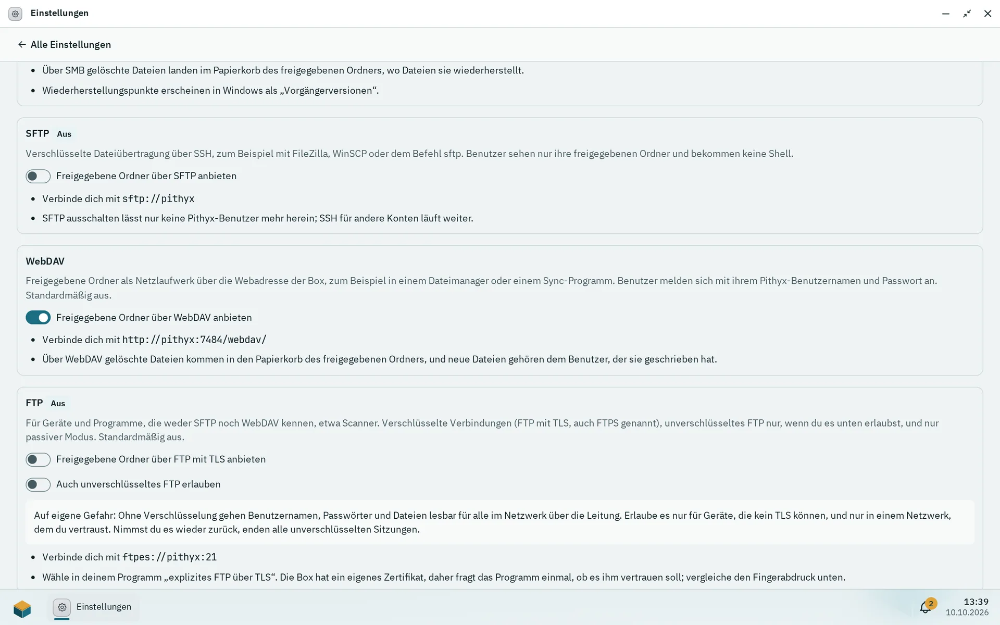

Neben der Dateien-App lassen sich deine freigegebenen Ordner auch von anderen Computern und Geräten aus öffnen, als Netzlaufwerk oder über ein Dateiübertragungsprogramm. Pithyx bietet vier Wege: SMB, SFTP, WebDAV und FTP. Du meldest dich mit deinem Pithyx-Benutzernamen und -Passwort an. Frag einen Administrator, welche davon für dich eingeschaltet sind.

In den folgenden Schritten ist `<box-address>` der Name oder die IP-Adresse, mit der du den Desktop öffnest, zum Beispiel `192.168.1.50`.

## Welches Protokoll du nutzen solltest



_Ein Administrator schaltet die Dateidienste unter Einstellungen > Dateidienste ein; jede Karte zeigt die Adresse dafür._

| Protokoll  | Wofür                                                                                            | Hinweise                                                                                                       |
| ---------- | ------------------------------------------------------------------------------------------------ | -------------------------------------------------------------------------------------------------------------- |
| **SMB**    | Ein Netzlaufwerk unter Windows, macOS und Linux für die tägliche Arbeit                          | Braucht SMB 3. Ältere Systeme können sich nicht verbinden. Frühere Versionen und der Papierkorb funktionieren. |
| **SFTP**   | Verschlüsselte Übertragungen mit einem Programm wie FileZilla oder WinSCP oder dem Befehl `sftp` | Du siehst nur deine freigegebenen Ordner und bekommst keine Shell. Nur Anmeldung per Passwort.                 |
| **WebDAV** | Programme und Dateimanager, die einen Web-Ordner einbinden können                                | Adresse: `https://<box-address>:7484/webdav/`                                                                  |
| **FTP**    | Geräte, die weder SFTP noch WebDAV kennen, etwa Scanner                                          | Nur der passive Modus. Mit TLS verschlüsselt; unverschlüsseltes FTP nur, wenn ein Administrator es erlaubt.    |

:::caution
Der Desktop und WebDAV nutzen HTTPS. Windows und macOS binden WebDAV erst ein, wenn der Computer dem Root-Zertifikat der Box vertraut; ein Administrator findet es unter Einstellungen > **Zertifikate**.
:::

Jeder sieht nur die freigegebenen Ordner, die seine Rechte erlauben, mit der Zugriffsstufe, die ein Administrator ihm gegeben hat: kein Zugriff, **Lesen** oder **Lesen und schreiben**. Administratoren erreichen jeden freigegebenen Ordner.

Die Zwei-Faktor-Anmeldung gilt hier nicht. Diese Dienste fragen nur nach deinem Passwort.

## Windows

**SMB (Netzlaufwerk)**

1. Öffne den Datei-Explorer.
2. Klicke in die Adressleiste, tippe `\\<box-address>\` und drücke **Enter**.
3. Melde dich auf Nachfrage mit deinem Pithyx-Benutzernamen und -Passwort an. Hake die Option zum Speichern der Zugangsdaten an, wenn du magst.
4. Deine freigegebenen Ordner erscheinen. Um einen als Laufwerksbuchstaben zu behalten, klicke mit der rechten Maustaste darauf und wähle **Netzlaufwerk verbinden**.

Die Box kündigt sich nicht im Netzwerk an, deshalb erscheint sie im Explorer nicht unter **Netzwerk**. Tippe immer die Adresse ein. Im Explorer zeigt **Vorgängerversionen** die täglichen Wiederherstellungspunkte eines freigegebenen Ordners. Dateien, die du löschst, landen im Papierkorb des freigegebenen Ordners, und du kannst sie in der Dateien-App wiederherstellen.

**SFTP und FTP:** Installiere ein Programm wie FileZilla oder WinSCP und verbinde dich mit `<box-address>`.

**WebDAV:** Klicke im Datei-Explorer mit der rechten Maustaste auf **Dieser PC**, wähle **Netzlaufwerk verbinden** und gib `https://<box-address>:7484/webdav/` ein. Windows verbindet sich erst, wenn es dem Root-Zertifikat der Box vertraut. Verweigert es trotzdem, nutze SMB oder ein WebDAV-Programm.

## macOS

**SMB (Netzlaufwerk)**

1. Wähle im Finder **Gehe zu** und dann **Mit Server verbinden**.
2. Tippe `smb://<box-address>/` und klicke auf **Verbinden**.
3. Melde dich mit deinem Pithyx-Benutzernamen und -Passwort an.

**SFTP:** Der Finder kann SFTP nicht durchsuchen. Nutze ein SFTP-Programm und verbinde dich mit `sftp://<box-address>`.

**WebDAV:** Gib unter **Mit Server verbinden** `https://<box-address>:7484/webdav/` ein. macOS verbindet sich, sobald es dem Root-Zertifikat der Box vertraut.

**FTP:** Nutze ein Programm, das FTP mit TLS unterstützt, und wähle „explizites FTP über TLS“.

## Linux

**SMB:** Die meisten Dateimanager akzeptieren `smb://<box-address>/` in der Adressleiste. Auf der Kommandozeile kannst du mit `mount -t cifs` und `vers=3.0` einbinden.

**SFTP:** Nutze `sftp://<box-address>` in deinem Dateimanager oder führe aus:

```sh
sftp <user>@<box-address>
```

SFTP akzeptiert nur Passwörter. Öffentliche Schlüssel werden für SFTP-Benutzer nicht verwendet.

**WebDAV:** Ein Dateimanager mit WebDAV-Unterstützung akzeptiert `davs://<box-address>:7484/webdav/`.

**FTP:** Nutze einen Client mit explizitem FTP über TLS, etwa `lftp`.

## Handys

Es gibt keine spezielle App. Jede App, die SMB 3, SFTP, WebDAV oder FTP mit TLS spricht, kann sich mit den obigen Einstellungen verbinden. Oder nutze den Desktop selbst: Er funktioniert im Browser eines Handys, einschließlich der Dateien-App. Siehe [Der Desktop](/de/docs/user/desktop/#handys-und-tablets).

Für FTP hat die Box ein eigenes Zertifikat. Dein Programm fragt einmal, ob du ihm vertraust. Vergleiche den Fingerabdruck, den es zeigt, mit dem **Fingerabdruck des Zertifikats (SHA-256)**, den ein Administrator in den Einstellungen unter **Dateidienste** nachlesen kann. FTP lauscht auf Port 21, und passive Datenverbindungen nutzen die Ports 50000 bis 50099.

## Anmelden

- Nutze deinen Pithyx-Benutzernamen (in Kleinbuchstaben) und dein Passwort.
- Dein Konto braucht das Recht für das Protokoll: **SMB (Netzlaufwerke)**, **SFTP**, **WebDAV** oder **FTP**. Neue Benutzer bekommen standardmäßig das SMB-Recht. Die anderen gibt dir ein Administrator.
- Dein Konto muss aktiv sein.
- **SMB und SFTP:** Wird eine Verbindung mit dem richtigen Passwort abgelehnt, melde dich einmal am Web-Desktop an, oder bitte einen Administrator, ein neues Passwort für dich zu setzen. So lernen die Dienste dein Passwort.
- Nach fünf falschen Versuchen für denselben Benutzernamen von derselben Adresse innerhalb von fünf Minuten pausieren weitere Versuche für kurze Zeit.
- Dateien, die du anlegst, gehören deinem Konto auf der Box. Berechtigungen kannst du unter Windows nicht ändern.
- Ist ein Protokoll ausgeschaltet, kannst du dich damit nicht verbinden. Ein Administrator schaltet Dienste in den Einstellungen unter **Dateidienste** ein. Siehe [Dateidienste](/de/docs/admin/file-services/).

Wenn etwas nicht funktioniert, sind die üblichen Ursachen ein fehlendes Recht, ein deaktiviertes Konto oder ein ausgeschaltetes Protokoll.
