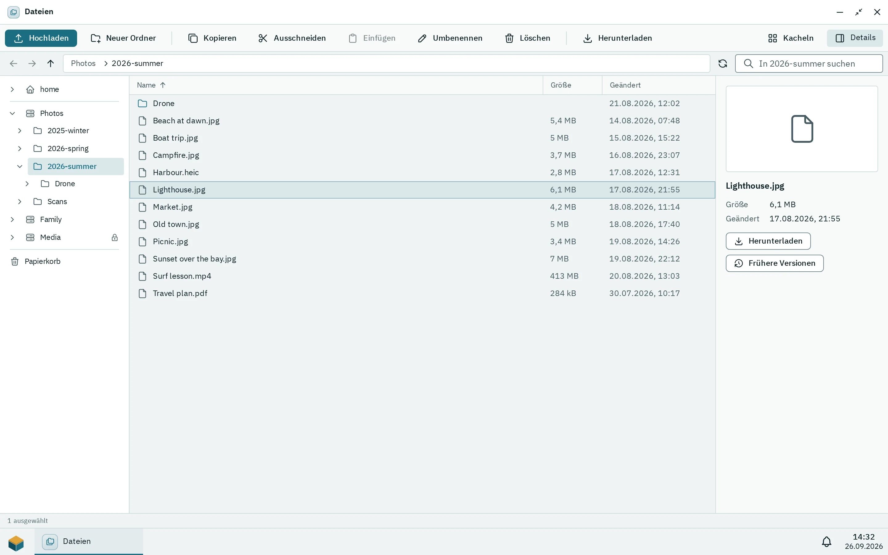
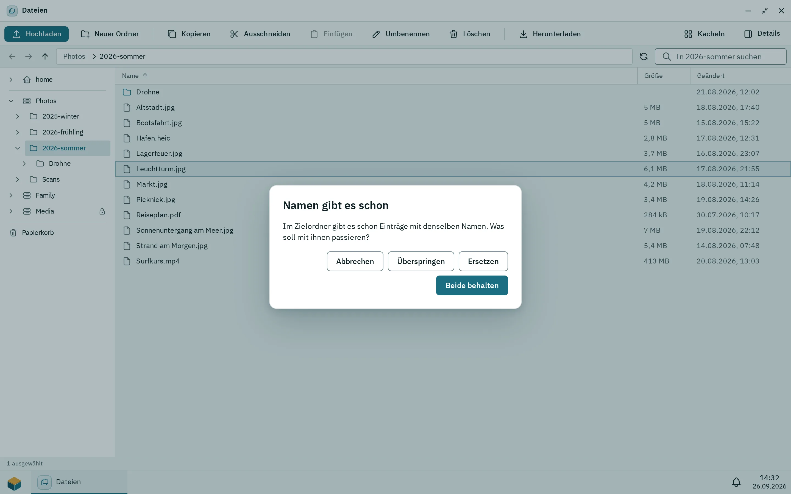
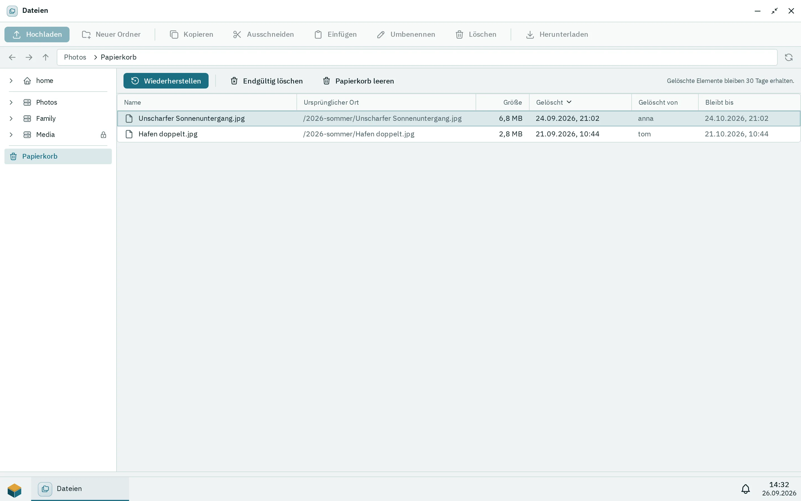

Dateien ist die App, mit der du in den freigegebenen Ordnern arbeitest, die du nutzen darfst: Ordner öffnen, Dateien hoch- und herunterladen, kopieren und verschieben und gelöschte Dateien aus dem Papierkorb wiederherstellen. Bilder, PDFs, Text, Audio und Video öffnen sich im Betrachter. Du brauchst das Recht, die App Dateien zu nutzen, und Zugriff auf mindestens einen freigegebenen Ordner.

## Freigegebene Ordner durchsuchen

_Dateien in der Listenansicht. Ein Rechtsklick auf einen Eintrag öffnet sein Kontextmenü._

Öffne **Dateien** im Pithyx-Menü. Die Seitenleiste listet unter **Freigaben** zuerst deinen Home-Ordner **home** und darunter deine freigegebenen Ordner auf; Dateien öffnet sich in deinem Home. Dein Home ist privat: Nur du und die Administratoren können es öffnen. Administratoren sehen zusätzlich **homes**, das das Home jedes anderen Benutzers als Ordner auflistet, in derselben Liste oder denselben Kacheln wie jeden Ordner; ein Doppelklick öffnet eines. Die Homes selbst lassen sich dort nicht umbenennen, verschieben oder löschen, und ihr Menü bietet nur **Öffnen**. Klicke auf einen Eintrag, um ihn zu öffnen. Ein Ordner, der gerade nicht erreichbar ist (zum Beispiel weil sein Pool offline ist), zeigt **Nicht verfügbar**. Ist die Liste leer, hast du noch keine freigegebenen Ordner, und ein Administrator muss sie anlegen. Ein freigegebener Ordner mit der Markierung **Nur lesen** lässt dich ansehen und herunterladen, aber nichts ändern.

So bewegst du dich:

- Doppelklicke auf einen Ordner, oder wähle ihn aus und drücke **Enter**, um ihn zu öffnen.
- Nutze die Schaltflächen **Zurück**, **Vorwärts** und **Eine Ebene nach oben**, oder tippe einen Ort in das Feld **Pfad**.
- **Rücktaste** oder **Alt+Hoch** geht eine Ebene nach oben.
- Klicke oben in der Liste auf **Name**, **Größe** oder **Geändert**, um zu sortieren. Klicke noch einmal, um die Reihenfolge umzukehren.
- Mit **Als Kacheln zeigen** oder **Als Liste zeigen** änderst du die Ansicht, mit **Komfortabel** oder **Kompakt** die Zeilenhöhe.
- Das Suchfeld (angezeigt als „In“ mit dem Ordnernamen und „suchen“) sucht nach Namen im aktuellen Ordner.

Die Statuszeile zeigt, wie viele Elemente der Ordner enthält oder wie viele du ausgewählt hast. Lange Ordner laden beim Scrollen seitenweise nach. Das Fenster merkt sich seinen Ordner und seine Ansicht für das nächste Mal.

Wie sich eine Datei öffnet, hängt von ihrem Typ ab: Bilder, PDFs, Text, Audio und Video öffnen sich im Betrachter; andere Dateien werden heruntergeladen. Gibt sich genau eine installierte App als Standard für einen Dateityp an, öffnet stattdessen sie die Datei. Um selbst zu wählen, klicke mit der rechten Maustaste, wähle **Öffnen mit …** und dann eine installierte App, die angibt, diesen Dateityp zu öffnen, **Betrachter** oder **Herunterladen**; Apps, die sich als Standard für den Typ angeben, stehen oben, und **Standard** zeigt, was ein Doppelklick gerade tut. Setzt du vorher das Häkchen bei **.x-Dateien immer so öffnen**, öffnet sich jede Datei dieses Typs von da an so, auf jedem Gerät, an dem du dich anmeldest. Deine Wahl findest du im Benutzermenü unter **Standard-Apps**; **Vergessen** stellt das übliche Verhalten wieder her. Die Wahl einer App, die entfernt wurde, wird übergangen. Namen, die mit `.pithyx-upload-` beginnen, und der Ordner `.pithyx-trash` sind intern und werden nicht angezeigt.

Klicke mit der rechten Maustaste auf ein Element für sein Menü: **Öffnen**, **Herunterladen**, **Öffnen mit …**, **Zum Desktop hinzufügen**, **Kopieren**, **Ausschneiden**, **Umbenennen**, **Frühere Versionen**, **In den Papierkorb** und **Endgültig löschen**. Klicke mit der rechten Maustaste auf eine freie Stelle für **Neuer Ordner**, **Neue Datei**, **Hochladen**, **Einfügen** (nachdem du etwas kopiert oder ausgeschnitten hast) und **Alles auswählen**. Aktionen, die etwas ändern, erscheinen nur, wenn du im freigegebenen Ordner schreiben darfst. Installierte Apps können eigene Einträge für die Dateien hinzufügen, mit denen sie umgehen, etwa **Hier entpacken** bei einem Archiv; sie erscheinen, wenn jedes ausgewählte Element passt, und arbeiten mit deinen Rechten.

### Frühere Versionen

Hat ein Administrator für den freigegebenen Ordner Wiederherstellungspunkte eingeschaltet, speichert die Box einmal am Tag eine Kopie und hält sie 7 Tage lang vor. Klicke mit der rechten Maustaste auf eine Datei oder einen Ordner und wähle **Frühere Versionen**, um sie zu sehen. Wähle einen Tag und dann **Aktuelle Version ersetzen**, oder stelle sie neben der aktuellen wieder her, mit dem Datum im Namen. Das Wiederherstellen braucht Schreibzugriff auf den Ordner. Gibt es keine Wiederherstellungspunkte, sagt die Liste, dass es noch keine früheren Versionen gibt.

Wiederherstellungspunkte liegen auf denselben Platten wie die Dateien. Sie ersetzen kein Backup auf einem anderen Gerät.

## Hochladen

1. Öffne den Ordner, in den die Dateien sollen.
2. Klicke auf **Hochladen** und wähle Dateien aus, oder ziehe Dateien von deinem Computer in das Fenster. Lass sie auf einem Ordner, einem Teil des Pfads über der Liste oder einer Freigabe in der Seitenleiste fallen, um sie dort abzulegen.
3. Verfolge den Fortschritt in der Schaltfläche für Übertragungen in der Taskleiste. Sie zeigt die Geschwindigkeit und die Restzeit und hat eine Schaltfläche, um eine Übertragung abzubrechen.

Gut zu wissen:

- Du brauchst Schreibzugriff auf den freigegebenen Ordner.
- Dateien werden nacheinander hochgeladen.
- Es gibt keine Begrenzung der Dateigröße außer dem freien Platz des Pools.
- Eine Datei erscheint im Ordner erst, wenn sie vollständig angekommen ist. Bricht die Verbindung ab, wird nichts gespeichert, und du lädst die Datei erneut hoch. Ein Fortsetzen gibt es nicht.
- Die hochgeladene Datei gehört deinem Konto auf der Box.
- Gibt es einen Namen schon, fragt Dateien, was zu tun ist (siehe unten).

## Kopieren, Verschieben und Konflikte

_Der Dialog, wenn es die Namen im Zielordner schon gibt._

- **Kopieren und Einfügen:** Wähle Elemente aus, drücke **Strg+C** (oder **Cmd+C**), öffne den Zielordner und drücke **Strg+V**. **Strg+X** schneidet aus, statt zu kopieren.
- **Ziehen und Ablegen:** Elemente auf einen anderen Ordner, einen Teil des Pfads über der Liste oder eine Freigabe in der Seitenleiste zu ziehen, verschiebt sie dorthin (eine Freigabe, die du nur lesen darfst, nimmt nichts an). Halte beim Ablegen **Strg** oder **Alt** gedrückt, um zu kopieren.
- **Umbenennen:** Drücke **F2** oder wähle **Umbenennen**. Ein Name darf nicht leer sein, kein `/` enthalten und höchstens 255 Bytes lang sein.
- **Neuer Ordner:** Wähle **Neuer Ordner** und tippe dann seinen Namen.
- **Neue Datei:** Klicke mit der rechten Maustaste auf eine freie Stelle, wähle **Neue Datei** und tippe dann ihren Namen mit Endung, zum Beispiel `conf.toml`. Die Datei ist zunächst leer; ein Doppelklick öffnet sie mit ihrer Standard-App.

Kopieren und Verschieben laufen im Hintergrund, mit Fortschritt und einer Abbrechen-Schaltfläche. Eine Anfrage verarbeitet bis zu 1000 ausgewählte Elemente. Symbolische Links werden nicht kopiert. Ein Ordner lässt sich nicht in sich selbst kopieren oder verschieben.

Hat das Ziel schon Elemente mit denselben Namen, bietet ein Dialog mit dem Titel **Namen gibt es schon** an:

- **Überspringen**: die vorhandenen Elemente in Ruhe lassen.
- **Ersetzen**: Dateien werden ersetzt, Ordner zusammengeführt.
- **Beide behalten**: das neue Element bekommt eine Nummer, zum Beispiel `Report (2).pdf`.
- **Abbrechen**.

Zum Herunterladen wählst du **Herunterladen** oder öffnest eine Datei, die der Betrachter nicht zeigen kann.

## Der Papierkorb

_Jede Freigabe hat ihren eigenen Papierkorb mit dem Datum, an dem ein Eintrag endgültig gelöscht wird._

**In den Papierkorb** (die Taste **Entf**) löscht eine Datei nicht. Sie verschiebt sie in den Papierkorb ihres freigegebenen Ordners oder deines Homes. Dateien über SMB, WebDAV oder FTP zu löschen, tut dasselbe.

Um einen Papierkorb zu sehen, klicke in der Seitenleiste auf **Papierkorb** und wähle den freigegebenen Ordner. Jeder Eintrag zeigt, woher er kam und wann er gelöscht wurde. Mit **Wiederherstellen** bekommst du ihn in seinem ursprünglichen Ordner zurück; fehlende übergeordnete Ordner werden angelegt. **Endgültig löschen** entfernt einzelne Elemente. **Papierkorb leeren** entfernt alles im Papierkorb dieses Ordners. Beides fragt vorher nach, und du brauchst Schreibzugriff.

Dateien bleiben standardmäßig 30 Tage im Papierkorb, dann löscht die Box sie. Der Papierkorb zeigt den verwendeten Zeitraum als Hinweis oben an. Nur ein Administrator kann diesen Zeitraum ändern.

Um den Papierkorb zu überspringen, drücke **Umschalt+Entf** oder wähle **Endgültig löschen**. Nach der Frage **Endgültig löschen?** sind die Elemente endgültig weg.

Löschen über SFTP nutzt den Papierkorb nicht: Die Dateien sind sofort weg.

## Vorschaubilder und der Betrachter

**Vorschaubilder.** Dateien zeigt kleine Vorschauen für JPEG-, PNG-, WebP- und GIF-Bilder. Andere Typen, auch Videos und HEIC-Bilder, zeigen ein Symbol. Vorschauen werden gezeichnet, wenn sie ins Bild kommen, und die Box hält sie in einem Cache auf dem Pool (bis zu 2 GB). Sehr große Bilder bekommen keine Vorschau: Die Grenzen sind 256 MiB pro Datei und 50 Millionen Pixel.

**Der Betrachter** öffnet sich in einem eigenen Fenster. Er zeigt:

- **Bilder:** JPEG, PNG, WebP, GIF, AVIF, BMP, ICO und SVG. Zoome mit der Werkzeugleiste oder drücke **+**, **-** und **0** (an das Fenster anpassen).
- **PDF-Dateien**
- **Text- und Code-Dateien**, als reinen Text. Nur das erste Megabyte wird angezeigt; lade die Datei herunter, um den Rest zu sehen.
- **Audio und Video** in den Formaten, die dein Browser abspielen kann.

Im Betrachter gehen **Pfeil links** und **Pfeil rechts** zur vorherigen und nächsten Datei im selben Ordner. Bei Typen, die er nicht kennt, bittet der Betrachter dich, die Datei herunterzuladen.

## Tastenkürzel

| Tasten                                        | Aktion                                                                      |
| --------------------------------------------- | --------------------------------------------------------------------------- |
| Pfeiltasten                                   | Die Auswahl bewegen (Umschalt erweitert sie, Strg bewegt, ohne auszuwählen) |
| **Pos1**, **Ende**, **Bild auf**, **Bild ab** | Durch die Liste springen                                                    |
| **Enter**                                     | Öffnen                                                                      |
| **Leertaste**                                 | Auswählen (Strg+Leertaste schaltet um)                                      |
| **Rücktaste**, **Alt+Hoch**                   | Eine Ebene nach oben                                                        |
| **F2**                                        | Umbenennen                                                                  |
| **Entf**                                      | In den Papierkorb                                                           |
| **Umschalt+Entf**                             | Endgültig löschen                                                           |
| **Strg+A**                                    | Alles auswählen                                                             |
| **Strg+C**, **Strg+X**, **Strg+V**            | Kopieren, ausschneiden, einfügen                                            |
| **Esc**                                       | Die Auswahl aufheben                                                        |
| **Umschalt+F10** oder die Menütaste           | Das Kontextmenü öffnen                                                      |

Siehe auch [Von anderen Geräten zugreifen](/de/docs/user/file-access/) und [Freigegebene Ordner](/de/docs/admin/shared-folders/).
