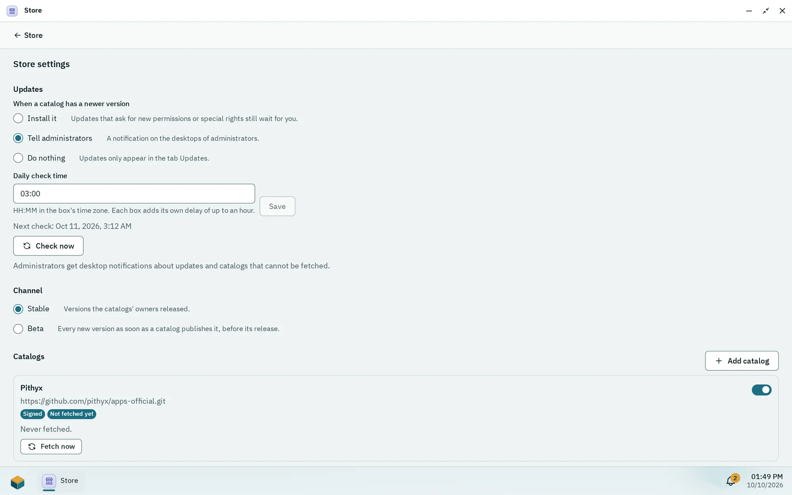

Only administrators install apps, in the Store app. An app is a frontend that the daemon serves plus, optionally, a backend of containers. Apps come from catalogs (git repositories with a signed index) or from a package file (`.pithyxapp`). All app data lives on one pool you choose at the first install, never on the system disk.

## The Store

The Store has the tab **Installed**, **Updates** while updates wait (with their number), **Official** and **Community** while that catalog is on, and **Own** while you added a catalog of your own, and a gear for **Store settings**. Official apps are reviewed, built and signed by the Pithyx project; community apps are from developers outside the project and reviewed by it before they are published; **Own** shows apps of catalogs you added, which the project does not verify. Badges read "Pithyx", "Community" and "Unverified" (also for apps installed from a file). Search covers name, description and developer. An installed app has one page, whichever tab or search you open it from: its actions, permissions, folders and settings, and for an app from a catalog also its screenshots, the link to its source and its versions. Users open installed apps from the Pithyx menu; see [Apps](/docs/user/apps/).

## Installing from a file

Choose **Install from file** on the **Installed** tab (or **Update from file** in an app's detail) and select a package. The dialog lists the permissions the app asks for, the folders it needs, whether it brings a backend, a warning if a container runs as root, special rights, **Who may use it**, and **Pool for app data**. For a package from a file it warns "This package comes from a file and is not verified."

Limits of an upload: the file at most 256 MB, unpacked at most 512 MB and 10 000 entries, the manifest at most 64 KB ([`app.package.too_large`](/docs/reference/errors/#app.package.too_large)). A checked package waits 15 minutes for you to confirm. The ids `org.pithyx.*` are refused from files. A version can be installed, updated, reinstalled (replaces its files) or downgraded; a downgrade may be refused ([`app.package.downgrade_unsupported`](/docs/reference/errors/#app.package.downgrade_unsupported)), then use **Back to the previous version**.

**Uninstall** asks you to **Keep the data** (installing again finds it, with the app's user id; the install dialog then says so) or **Delete the data** (databases, settings, files and snapshots; irreversible). Shared folders mapped into the app stay either way. Disabling an app ("Users can open the app" off) keeps its data and access. An app asks for storage; you map each requested folder to a folder in a shared folder, read only or read and write: choose the shared folder, open the folder you want (or **New folder** to create it there) and save; the shared folder itself works too. Required ones must be mapped or the backend does not start. The install dialog offers the mapping as its last step and shows **Open app** once every required folder has one; until then the app's window says that it waits for a folder. The switch "Send debug messages to the Log Center" turns on debug logging for one app.

## The app pool

At the first install you pick **Pool for app data**: "Every app keeps its data on this pool. It cannot change while an app is installed." Without a pool the Store says to create one in Storage first. The pool must be imported, online (or degraded), writable, unlocked and set up by Pithyx.

Each app gets a dataset `<pool>/pithyx/apps/<id>`, mounted at `/<pool>/.pithyx/apps/<id>`. Docker's data root is `/<pool>/.pithyx/docker`. If the pool is missing or locked, apps on it show "Pool not available" and nobody can open them until it is back. App containers run with user ids from 40000 to 49999.

## Updates and rollback

_The Store settings: what happens with new versions, when the box checks and which channel it follows._

Open the gear, then **Updates**. The policy "When a catalog has a newer version" is **Install it**, **Tell administrators** (default) or **Do nothing** (the update is only listed in the **Updates** tab). An update that asks for new permissions or special rights never installs on its own. The daily check time defaults to 03:00 (box time zone) plus a fixed random delay of 0 to 3600 seconds per box; **Check now** runs it at once. An app can follow its own policy in its detail. Administrators get the notifications "App updates" and "Catalog not fetched".

Before an update Pithyx takes a snapshot of the app's dataset. If the new version does not start, the old one comes back. **Back to** and the version number (for example **Back to 1.2.0**) returns to the previous version, with the app's data as it was before the update; changes and snapshots made since are lost. Only the one previous version is kept.

The channel is **Stable** (versions the catalogs' owners released, default) or **Beta** (every new version as soon as a catalog publishes it, before its release).

## Catalogs and trust

The official and the community catalog are both on by default; the tab **Community** says that its apps come from developers outside the project, reviewed by the project but not vouched for like its own. Switch the community catalog off in the Store settings if you want only official apps; switching it on again asks "Use the community catalog?". Neither can be removed ([`store.catalog.built_in`](/docs/reference/errors/#store.catalog.built_in)). To add your own, enter a **Repository URL**: `https://...` for a public catalog or `git@host:owner/repository.git` for a private one (no credentials in the URL, at most 500 characters; [`store.catalog.url_invalid`](/docs/reference/errors/#store.catalog.url_invalid)).

For a private catalog over SSH the box generates an ed25519 deploy key and shows its public line; add it to the repository as a read-only deploy key and choose **Fetch now**. The server's host key is pinned at the first connection. A fetch times out after 3 minutes. A fetch state is Off, Not fetched yet, Up to date, Fetch failed or Fetching; a failed fetch keeps the last verified copy.

Indexes of the official and community catalogs carry an Ed25519 signature checked against keys built into the daemon, and every file's hash is checked. Custom catalogs are unsigned: "Apps of your own catalogs are not checked by the Pithyx project. Add only catalogs you trust." The ids `org.pithyx.*` come only from the official catalog.

## Special rights

Some apps need more than the sandbox gives a backend: the box's own network (`host.network`, for example to find devices by broadcast), the box's processes (`host.pid`, for monitoring), a device node such as a graphics card for video conversion or a radio stick for home automation (`device:/dev/...`), a Linux capability for root in the app's container (`capability:<NAME>`, for example `NET_ADMIN` for a VPN), or its own containers (`docker.socket`, for example a build server or a job runner). The install dialog and the app's detail list them under **Special rights**, each with what it allows and why that is a risk.

- Granting needs a step-up: your password again and, with two-factor sign-in on, a code from your authenticator app. The confirmation holds for five minutes in the session that made it, so several rights in a row need it once. A wrong password counts towards the sign-in limits.
- In the install dialog **Grant these rights** is on by default. Turn it off to install the app without them; its backend then runs without these rights until you grant them in the app's detail.
- Each right has a switch in the app's detail. Revoking one needs no password; the backend restarts without it (a service without `host.network` joins the app's own network, a device or capability is left out). Granting it again asks for the step-up.
- An update that asks for a right the app did not have needs the step-up too and never installs on its own. A right you revoked stays revoked across updates.
- An app holding a special right carries the badge **Special rights** in the Store.
- Every step-up, also a failed one, and every right granted or revoked goes to the audit log, which the Log Center shows as the source **Audit log**. The audit log is kept on the box apart from the Log Center's retention, and a restore of a configuration backup does not replace it.

### Devices

An app names a single device node (for example `/dev/net/tun`) or a device class: `/dev/dri` stands for every graphics card and render node of the box, `/dev/serial` for every USB serial adapter (`/dev/ttyUSB*`, `/dev/ttyACM*`, such as a Zigbee or Z-Wave stick), `/dev/net/tun` for network tunnels. When the backend starts, the box gives it every node of the class that is plugged in, each with its group.

- A device is required unless the app marks it optional (an app that only gets faster with a graphics card, for example). A required device that is not plugged in stops the install with [`app.device.missing`](/docs/reference/errors/#app.device.missing): plug it in and try again. A missing optional one is only a hint in the install dialog, and the app runs without it.
- When a required device goes away later (unplugged, or missing after a restart), the backend stops or does not start, the app's window says why, the app's log in the Log Center gets an entry and administrators get a notification. When the device is back, the app starts again as usual; nothing polls, the box follows the kernel's device events.
- A missing optional device only gives a warning in the app's log and a hint on the app's detail page.

### Docker socket

With `docker.socket` the app's backend starts and controls containers of its own through a filtered Docker socket the box puts where the app mounts `/var/run/docker.sock`. The app sees and controls only the containers and volumes it started. They join the app's own network and get the same limits as its backend, and they never get a privileged mode, the box's network or processes, devices, capabilities, published ports or folders of the box (only named volumes it created and folders in the app's own volumes). Downloading images needs the permission "Internet"; building, pushing, loading, committing and pruning are refused. Its containers stop with the backend and are removed with the app.

`docker.socket.raw` is the same socket without the filter. That is root on the box: an app holding it can read and change everything. The box grants it only to apps installed from a file, never from a catalog ([`app.elevated.sideload_only`](/docs/reference/errors/#app.elevated.sideload_only)), with the same step-up and a plain warning. Containers it starts are not tracked by the box, so removing the app does not remove them.

Pithyx never grants some rights: a privileged container, all capabilities at once or the dangerous ones (such as `SYS_ADMIN` or `SYS_MODULE`), and device nodes that would reach the box itself (memory, disks and partitions, ZFS, consoles and terminals, input devices, watchdogs). An app asking for one is refused with [`app.elevated.unsupported`](/docs/reference/errors/#app.elevated.unsupported). A service with the box's network, its processes or a device (other than `/dev/net/tun`) runs outside the box's user namespace with the app's own user and the device's group, so such an app can never run as root ([`app.elevated.root_conflict`](/docs/reference/errors/#app.elevated.root_conflict)). If a required device is missing when the backend starts, for example an unplugged stick, the backend does not start ([`app.device.unavailable`](/docs/reference/errors/#app.device.unavailable)) and starts by itself once the device is back.

## Backends and Docker

A backend is a Compose subset with images pinned by digest, checked against a fixed allowlist. The box runs it in Docker (Debian's `docker.io`), which the daemon starts only while a backend app is installed and its pool is available. Containers run in a user namespace, on an own internal network without internet unless the app has the permission "Internet", and cannot reach host services. Other devices in your network (router, printer, other servers) are reachable only with the permission "Local network"; "Internet" alone does not include them. Containers that do not run as root have no Linux capabilities. A container as root is only allowed when the app declares it, and the install dialog warns. Rights beyond this sandbox are [special rights](#special-rights).

A backend with lifecycle `always` runs whenever it can; `onDemand` starts when a user opens the app (a request waits up to 30 seconds) and stops 10 minutes after the last window closed. A failed start is retried after 1 minute. Container output goes to the Log Center as source `app/<id>`.
