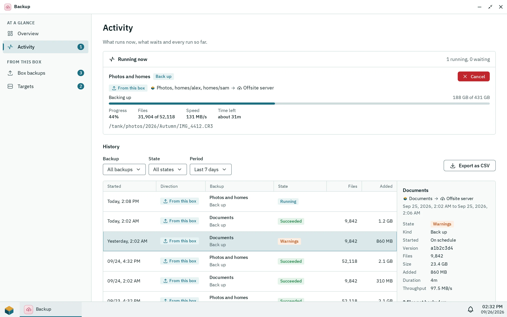

**Activity** in the **Backup** app shows what runs now and every run and check of the [box backups](/docs/admin/backup-jobs/) so far. It is for administrators, like the rest of the app. The number next to **Activity** in the navigation counts the runs going on.

_Activity shows the running backup on top and the history below; the selected run shows its numbers and the files it could not back up._

## Running now

**Running now** lists every run and check going on, and those waiting for their turn (**Waiting**). A running backup shows its route, a progress bar with the data read so far, the **Progress** in percent, the **Files**, the **Speed**, the **Time left** and the file it reads now. **Cancel** stops it; the run then ends as **Cancelled** and saves no version.

## History

**History** lists the runs and checks of every box backup, newest first, with when they started, their direction, the backup and whether it was a backup (**Back up**) or a check (**Check**), the state, the files and the data added.

- **Backup** shows only the runs of one box backup.
- **State** shows only runs that succeeded, ended with warnings, failed, were cancelled or interrupted, or still run.
- **Period** shows the runs of today, the last 7, 30 or 90 days, or all of them.
- **Show more** loads older runs, up to 2,000.
- **Export as CSV** downloads the runs shown, with their start and end, backup, kind, state, files, size and data added in bytes, warnings and error code, for a spreadsheet.

Runs of a deleted box backup are deleted with it.

## Run details

Selecting a run shows its time, the error of a failed run, its state, kind and how it started (**On schedule** or **By hand**), the **Version** (the short id of the restic snapshot it saved), the files, the size of the version, the data added, the duration and the **Throughput**.

### Files not backed up

A run with **Warnings** saved a complete version except for files it could not read. The details list them with their path in the shared folder or home and the reason: **No permission** (the box may not read the file), **Gone while reading** or **Could not be read**. The box keeps the first 100 files of a run and counts the rest ("and 20 more files").

To back them up next time, give the box read access to them, or exclude them in the backup's settings with **Edit** (**More settings** > **Excludes**).
