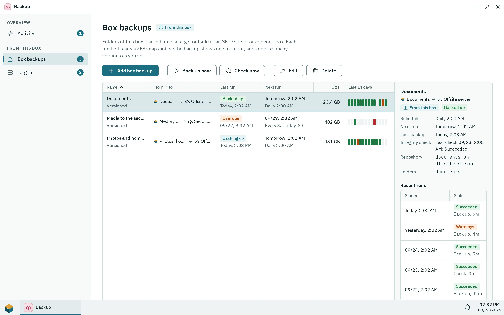

A **job** in the **Backup** app backs up folders of shared folders and homes to a [backup target](/docs/admin/backup-targets/) on a schedule. Each run first takes a ZFS snapshot, so a backup shows one moment even while people keep working, and saves a new version into the job's own repository on the target with [restic](https://restic.net/) over SFTP. Older versions are thinned out by the retention, and an integrity check reads the repository back on a schedule of its own. Jobs are for administrators; the box reports failed, incomplete and overdue backups to them.

_Each job is a card with its state, the target, the next run and the last backup; the chevron shows its folders, repository and recent runs._

## Adding a job

1. Add a [target](/docs/admin/backup-targets/) first and test its connection.
2. Open **Backup**, choose **Jobs** and **Add job**.
3. Enter a name and choose the target. **Repository folder** is the folder below the target's folder that holds this job's repository; it follows the name until you change it.
4. Under **Folders to back up**, choose a shared folder or a home and, in **Folder inside**, a folder in it, or nothing for all of it. **Add folder** adds more, up to 32.
5. Choose when it **Backs up**: every hour, day, week or month at a time, or a cron expression with five fields (minute, hour, day of the month, month, day of the week). Times are in the box's time zone. Without **Run on schedule** the job runs only by hand.
6. Set the **Versions to keep** and the **Integrity check** (see below), and under **More settings** the limits, the overdue time and the excludes.
7. Choose **Create**. The box creates the repository on the target and shows its key.

A new job backs up every day at 02:00, keeps 7 daily, 4 weekly and 12 monthly versions and checks the repository every Sunday at 05:00, reading 5 percent of the data.

Only folders on a pool can be backed up, since every run starts from a snapshot ([`backup.source.unsupported`](/docs/reference/errors/#backup.source.unsupported)). A folder whose pool is missing or locked fails the run with [`backup.source.unavailable`](/docs/reference/errors/#backup.source.unavailable).

The target and the repository of a job stay as they are; for another target or repository, add a new job. Everything else can be changed with **Edit**.

## The repository key

:::caution[Store the key outside the box]
Each repository is encrypted with a random key. The box shows it once, right after **Create**: copy it or download it as a text file and keep it somewhere other than this box. Without the key nobody can read the backups, also not after a reinstall. The dialog closes only after you tick **I stored the key outside the box**.
:::

The box keeps the key itself to run the job, and it goes into the part **Backup app** of the [configuration backup](/docs/admin/backup/), never into a [support bundle](/docs/admin/logs-and-monitoring/).

To use a repository that already exists, for example after a reinstall, tick **Use an existing repository** and paste its key. The box then checks that a repository is in that folder ([`backup.repository.not_found`](/docs/reference/errors/#backup.repository.not_found)) and that the key opens it ([`backup.repository.wrong_key`](/docs/reference/errors/#backup.repository.wrong_key)). A new job refuses a folder that already holds a repository ([`backup.repository.exists`](/docs/reference/errors/#backup.repository.exists)).

## What a run saves

A run takes a ZFS snapshot of every dataset the folders are on and lets restic read the snapshot in place of the live folder. The repository stores the folders under their paths on the box, with owners, permissions, ACLs and modification times. The snapshots exist only while the run lasts and are dropped when it ends. Each run backs up into the job's repository as a new version; restic saves only what changed since the last one.

Runs and checks are tasks of the box: they show their progress on the job's card and in the box's task list, run one at a time per job and can be cancelled with **Cancel**. **Back up now** and **Check now** start one at once. A time the box missed while it was off is not caught up; the overdue warning covers it.

The run's state:

- **Succeeded**: every file was saved.
- **Warnings**: a new version was saved, but some files could not be read (restic's exit code 3), or removing old versions failed. The Log Center names them.
- **Failed**: no new version was saved. The card names the reason, for example [`backup.target.unreachable`](/docs/reference/errors/#backup.target.unreachable), [`backup.repository.locked`](/docs/reference/errors/#backup.repository.locked) or [`backup.run.failed`](/docs/reference/errors/#backup.run.failed).
- **Cancelled**: an administrator cancelled it.
- **Interrupted**: the box restarted during the run.

**Recent runs** in the expanded card lists the last runs and checks with their files, size, the data added and the duration.

## Versions to keep

After every successful backup the box applies the retention: it keeps the latest versions, then one version per hour, day, week, month and year for as many of each as you set, and removes the others from the repository to free their space (`restic forget --prune`). All values at 0 keep every version.

## Integrity check

**Check the repository on a schedule** runs `restic check` on its own schedule. **Data to read back, in percent** reads that share of the data from the target each time, a different part on every check; 0 checks only the structure of the repository. A failed check is its own event ([`backup.check.failed`](/docs/reference/errors/#backup.check.failed)): run another check, and if it fails again, start a new repository for the job.

## More settings

- **Upload limit in KiB/s** and **Download limit in KiB/s**: limit the bandwidth restic uses towards the target; 0 for no limit.
- **Report as overdue after hours**: how long the job may go without a successful backup before it is reported. Empty means three times the time between two scheduled runs, at least two days.
- **Excludes**: one restic pattern per line, for example `*.tmp` or `**/cache`, up to 100.

restic keeps a cache of the repository's index on the pool of the job's first folder, in the dataset `<pool>/pithyx/backup-cache`, so nothing of it lands on the system disk.

## Events

The box reports these to its administrators, on the desktop and on the channels chosen in Settings > **Notifications** > **Events** (group **Backups**):

- **Backup failed**: a run saved nothing.
- **Backup skipped files**: a run ended with warnings.
- **Backup overdue**: no successful backup within the overdue time.
- **Backup check failed**: an integrity check failed.
- **Backup target's host key changed**: the target's server answered with another host key ([Backup targets](/docs/admin/backup-targets/#when-the-host-key-changes)).

## Deleting a job

**Delete** removes the job, its runs and its key from the box. The repository stays on the target; without the key nobody can read it. A running job cannot be deleted ([`backup.job.busy`](/docs/reference/errors/#backup.job.busy)); cancel the run first.

## Restoring

Restoring from the Backup app comes in a later version. Until then, restic itself opens the repository with its key from any machine that can reach the target over SFTP with an SSH key of its own, for example `restic -r sftp:<user>@<server>:<folder>/<repository> restore latest --target <folder>`.
