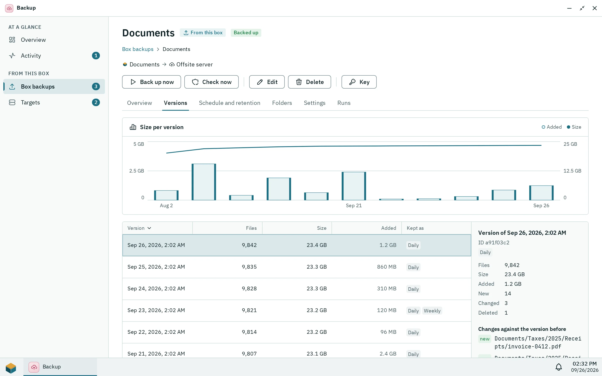

A **box backup** in the **Backup** app sends folders of shared folders and homes from this box to a [backup target](/docs/admin/backup-targets/) on a schedule. Each run first takes a ZFS snapshot, so a backup shows one moment even while people keep working, and saves a new version into the backup's own repository on the target with [restic](https://restic.net/) over SFTP. Older versions are thinned out by the retention, and an integrity check reads the repository back on a schedule of its own. Box backups are for administrators; the box reports failed, incomplete and overdue backups to them.

The app opens on its [Overview](/docs/admin/backup-overview/). Its navigation sorts backups by their direction: **From this box** holds the box backups and their targets, and every box backup carries the tag **From this box**. Backups of other servers onto this box come in a later version under their own heading. What runs now and every run so far are in [Activity](/docs/admin/backup-activity/).

_Box backups lists every backup with where it goes, its last and next run, the size of its last version and a bar per day; the selected one shows its details on the right._

## The list

**Box backups** is a table with one row per backup:

- **Name**, with the kind below (**Versioned**).
- **From → to**: the folders, or the first folders, and the target.
- **Last run**: its state (**Backed up**, **Backed up with warnings**, **Failed**, **Overdue**, **Backing up** and others) and when it started.
- **Next run**, with the schedule below, or **Runs only by hand**.
- **Size**: the size of the last version.
- **Last 14 days**: a bar per day, green for a backup without problems, orange for warnings, red for a failure and grey for a day without a backup. A screen reader reads the counts instead.

Selecting a row opens its details on the right: the progress of a running backup, the error of a failed run or check, the schedule, the next run, the last successful backup, the integrity check, the repository, the folders and **Recent runs**. The toolbar acts on the selected backup: **Open**, **Back up now** (or **Cancel** while it runs), **Check now**, **Edit** and **Delete**. **Open**, a double click or Enter on a row opens the backup's own page.

## The page of a backup

A backup's page shows its name, the tag **From this box** and its state in the title, the path back to **Box backups** and its route. The toolbar has **Back up now** (or **Cancel**), **Check now**, **Edit**, **Delete** and **Key**, and the page has these tabs:

- **Overview**: the progress of a running backup, the error of a failed run or check, schedule, next run, last backup, integrity check, repository, folders and the recent runs.
- **Versions**: every version in the repository (see below).
- **Schedule and retention**: when it backs up, the next run, the versions it keeps, the integrity check and when it counts as overdue.
- **Folders**: the folders it backs up and its excludes.
- **Settings**: target, repository, whether it runs on schedule and the bandwidth limits.
- **Runs**: its runs and checks.

**Edit** on the tabs opens the same dialog as in the list.

_The Versions tab: what each version added and its size, why the retention keeps it, and what changed in the newest one._

### Versions

**Versions** lists every version in the backup's repository, newest first, with its time, files, size, the data it added to the repository and **Kept as**: why the retention keeps it (**Latest**, **Hourly**, **Daily**, **Weekly**, **Monthly**, **Yearly**) and **Protected**. The chart above shows the data each version added as bars and its size as a line. Selecting a version shows its numbers on the right; for the newest one also how many files are new, changed and deleted against the version before, with up to 100 of them.

The box stores the versions after every run and after every change of a version, so the list shows the repository as the box last saw it and reading it never contacts the target. A version deleted outside the box disappears after the next run.

**Protect from deletion** keeps a version whatever the retention says, for example the state before a large clean-up; **Release protection** hands it back to the retention. Protecting adds restic's tag `pithyx-protected` to the version, which every later retention keeps (`--keep-tag`). It is refused while a run or check goes on ([`backup.job.busy`](/docs/reference/errors/#backup.job.busy)), and a version the retention removed meanwhile answers [`backup.version.not_found`](/docs/reference/errors/#backup.version.not_found). Both are recorded in the Log Center's source **audit**.

Browsing a version and restoring from it come with the restore portal.

## Adding a box backup

1. Add a [target](/docs/admin/backup-targets/) first and test its connection.
2. Open **Backup**, choose **Box backups** and **Add box backup**.
3. Enter a name and choose the target. **Repository folder** is the folder below the target's folder that holds this backup's repository; it follows the name until you change it.
4. Under **Folders to back up**, choose a shared folder or a home and, in **Folder inside**, a folder in it, or nothing for all of it. **Add folder** adds more, up to 32.
5. Choose when it **Backs up**: every hour, day, week or month at a time, or a cron expression with five fields (minute, hour, day of the month, month, day of the week). Times are in the box's time zone. Without **Run on schedule** the backup runs only by hand.
6. Set the **Versions to keep** and the **Integrity check** (see below), and under **More settings** the limits, the overdue time and the excludes.
7. Choose **Create**. The box creates the repository on the target and shows its key.

A new box backup backs up every day at 02:00, keeps 7 daily, 4 weekly and 12 monthly versions and checks the repository every Sunday at 05:00, reading 5 percent of the data.

Only folders on a pool can be backed up, since every run starts from a snapshot ([`backup.source.unsupported`](/docs/reference/errors/#backup.source.unsupported)). A folder whose pool is missing or locked fails the run with [`backup.source.unavailable`](/docs/reference/errors/#backup.source.unavailable).

The target and the repository of a box backup stay as they are; for another target or repository, add a new box backup. Everything else can be changed with **Edit**.

## The repository key

:::caution[Store the key outside the box]
Each repository is encrypted with a random key. The box shows it once, right after **Create**: copy it or download it as a text file and keep it somewhere other than this box. Without the key nobody can read the backups, also not after a reinstall. The dialog closes only after you tick **I stored the key outside the box**.
:::

**Key** on the backup's page shows the key again, for example when the copy got lost. It asks for your password and, with two-factor sign-in on, a code from your authenticator app; wrong answers count like failed sign-ins. Every time the key is shown is recorded in the Log Center's source **audit**, without the key.

The box keeps the key itself to run the backup, and it goes into the part **Backup app** of the [configuration backup](/docs/admin/backup/), never into a [support bundle](/docs/admin/logs-and-monitoring/).

To use a repository that already exists, for example after a reinstall, tick **Use an existing repository** and paste its key. The box then checks that a repository is in that folder ([`backup.repository.not_found`](/docs/reference/errors/#backup.repository.not_found)) and that the key opens it ([`backup.repository.wrong_key`](/docs/reference/errors/#backup.repository.wrong_key)). A new box backup refuses a folder that already holds a repository ([`backup.repository.exists`](/docs/reference/errors/#backup.repository.exists)).

## What a run saves

A run takes a ZFS snapshot of every dataset the folders are on and lets restic read the snapshot in place of the live folder. The repository stores the folders under their paths on the box, with owners, permissions, ACLs and modification times. The snapshots exist only while the run lasts and are dropped when it ends. Each run backs up into the backup's repository as a new version; restic saves only what changed since the last one.

Runs and checks are tasks of the box: they show their progress in the backup's details, in [Activity](/docs/admin/backup-activity/) and in the box's task list, run one at a time per backup and can be cancelled with **Cancel**. **Back up now** and **Check now** start one at once. A time the box missed while it was off is not caught up; the overdue warning covers it.

The run's state:

- **Succeeded**: every file was saved.
- **Warnings**: a new version was saved, but some files could not be read (restic's exit code 3), or removing old versions failed. The run's details in [Activity](/docs/admin/backup-activity/#files-not-backed-up) name the files.
- **Failed**: no new version was saved. The details name the reason, for example [`backup.target.unreachable`](/docs/reference/errors/#backup.target.unreachable), [`backup.repository.locked`](/docs/reference/errors/#backup.repository.locked) or [`backup.run.failed`](/docs/reference/errors/#backup.run.failed).
- **Cancelled**: an administrator cancelled it.
- **Interrupted**: the box restarted during the run.

**Recent runs** in the details lists the last runs and checks with their state, kind and duration; [Activity](/docs/admin/backup-activity/) has every run with its numbers.

## Versions to keep

After every successful backup the box applies the retention: it keeps the latest versions, then one version per hour, day, week, month and year for as many of each as you set, and removes the others from the repository to free their space (`restic forget --prune`). All values at 0 keep every version. A protected version is always kept (see [Versions](#versions)).

## Integrity check

**Check the repository on a schedule** runs `restic check` on its own schedule. **Data to read back, in percent** reads that share of the data from the target each time, a different part on every check; 0 checks only the structure of the repository. A failed check is its own event ([`backup.check.failed`](/docs/reference/errors/#backup.check.failed)): run another check, and if it fails again, start a new repository for the backup.

## More settings

- **Upload limit in KiB/s** and **Download limit in KiB/s**: limit the bandwidth restic uses towards the target; 0 for no limit.
- **Report as overdue after hours**: how long the backup may go without a successful backup before it is reported. Empty means three times the time between two scheduled runs, at least two days.
- **Excludes**: one restic pattern per line, for example `*.tmp` or `**/cache`, up to 100.

restic keeps a cache of the repository's index on the pool of the backup's first folder, in the dataset `<pool>/pithyx/backup-cache`, so nothing of it lands on the system disk.

## Events

The box reports these to its administrators, on the desktop and on the channels chosen in Settings > **Notifications** > **Events** (group **Backups**):

- **Backup failed**: a run saved nothing.
- **Backup skipped files**: a run ended with warnings.
- **Backup overdue**: no successful backup within the overdue time.
- **Backup check failed**: an integrity check failed.
- **Backup target's host key changed**: the target's server answered with another host key ([Backup targets](/docs/admin/backup-targets/#when-the-host-key-changes)).

## Deleting a box backup

**Delete** removes the backup, its runs, its versions, its key and restic's cache of its repository from the box. The repository stays on the target; without the key nobody can read it. A running backup cannot be deleted ([`backup.job.busy`](/docs/reference/errors/#backup.job.busy)); cancel the run first.

## Restoring

Restoring from the Backup app comes in a later version. Until then, restic itself opens the repository with its key from any machine that can reach the target over SFTP with an SSH key of its own, for example `restic -r sftp:<user>@<server>:<folder>/<repository> restore latest --target <folder>`.
