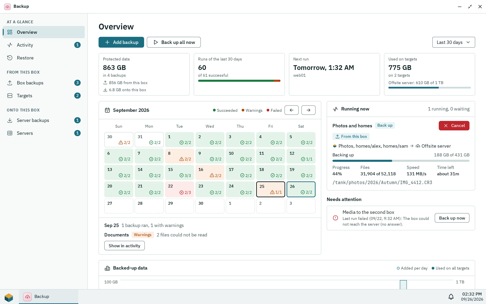

The **Backup** app opens on its **Overview**: everything about your [box backups](/docs/admin/backup-jobs/) on one page. It is for administrators, like the rest of the app.

_The overview of a box with three backups: one runs now, one failed and is listed under Needs attention, and the calendar shows how each day went._

## Toolbar

- **Add backup** asks what to back up: folders of this box to a target, a [box backup](/docs/admin/backup-jobs/#adding-a-box-backup), or a Linux server onto this box, a [server backup](/docs/admin/backup-servers/#adding-a-server-backup). Without a target or a server the app first asks for one.
- **Back up all now** starts every switched-on backup that does not run or check at the moment.
- The period on the right (**Last 7 days**, **Last 30 days**, **Last 90 days**) sets what the run tile and the chart count.

## Tiles

- **Protected data**: the size of the newest version of every backup together, how many backups there are, and how much of it goes from this box and how much comes onto it from servers. Server backups take nothing on a target, so **Used on targets** leaves them out.
- **Runs of the last 30 days** (or the chosen period): how many runs and checks succeeded, with warnings counted as successful, of how many. The bar shows the share that succeeded, had warnings and failed. Cancelled runs are not counted.
- **Next run**: when the next scheduled backup starts, and which one.
- **Used on targets**: what the repositories of all backups take on their targets, and on how many targets. The bar below shows the target with the least room left: how much of it is used, as its server reported. The box asks the server for its free space at every [connection test](/docs/admin/backup-targets/) and after every run.

## Calendar

The calendar shows one month, a day per cell, in the box's time zone. A day where every backup that ran succeeded is green, a day with warnings orange, a day with a failed or interrupted run or check red; the cell says how many of the backups that ran that day had no failure ("5/6"). Days without a run stay empty, days still to come have a dashed border, and today has a colored border. The arrows show the previous and the next month.

Selecting a day shows below the calendar how many backups ran and how many runs failed or had warnings, and lists those runs with their error or the number of files they could not read. **Show in activity** opens [Activity](/docs/admin/backup-activity/) for the details. Without a selection the calendar picks the latest day with a problem in the month, else today.

## Running now and Needs attention

**Running now** is the same list as in [Activity](/docs/admin/backup-activity/#running-now): each running run or check with its progress and **Cancel**.

**Needs attention** lists every problem with the action that fixes it:

- A target whose last connection test failed, with its error. If its host key changed, **Check new host key** opens the dialog to [confirm the new key](/docs/admin/backup-targets/#when-the-host-key-changes); otherwise **Show targets** opens the targets.
- A backup whose last run failed or was interrupted, with its error and **Back up now**.
- A backup that is overdue, with when it last succeeded and **Back up now**.
- A backup whose last run had warnings, with the number of files it could not read and **Show**, which opens Activity.
- A backup whose last integrity check failed, with **Check now**.

When nothing needs attention, the panel says so.

## Backed-up data

The chart shows each day of the period: the bars are the data the backups added to their repositories that day (left scale), the line is what the repositories took on their targets at the end of the day (right scale). The box measures a repository's size after each run, with restic's own statistics; a day without a measurement keeps the last one. Pruning old versions shows as the line going down.
