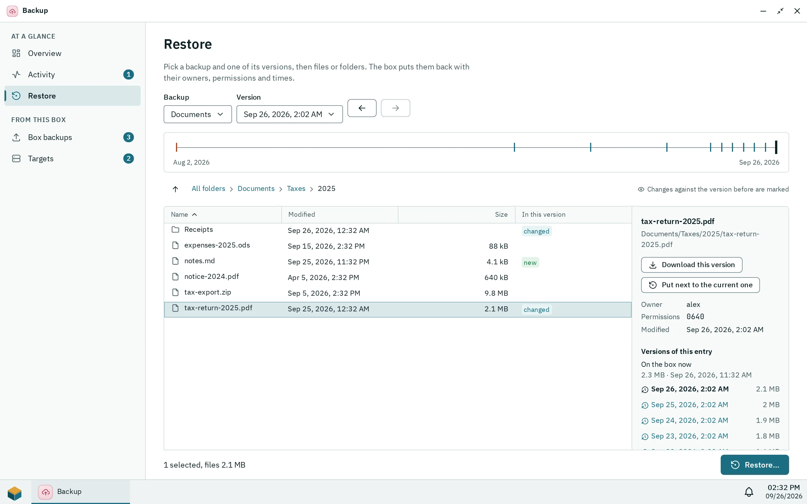

**Restore** in the **Backup** app opens the versions of a [box backup](/docs/admin/backup-jobs/), shows their folders and files, and brings files and folders back onto the box: where they were, or into another folder. It is under **Overview** in the app's navigation; **Browse and restore** on a version of a backup's page opens the same page on that version. Restoring is for administrators.

_Restore shows a folder as it was in the chosen version; the file selected on the right shows its versions, and the bar at the bottom restores what is ticked._

## Choosing a version

The toolbar picks the backup and its version; **Older version** and **Newer version** step through the versions, and the timeline below shows each version at its time, protected ones marked. The versions are the ones the box stored after its last run ([Versions](/docs/admin/backup-jobs/#versions)).

The box reads a version by mounting the backup's repository read-only. The first folder of a backup takes a moment, since restic reads the repository's index from the target; after that every folder opens from the mount. The mount ends ten minutes after the last read, and before a run, a check or a change of protection of that backup; the page then opens it again by itself. A version newer than the mount also opens it again.

## Browsing

At the top a version shows the folders it holds, named after the shared folder or home and the path below it, as they are named now. A double click or Enter opens a folder; **One folder up** and the path go back. Entries that are new against the version before are marked **new**, changed ones (by size or time) **changed**; the oldest version has no marks.

Selecting one entry shows it in the pane on the right: its owner, permissions and time in the shown version, and its versions: the one on the box now and each version of the backup, with its size and time, or **not there**. A click on a version opens it. **Download this version** downloads a file, or a folder as a zip of its files and folders (symbolic links and devices are left out). **Put next to the current one** restores it with **Keep both** where it was.

## Restoring

Tick files and folders (the selection stays while you switch versions, for entries that are in the new one), then choose **Restore…** in the bar at the bottom:

- **Where to**: **Where it was** puts each entry back into its folder, and folders above it that are gone are made again. **Into another folder** puts each entry under its name into a folder of a shared folder or home you pick.
- **When a file is already there**: **Keep both** puts the restored file next to it as `<name> (version yyyy-MM-dd HH.mm UTC)<extension>`, the way [previous versions](/docs/user/files/#previous-versions) in Files are restored, and leaves a file with the same size and time as the one there alone, since nothing changed; **Replace it** puts the restored file in its place; **Leave it** keeps the file in place and leaves the restored one out. A folder that is already there is merged with the restored one, and a folder never replaces a file or the other way round: both are kept.

Files come back with their owner, group, permissions, ACLs and times. A restore is a task of the box: its progress is in the task list and on the page, and at the end the page says how many entries it restored, replaced, kept next to one and left out. A restore waits while a run or check of the same backup goes on ([`backup.job.busy`](/docs/reference/errors/#backup.job.busy)).

The box restores into a hidden folder `.pithyx-restore-<number>` in the target's shared folder and moves the entries from there, so a restore needs space there for what it restores. A shared folder or home that is gone cannot take the entries back where they were ([`backup.restore.failed`](/docs/reference/errors/#backup.restore.failed) with the reason place); restore them into another folder instead.

Every restore and download is recorded in the Log Center's source **audit**.

## Without the box

Every repository is a plain restic repository. If the box is gone, restic opens it with its key from any machine that reaches the target over SFTP with an SSH key of its own, for example `restic -r sftp:<user>@<server>:<folder>/<repository> restore latest --target <folder>`. The key is under **Key** on the backup's page.
