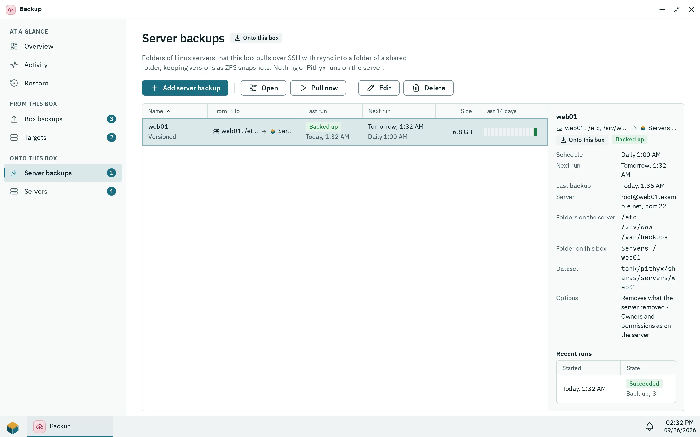
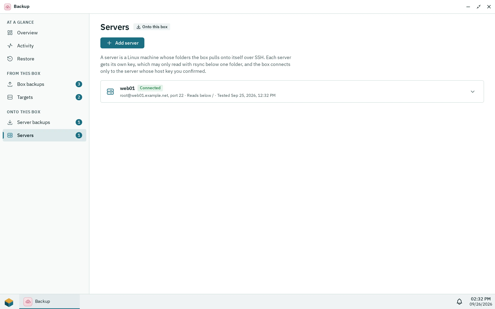

A **server backup** in the **Backup** app pulls folders of a Linux server onto this box on a schedule. The box signs in over SSH and copies with [rsync](https://rsync.samba.org/) into a folder of a shared folder, which it makes as a ZFS dataset of its own. After each run it keeps the folder's state as a ZFS snapshot: that is the run's version. Nothing of Pithyx runs on the server; it needs only SSH and rsync. Server backups are for administrators, and the box reports failed, incomplete and overdue ones to them as it does for [box backups](/docs/admin/backup-jobs/).

The navigation of the app has them under **Onto this box**: **Server backups** and **Servers**. Every server backup carries the tag **Onto this box**, and its route reads from the server to the folder on the box. Their runs are in [Activity](/docs/admin/backup-activity/) and on the [Overview](/docs/admin/backup-overview/) with the others.



_Server backups lists every backup of a server with its route, last and next run, size and the last 14 days; the selected one shows what it pulls and where it lands._

## Adding a server

A server is the machine a server backup reads from. Each server has its own SSH key, made by the box, and the host key you confirmed, as a [backup target](/docs/admin/backup-targets/) does.

1. Open **Servers** and choose **Add server**.
2. Enter a name, the server, the SSH port (22 when left empty) and the user. To keep every file with its owners, sign in as `root`; the key stays read-only either way.
3. **Folder the key may read** is the folder the server's key is limited to: absolute and without spaces, `/` for the whole server. The backups choose folders below it.
4. Choose **Next**, compare the host key's fingerprint with the one of the server (`ssh-keygen -lf /etc/ssh/ssh_host_ed25519_key.pub` on the server) and choose **Fingerprint matches, save** only if it is the same.
5. The box shows the **Line for authorized_keys**. Add it to the file `.ssh/authorized_keys` of the user on the server and choose **Test connection**.

The line looks like this:

```
restrict,command="rrsync -ro /" ssh-ed25519 AAAA... pithyx-backup@box
```

`restrict` turns off a shell, port and agent forwarding and terminals for the key, and `command` runs only `rrsync`, rsync's helper for keys like this, read-only (`-ro`) below the folder. So the key can read below that folder and do nothing else, even if somebody took it from the box. The server needs rsync with `rrsync`, which current distributions install with rsync. **Test connection** signs in and lets rsync list the folder.

A failed test or run names the reason, as for targets ([`backup.target.unreachable`](/docs/reference/errors/#backup.target.unreachable), [`backup.target.auth_failed`](/docs/reference/errors/#backup.target.auth_failed), [`backup.target.host_key_changed`](/docs/reference/errors/#backup.target.host_key_changed)), and two of its own:

- [`backup.server.rsync_missing`](/docs/reference/errors/#backup.server.rsync_missing): rsync or `rrsync` is not installed on the server, or not where the line expects it.
- [`backup.server.refused`](/docs/reference/errors/#backup.server.refused): the server refused the folder, usually because it is not below the folder the key may read, or it does not exist.



## Adding a server backup

**Add server backup** on **Server backups**, or **Add backup** on the Overview with **Back up a Linux server onto this box**, opens the dialog:

- **Name** of the backup.
- **Server**: one of the servers.
- **Shared folder** and **Folder name**: the box makes the folder in the shared folder as a dataset of its own, named after the backup unless you change it (letters, digits, dots, dashes and underscores). The shared folder must be the root of its dataset, as every shared folder the box makes is; a folder that already exists there is refused ([`backup.destination.invalid`](/docs/reference/errors/#backup.destination.invalid)).
- **Folders on the server**: one path per line, starting with `/`, from the folder the server's key may read. With `/` as that folder they are the server's paths, for example `/etc` or `/srv/www`; with `/srv`, `/www` is `/srv/www` on the server. Each lands in the folder on the box with that path, so `/srv/www` becomes `srv/www` there.
- **Remove what was removed on the server**: on, files gone on the server go from the folder on the box too; off, they stay. The versions keep them either way.
- **Owners and permissions**: **As on the server** keeps user and group ids, permissions, ACLs and extended attributes as numbers, so the files on the box belong to the ids they have on the server. **Owned by the box** gives them to the box with the permissions of the shared folder.
- **Pulls**, **Run on schedule**, **Versions to keep**, the download limit, **Report as overdue after hours** and **Excludes** (rsync patterns, for example `*.tmp` or `/var/cache/`) work as for [box backups](/docs/admin/backup-jobs/#adding-a-box-backup).

Everybody who may open the shared folder can read what the box copied, over every protocol it is shared with. For a server with secrets, such as `/etc` with its keys, choose a shared folder only administrators can open.

**Edit** changes everything except the server and the folder on the box; for others, add a new backup.

## What a run does

A run copies the folders with rsync over the server's key into the backup's folder, rewriting only the changed parts of changed files, and keeps hard links and symbolic links. Then it takes a ZFS snapshot of the folder (`pithyx-pull-<time>`) as the new version and applies the retention. A file the server would not let it read makes the run **Backed up with warnings** and is listed in its details, as for box backups; anything else that stops rsync makes it **Failed**, and the folder keeps what the run had copied until then, without a new version.

## Versions

The **Versions** tab of a server backup's page lists its snapshots as box backups list theirs, with what each added, the reasons the retention kept it and, for the newest, the files rsync added, changed and removed. **Protect from deletion** puts a ZFS hold on the snapshot, so neither the retention nor anything else removes it until you release it. The retention keeps versions with the same rules as for box backups, in the box's time zone.

The live folder always holds the newest state. To get a file back from an earlier version, open the folder in [Files](/docs/user/files/) and use its previous versions, which are the backup's snapshots. Over SMB, previous versions show only the snapshots of the shared folder itself, not those of a server backup. Restoring a server backup in the app's **Restore** page and back to the server come in a later version.

## Deleting a server backup

**Delete** removes the backup and its runs. The folder on the box stays with its versions unless you choose **Also delete the folder and all its versions**, which destroys the backup's dataset with every snapshot and its holds. The box only ever destroys a dataset it made for that backup.

A server that server backups still use cannot be deleted ([`backup.target.in_use`](/docs/reference/errors/#backup.target.in_use)). After deleting a server, remove its line from the server's `authorized_keys` as well.

## Configuration backup

Servers, their keys and host keys and the server backups are in the part **Backup app** of the [configuration backup](/docs/admin/backup/). The data of a server backup is in its folder on the pool, not in the configuration backup.
