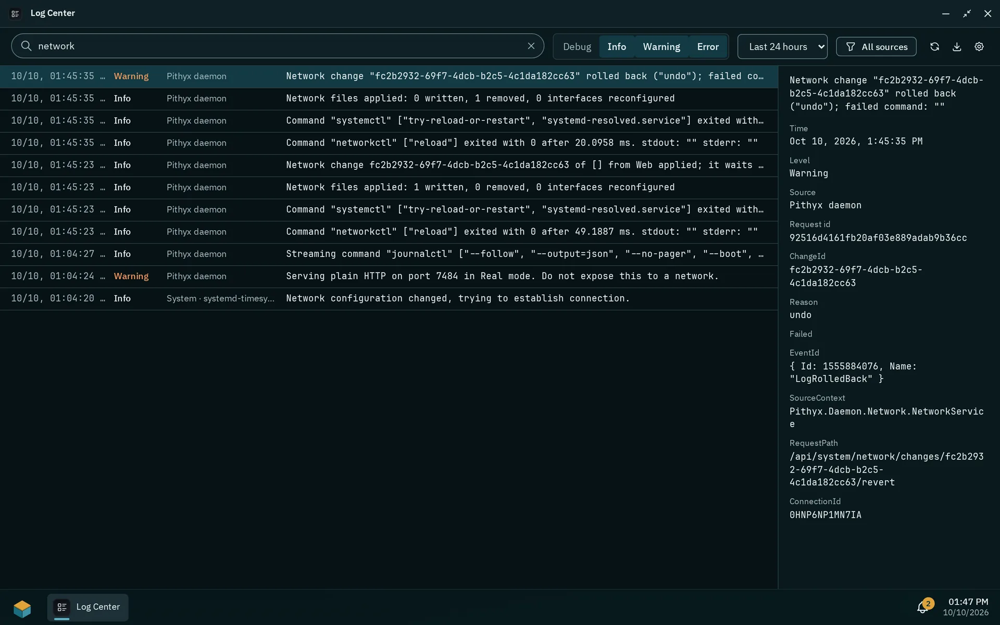
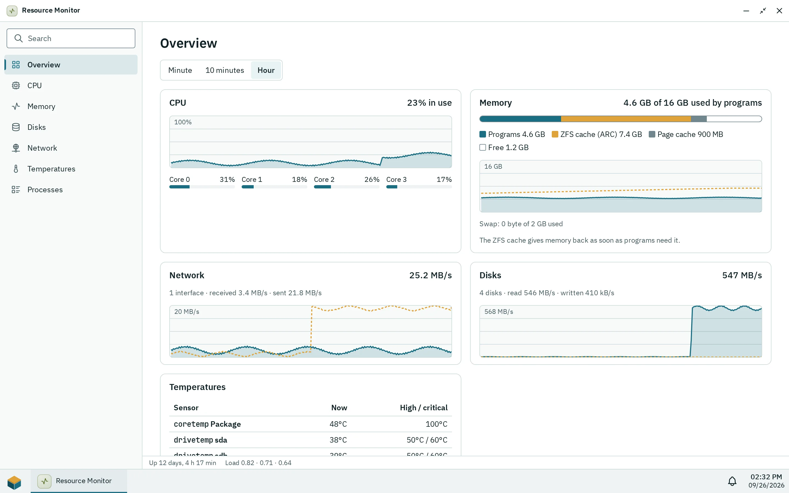

Two administrator apps show what the box is doing: the Log Center (messages from the daemon, the system and apps) and the Resource Monitor (CPU, memory, network, disks and temperatures). Notifications reach people in the desktop, and by email or webhook through [notification channels](/docs/admin/notifications/).

## The Log Center

_The Log Center with a search, level and time filters and the details of the selected entry._

The navigation on the left lists **All sources**, then the sources under **System** ("Pithyx daemon", "Audit log" with the step-ups and special rights of apps, see [Apps and Store](/docs/admin/apps-and-store/#special-rights), "Reverse proxy · {host}" for a proxy host's access log, and the journal units such as kernel, smbd, ssh, ZFS, systemd-networkd, timesyncd, Docker and smartmontools) and under **Apps**; each shows how many warnings and errors it logged in the chosen time range. The toolbar filters the level (**All** without debug, **Warnings**, **Errors**, or **Debug** for every level, with their counts) and the time range (last hour, 24 hours, 7 days, 30 days, all time), and searches the messages and their fields (an exact request id finds its entries too). The Log Center is live: new entries appear as the daemon writes them, about once a second, until you choose **Pause**; **Live** catches up and follows again. The entries are grouped by day; the chosen entry's message and fields show on the right, without its request id. The status bar says how many entries are loaded and how long the logs are kept. Pages hold 200 entries by default, at most 1000. **Export** offers **Export as text** (`.log`) and **Export as JSON lines** (`.jsonl`), up to 1 000 000 entries each.

Logs are stored in a database on the system disk under `/var/log/pithyx/`, so they work without a pool. Retention is set with **Retention**: keep 30 days by default (1 to 365) and at most 4 GB (64 MB to 4 GB); the oldest entries go first. The optional archive on a pool is off by default. When on, entries are copied to the pool once a day and before the current logs drop any, which wakes the pool's disks about once a day. Archive days: 1 to 3650 (default 365); size 0.25 to 1024 GB (default 10 GB). If the pool is unavailable, entries wait on the system disk.

The daemon also writes JSON files `/var/log/pithyx/daemon.json*`, rolling at 20 MB with 10 files. Secrets are masked in logs.

App messages arrive through the SDK: `info`, `warn` and `error` always, `debug` only while an administrator turned it on in the app's detail. A message is at most 4000 characters, with at most 20 data fields; an app may log 20 messages per second (burst 200). Backend container output lands in the source `app/<id>`. A line on stdout is info, a line on stderr a warning, and a line that is a JSON object with a string `level` (`debug` or `trace`, `info`, `warn` or `warning`, `error`, `fatal` or `critical`) keeps that level. Such a JSON line shows its `message` (or `msg`) as the message and its other fields (at most 32, each cut to 1024 characters) as data; a W3C `traceparent` field ties it to the request, so searching the request id finds it next to the daemon's lines. A `debug` line is kept only while an administrator turned debug messages on for the app.

## The Resource Monitor

_The Performance view of the last minute, here during a scrub._

The Resource Monitor has the views **Performance** and **Processes**, with time ranges of a minute, 10 minutes and an hour. It samples every second, and only while someone watches it; the history is kept in memory for one hour. So the history covers only the time the monitor was open somewhere: nothing is measured while nobody watches.

It shows CPU in total and per core, and memory split into Programs, ZFS cache (ARC), Page cache and Free, plus swap. The ZFS cache gives memory back as soon as programs need it. Network traffic is shown per interface, disk reads, writes and busy time per disk (from the kernel's counters, so a sleeping disk stays asleep), and temperatures from the sensors; disk temperatures are not read here. The process list shows name, PID, user, CPU (share of all cores together) and memory, with a filter. Settings > **Info Center** shows version, host name, kernel, CPU, memory and uptime.

## Notifications

Each user has a list in the desktop (up to 200 entries, kept 30 days). Administrators get storage alerts (degraded or faulted pools, missing disks, data errors, 80 and 90 percent full, failing SMART values), job results, and the Store notices "App updates" and "Catalog not fetched". Apps with the permission to show notifications can post to the user who uses them. Administrators also hear about repeated failed sign-ins (five for one name or thirty from one address within five minutes), at most once an hour per address and name. Channels send all of this by email or webhook: see [Notifications by email and webhook](/docs/admin/notifications/).
