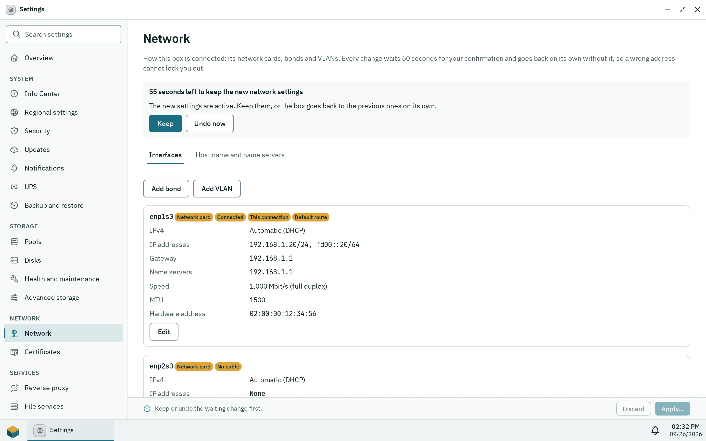

Settings > **Network** (administrators only) shows the box's network cards and changes their addresses, bonds, VLANs, host name, name servers and default route. Every change waits 60 seconds for your confirmation and goes back on its own without it, so a wrong address cannot lock you out. If you do lock yourself out, the console menu on the box itself resets the network.

## Cards and addresses

The page lists network cards, bonds and VLANs with their state (Connected, No cable, Off), IPv4 method (Automatic (DHCP), Static, Off, Set outside Pithyx), addresses, gateway, name servers, hardware address, MTU, speed and duplex. A card without settings uses DHCP.

Per interface you can switch it on or off, choose IPv4 DHCP, static or off, and IPv6 automatic (router and DHCPv6), static or off. A static address is written with its prefix length, for example `192.168.1.10/24` or `2001:db8::10/64`; the gateway is optional and must be inside the network. The MTU is 1280 to 9000 (576 to 9000 with IPv6 off); empty means 1500. **Back to DHCP** removes a card's own settings.

Changes are collected as a draft ("Changes not applied yet") and applied together with **Apply…**, or dropped with **Discard changes**. Pithyx refuses a change that would leave the box without any interface that has an address ([`network.config.unreachable`](/docs/reference/errors/#network.config.unreachable)). Pithyx writes systemd-networkd and systemd-resolved files for this; there is no Wi-Fi or bridge setting. The firewall is set with the file services (see [Security](/docs/admin/security/#open-ports)).

## Bonds

**Add bond** combines at least one card (cards with their own settings must go back to DHCP first) in a mode:

- **Active-backup**: one card carries the traffic, another takes over when its cable fails. Works with every switch; you can pick a primary card.
- **LACP (802.3ad)**: all cards together; the switch ports must form an LACP group. The LACP rate is Slow (every 30 seconds) or Fast (every second).
- **Adaptive load balancing**: all cards send and receive without help from the switch.

Names of bonds and VLANs have up to 15 lowercase letters, digits, dots, hyphens or underscores, start with a letter, and must not start with a prefix that Docker, the apps' networks, containers or VPNs use: `px-`, `veth`, `docker`, `br-`, `ve-`, `vb-`, `vz-`, `vt-`, `virbr`, `tun`, `tap` or `wg`.

## VLANs

**Add VLAN** takes a parent (a card or a bond) and a VLAN ID from 1 to 4094, as the switch port tags it (802.1Q).

## DNS, search domains and the default route

The card "Host name and name servers" holds:

- **Host name**: letters, digits and hyphens, 1 to 63 characters, no leading or trailing hyphen. Windows networks see its first 15 characters.
- **Name servers**: up to 4. Empty uses the ones DHCP announces; set ones replace them.
- **Search domains**: up to 6.
- **Default route via**: Automatic, or a chosen interface that is enabled and has settings and a gateway.

## The confirmation timer

_After Apply the page counts down. Without Keep the box goes back to the previous settings._

After **Apply…** a banner shows "{seconds} left to keep the new network settings" with **Keep** and **Undo now**. Without confirmation within 60 seconds, after **Undo now**, after a failed apply ([`network.apply.failed`](/docs/reference/errors/#network.apply.failed)) or after a daemon restart, the previous settings come back. Only one change can wait at a time. If the page stops answering because the address changed, open the box at its new address and keep the change there; the dialog lists the addresses.

:::note
Backups do not contain network settings (see [Backup and restore](/docs/admin/backup/)), because cards are named differently on other hardware.
:::

## Locked out: the console menu

On the box's own screen, the console shows the addresses and a menu that needs no password, because physical access is the proof:

- `[s]` Set a static address: card number, address with prefix length, gateway (empty for none) and name servers (empty keeps them). The same 60 second timer applies.
- `[r]` Reset the network to DHCP: after "Reset every network card to DHCP and remove bonds, VLANs and name servers? [y/N]", every card goes back to DHCP. The host name stays. No timer.
- While a change waits: `[k]` keep it, `[u]` undo it.

Only IPv4 static addresses can be set from the console.
