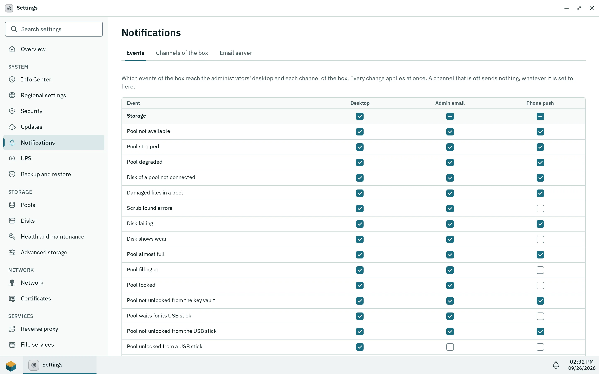

Notifications show up in the desktop of everyone they are for. Channels take them further: an email, or an HTTP POST to a webhook such as a self-hosted [ntfy](https://ntfy.sh) or Gotify server. So a degraded pool or a failed update reaches you also when no desktop is open.

There are two kinds of channels:

- **Channels of the box**, in Settings > **Notifications** (administrators only), get the system's own alerts once for all administrators: storage problems, updates, the UPS, repeated failed sign-ins, certificates that could not be renewed and more.
- **A user's own channels**, in **Personal settings** under **Notification channels**, get what reaches that user in the desktop: their job results, alerts for administrators, and messages of apps that may send beyond the desktop. Every user can add up to 10, administrators too.

## The email server

Email channels send through one SMTP server, which an administrator sets in Settings > **Notifications** > **Email server**: its name, the port, the encryption (**TLS**, usually port 465, **STARTTLS**, usually 587, or **None**, only for a server in the local network), a user name and password if it needs them, and the sender address; **Apply** in the bar at the bottom saves them and **Discard** drops the changes. The password is never shown again; leave the field empty to keep it. An empty server name removes the server; email channels then fail with [`notifications.smtp.missing`](/docs/reference/errors/#notifications.smtp.missing), and a new one cannot be added.

Under **Test email**, **Send test email** sends a short email to the address you type, through the server as the form above has it, before or after you apply it; an empty password field uses the saved password. A failure shows the server's own words, for example a wrong password or a refused sender.

## Adding a channel

**Add channel** asks for:

- **Name**, to tell channels apart.
- **Kind**: **Email** with up to 10 addresses, or **Webhook** with an `http` or `https` address. The kind cannot change later.
- **Format** of a webhook: **JSON** sends `title`, `message` and `priority` (as Gotify reads them, so a Gotify URL with `?token=...` works as it is), plus `level`, `category`, `code`, `params`, `app`, `box` and `time`. **ntfy** sends the text as the body with the headers `Title`, `Priority` (3, 4 or 5) and `Tags`; use the topic's URL, for example `https://ntfy.example.com/my-box`.
- **Headers** of a webhook, for example `Authorization` with a token. Their values never leave the box again: the list shows only their names, and an empty value keeps the saved one.
- **Events** and **At least**, for a user's own channel: Storage, Updates, Backups, Security, Apps, System, and **Everything**, **Warnings and errors** or **Errors only**. A job's result counts for its area (a pool job for Storage, an app install for Apps); critical notifications count as errors. A channel of the box has neither: what it gets is set per event in the matrix (see below).

**Send test** sends a test message at once, also through a switched-off channel. The channel shows when it last sent something and, until a delivery works again, why the last one failed, with the server's own words ([`notifications.channel.failed`](/docs/reference/errors/#notifications.channel.failed)).

## Which events go where

Settings > **Notifications** > **Events** is a matrix of every event the box reports to its administrators, grouped by Storage, Updates, Security, Apps and System: a pool that is degraded or almost full, a failing disk, a scrub that found errors, an update that is available, installed or rolled back, repeated failed sign-ins, the UPS on battery, a certificate that was not renewed, a task of the box that failed, and more. It has one column for the administrators' **Desktop** and one per channel of the box. A checkbox applies at once; the checkbox in a group's row sets every event of the group for that column and shows a dash when only some are on.

_The matrix: every event by the desktop and the box's channels._

- An event that is off for **Desktop** reaches no administrator's desktop, and so none of their own channels either; the box's channels still get it if their column says so.
- Until you change a cell, the desktop gets every event, and a channel what its events and least level took before the matrix (a new channel of the box starts with Storage, Updates, Security and System from warnings up). A channel that is switched off sends nothing, whatever its column says.
- A user's own channels and the notifications of apps are not in the matrix; they keep their events, least level and app categories.

## What a channel gets

- The texts are in the language of the user's desktop (the box remembers the one it last used) and, for the box's channels, in the system language from Settings > **Regional settings**. Emails end with the name of the box that sent them.
- The same notification goes out at most once in 15 minutes per channel, and a channel sends at most 20 in an hour. What is held back stays in the desktop.
- An app's notification leaves the desktop only if the app has the permission **Email and webhooks** (`notifications.external`), and only to the channels of the user it is for, never to the box's channels. Apps never see the channels or their addresses.

## Privacy and security

- The box connects only to the email server and the webhook addresses you set; nothing goes to the Pithyx project.
- A webhook never reaches the box itself: `localhost`, loopback and link-local addresses are refused ([`notifications.channel.invalid`](/docs/reference/errors/#notifications.channel.invalid)), also when a name resolves to them, and a redirect is not followed. Addresses in the local network are allowed, so a self-hosted push server works.
- Passwords and header values never appear in the logs, and of a webhook at most its host and port. The channels and the email server are part of the configuration backup (channels with **Users and groups**, the email server with **System settings**).
