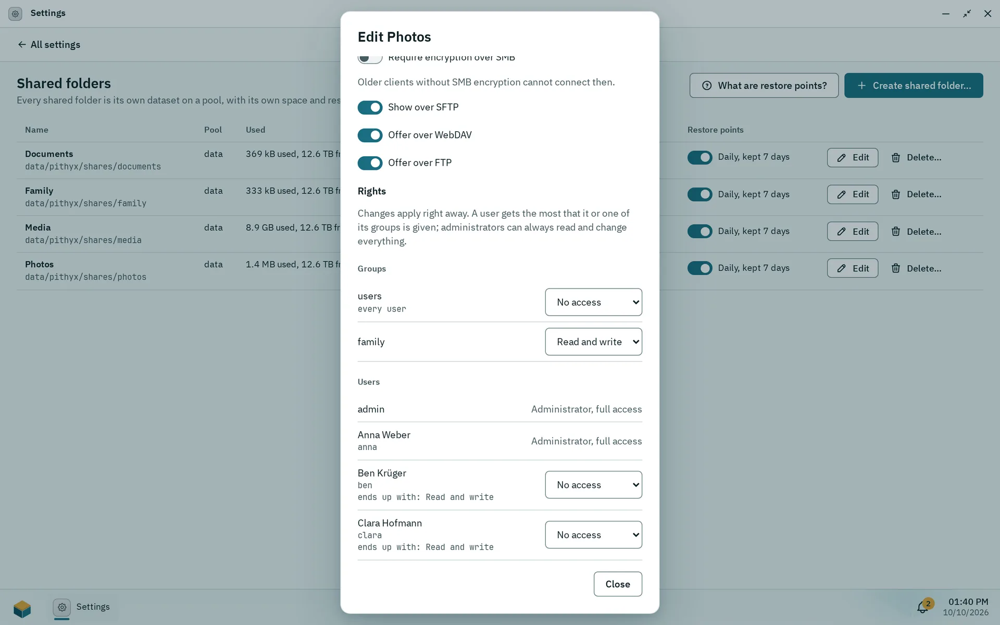

A shared folder is a ZFS dataset of its own on a pool, with its own space, rights and snapshots. Administrators create them in Settings > **Shared folders**; users see only the folders they have a right to. Deleted files go to a recycle bin (30 days by default) and daily restore points keep seven days of older versions.

## Creating a shared folder

1. Open Settings > **Shared folders** and choose **Create shared folder…**.
2. Enter a **Name**, pick the **Pool** and, if you like, a **Description (optional)**.
3. Check **Show commands** if you want to see what runs, then choose **Create shared folder**.

If no pool exists, the dialog says "No pool is ready for shared folders yet. Create a pool in Storage first."

The name has 1 to 64 characters: letters, digits, spaces, dots, dashes and underscores, not starting with a dot, unique without regard to case ([`fs.share.invalid`](/docs/reference/errors/#fs.share.invalid), [`fs.share.exists`](/docs/reference/errors/#fs.share.exists)). The description has at most 200 characters on one line. The names `global`, `homes`, `printers`, `print$` and `ipc$` are reserved. The dataset gets a name derived from the folder name (lowercase, accents folded, other characters turned into `-`) at `<pool>/pithyx/shares/<name>`, mounted at `/<pool>/<dataset-name>`.

New folders start with restore points on. To limit the size of a shared folder, set a quota on its dataset in Storage (**Limits…**); the dialog has no size field.

:::note
Registering an existing folder as a shared folder works only on development machines ([`fs.share.folder_dev_only`](/docs/reference/errors/#fs.share.folder_dev_only)). On a normal box every shared folder is a new dataset.
:::

## Rules for folders

_The edit dialog of a shared folder: network access per protocol and rights per group and user._

The edit dialog has three parts.

- **Name and description.** Renaming changes only the name users see; the dataset keeps its name.
- **Rights.** Per user and per group: no access, read, or read and write. A user gets the most that it or one of its groups is given, and administrators can always read and change everything. Every user is in the group users, shown as "every user". Changes apply right away. See [Permissions](/docs/admin/permissions/).
- **Network access.** Switches **Offer over SMB**, **Show over SFTP**, **Offer over WebDAV** and **Offer over FTP**, all on by default, and **Require encryption over SMB** (off by default; older clients without SMB encryption cannot connect then). A user needs both the protocol right and the folder switch. See [File services](/docs/admin/file-services/).

The overview table shows Name, Pool, Used, Description, Rights and Restore points. A user without any right does not see the folder at all ([`fs.share.not_found`](/docs/reference/errors/#fs.share.not_found)). If its pool is not connected, stopped or not mounted, the folder is unavailable ([`fs.share.unavailable`](/docs/reference/errors/#fs.share.unavailable)).

:::danger[Deleting a shared folder]
Deleting asks you to type the folder name and to choose: **Keep the data** (the dataset and files stay and remain visible in Storage) or **Delete the data for good** (dataset, files and every snapshot, no undo).
:::

## Recycle bin and retention

Every shared folder has a hidden folder `.pithyx-trash` at its root. Deleting in Files moves items there, and so do deletes over SMB and WebDAV. The bin lists where each item came from, when it was deleted and when it goes for good, and offers **Restore**, **Delete for good** and **Empty recycle bin**. How users work with it is in [Files](/docs/user/files/#the-recycle-bin).

The retention is per folder: 30 days by default, 0 keeps items until the bin is emptied, at most 3650 days. A cleanup runs hourly. Only administrators can change the retention, and the desktop has no setting for it today; it can only be set through the API (`PUT /api/shares/{shareId}/trash`, [`fs.trash.retention_invalid`](/docs/reference/errors/#fs.trash.retention_invalid) for a bad value). The bin shows "Deleted items are kept for {days} days."

## Restore points

Restore points are daily snapshots kept for 7 days. They only use space for files that changed or were deleted, and a deleted file frees its space after the last point holding it expires. Users restore older versions with **Previous versions** in Files, and Windows shows them as "Previous versions". They help against accidental deletion and ransomware but are no replacement for a backup on another device, because they live on the same disks. Restore points are not available for a shared folder registered from an existing folder (development machines only), because it has no dataset of its own.

## Encryption over SMB

The per-folder switch **Require encryption over SMB** sets `server smb encrypt = required` for that folder; otherwise encryption is used when the client supports it. The server always requires SMB 3 and signing. This is separate from pool encryption, which is not available (see [Storage](/docs/admin/storage/#encryption)).
