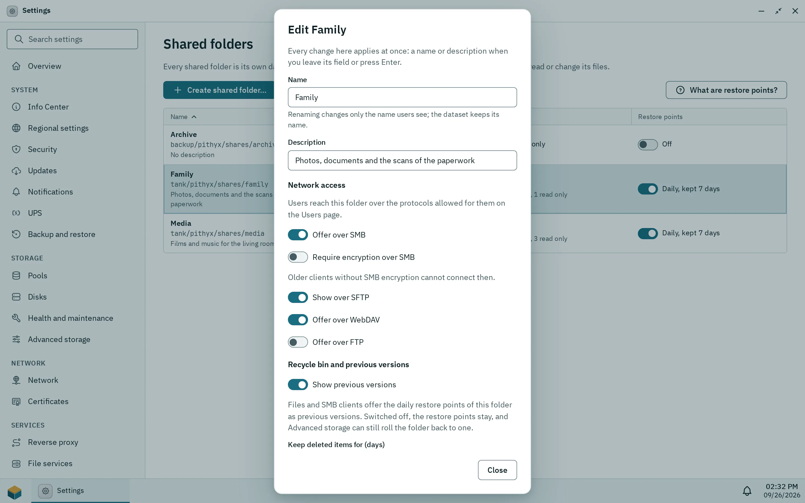

A shared folder is a ZFS dataset of its own on a pool, with its own space, rights and snapshots. Administrators create them in Settings > **Shared folders**; users see only the folders they have a right to. Deleted files go to a recycle bin (30 days by default) and daily restore points keep seven days of older versions.

## Creating a shared folder

1. Open Settings > **Shared folders** and choose **Create shared folder…**.
2. Enter a **Name**, pick the **Pool** and, if you like, a **Description (optional)**.
3. Check **Show commands** if you want to see what runs, then choose **Create shared folder**.

If no pool exists, the dialog says "No pool is ready for shared folders yet. Create a pool under Storage first." **Go to the pools…** opens Settings > **Pools**.

The name has 1 to 64 characters: letters, digits, spaces, dots, dashes and underscores, not starting with a dot, unique without regard to case ([`fs.share.invalid`](/docs/reference/errors/#fs.share.invalid), [`fs.share.exists`](/docs/reference/errors/#fs.share.exists)). The description has at most 200 characters on one line. The names `global`, `home`, `homes`, `apps`, `printers`, `print$` and `ipc$` are reserved ([`fs.share.name_reserved`](/docs/reference/errors/#fs.share.name_reserved)); `home` and `homes` are the [home folders](/docs/admin/home-folders/), `apps` is the [Apps folder](#the-apps-folder). The dataset gets a name derived from the folder name (lowercase, accents folded, other characters turned into `-`) at `<pool>/pithyx/shares/<name>`, mounted at `/<pool>/<dataset-name>`.

New folders start with restore points on. To limit the size of a shared folder, set a quota on its dataset under Settings > **Advanced storage** > **Show datasets** (**Limits…**); the dialog has no size field.

:::note
Registering an existing folder as a shared folder works only on development machines ([`fs.share.folder_dev_only`](/docs/reference/errors/#fs.share.folder_dev_only)). On a normal box every shared folder is a new dataset.
:::

## Rules for folders

_The edit dialog of a shared folder: network access per protocol and rights per group and user._

The edit dialog has three parts.

- **Name and description.** Renaming changes only the name users see; the dataset keeps its name. Like everything else in the dialog, they apply at once: when you leave the field or press Enter.
- **Rights.** Per user and per group: no access, read, or read and write. A user gets the most that it or one of its groups is given, and administrators can always read and change everything. Every user is in the group users, shown as "every user". Changes apply right away. See [Permissions](/docs/admin/permissions/).
- **Network access.** Switches **Offer over SMB**, **Show over SFTP**, **Offer over WebDAV** and **Offer over FTP**, all on by default, and **Require encryption over SMB** (off by default; older clients without SMB encryption cannot connect then). A user needs both the protocol right and the folder switch. See [File services](/docs/admin/file-services/).

The table shows each folder's name with its path and description, its pool with the space it uses, its rights and the restore points, and sorts by a click on a heading. Select a folder for **Edit** and **Delete…** in the toolbar, or double-click it to edit it. A user without any right does not see the folder at all ([`fs.share.not_found`](/docs/reference/errors/#fs.share.not_found)). If its pool is not connected, stopped or not mounted, the folder is unavailable ([`fs.share.unavailable`](/docs/reference/errors/#fs.share.unavailable)).

:::danger[Deleting a shared folder]
Deleting asks you to type the folder name and to choose: **Keep the data** (the dataset and files stay and remain visible under Storage) or **Delete the data for good** (dataset, files and every snapshot, no undo).
:::

## Recycle bin and retention

Every shared folder has a hidden folder `.pithyx-trash` at its root. Deleting in Files moves items there, and so do deletes over SMB, WebDAV and FTP. Deleting over SFTP removes files for good. The bin lists where each item came from, when it was deleted and when it goes for good, and offers **Restore**, **Delete for good** and **Empty recycle bin**. How users work with it is in [Files](/docs/user/files/#the-recycle-bin).

The retention is per folder: 30 days by default, 0 keeps items until the bin is emptied, at most 3650 days. A cleanup runs hourly. Only administrators can change the retention, and the desktop has no setting for it today; it can only be set through the API (`PUT /api/shares/{shareId}/trash`, [`fs.trash.retention_invalid`](/docs/reference/errors/#fs.trash.retention_invalid) for a bad value). The bin shows "Deleted items are kept for {days} days."

## Restore points

Restore points are daily snapshots; the newest 7 are kept (a box that was off for a while keeps its last points instead of losing them). They only use space for files that changed or were deleted, and a deleted file frees its space after the last point holding it expires. Each folder has a switch in the column **Restore points** ("Daily, kept 7 days" or "Off"); **What are restore points?** explains them to the user. Users restore older versions with **Previous versions** in Files, and Windows shows them as "Previous versions". They help against accidental deletion and ransomware but are no replacement for a backup on another device, because they live on the same disks. Restore points are not available for a shared folder registered from an existing folder (development machines only), because it has no dataset of its own.

## Encryption over SMB

The per-folder switch **Require encryption over SMB** sets `server smb encrypt = required` for that folder; otherwise a connection is encrypted when the client asks for it. The server always requires SMB 3 and signing. This is separate from pool encryption, which encrypts the data on the disks (see [Storage](/docs/admin/storage/#encryption)).

## The Apps folder

**Apps** is a shared folder the box makes itself: one folder per app on the app pool, named after the app's id (`com.example.chat`), with the app's data and nothing else of it (the app's `volumes/`; versions and its Compose file stay hidden). It appears once an app is installed, in Files and over SMB, and never over SFTP, WebDAV or FTP. Settings > **Shared folders** lists it with the badge **System**; it cannot be renamed, described or deleted ([`fs.share.system`](/docs/reference/errors/#fs.share.system)), and its edit dialog offers only **Offer over SMB**, **Require encryption over SMB** and the rights.

Only administrators have Apps. Giving it to a user or a group, or raising read to read and write, asks first: Apps holds the data of every app, which may include personal data of every user. **Give access** applies the change and every other administrator gets a notification; a request without the confirmation fails with [`fs.apps.confirmation_required`](/docs/reference/errors/#fs.apps.confirmation_required). The same question comes from the user and group dialogs under Settings > **Users and groups**.

What changes in an app's folder:

- **The top level is the box's.** The folders come and go with the apps; nothing can be created, renamed or deleted next to them ([`fs.apps.root_fixed`](/docs/reference/errors/#fs.apps.root_fixed)). Inside an app's folder, whoever may write can change anything.
- **No recycle bin and no previous versions.** Deleting in Apps is permanent, in Files after a confirmation, over SMB at once ([`fs.apps.trash_unsupported`](/docs/reference/errors/#fs.apps.trash_unsupported) for a move to the bin). The column **Restore points** says "None".
- **New files belong to the app.** What Files or SMB creates in an app's folder gets the folder's owner, the app's user id (or the remapped root of an app that runs as root), and no rights for anybody else, so the app can use it. Nobody can change owners, modes or ACLs from an SMB client.
- **Links stay inside.** A link an app made points somewhere in its container; neither Files nor SMB follows it, and no path leads from one app's folder into another or out of Apps.
- **Moving between apps is a copy.** Each app's folder is a file system of its own, so a move from one app's folder into another's copies the files and then deletes the originals: in Files that takes as long as a copy, and over SMB the computer does the same or refuses the move (then copy and delete by hand). The copies belong to the other app.
- **Uninstalled apps.** When an uninstall keeps the data, the folder stays and Files marks it **Not installed**. Deleting the data removes it.

Files warns before something is changed in the folder of an app whose backend runs, because the app may have those files open; over SMB nothing can warn, and the dialog that gives access says so. Before an app's data is deleted, or its pool exported or destroyed, the box ends every SMB connection to Apps, so files open there are closed without saving; the uninstall dialog says when somebody is connected.
