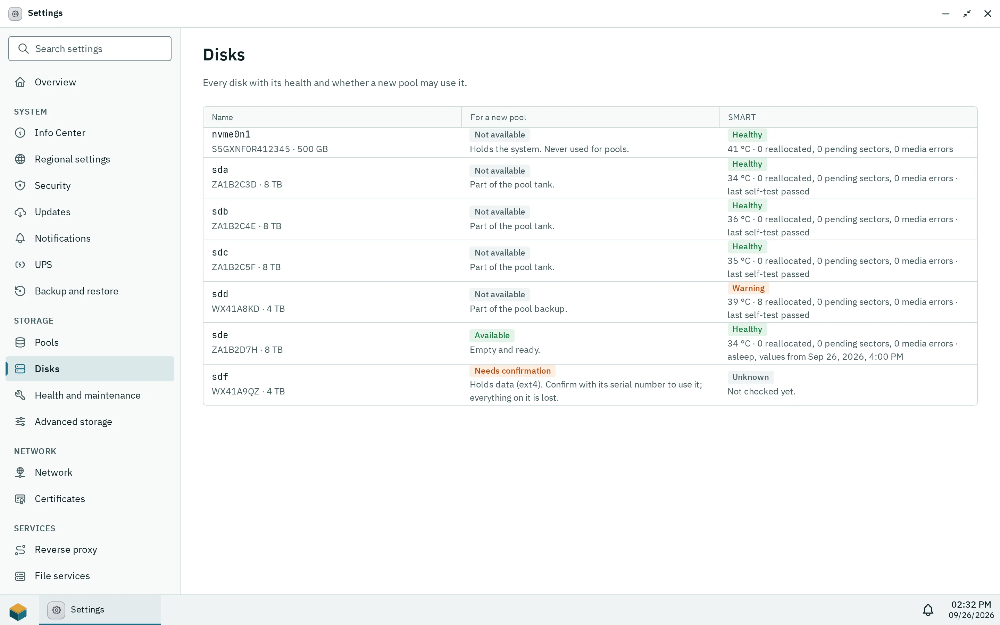
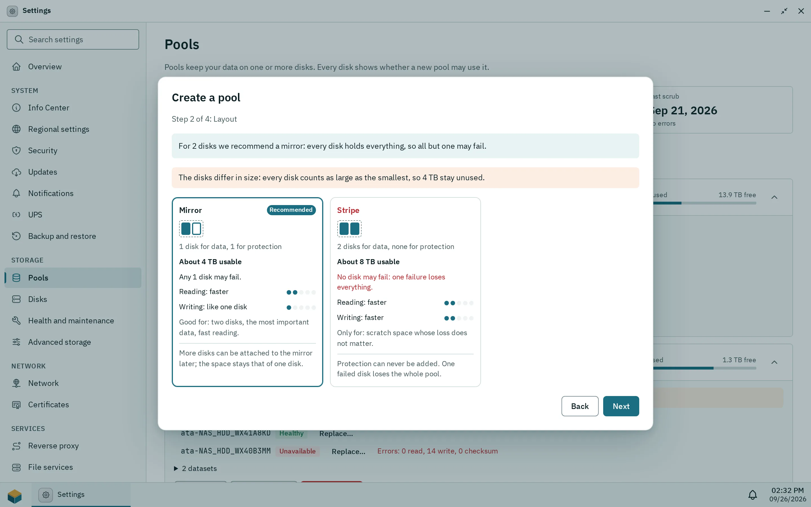

The Storage app (administrators only) creates and manages the ZFS pools that hold all data on the box. Pithyx never uses the system disk for a pool, shows for every disk whether it may be used, and asks you to type the disk's serial number before it wipes a disk that holds data. Changes run in the background, and **Show commands** lists the exact commands before anything runs.

## Disk verdicts

_The Disks tab says for every disk whether a new pool may use it._

The column **For a new pool** shows one of three verdicts per disk: **Available**, **Needs confirmation** or **Not available**. Pithyx re-checks the verdict right before each command of a plan, so a disk that changed after you looked is caught.

A disk is **Not available** when:

- it holds the system (`/`, `/boot`, `/boot/efi` or `/var/lib/pithyx`, also through partitions, LVM, md or another pool): "Holds the system. Never used for pools."
- it is read-only, or a file system on it is in use;
- it is already part of a pool;
- another disk reports the same serial number, so the two cannot be told apart;
- it holds data but has no serial number to confirm with.

A disk **Needs confirmation** when it has partitions, file systems or other signatures, or has not been checked yet. For a disk with contents Pithyx says "Holds data" and lists the partitions, file systems and signatures it found. Type its serial number exactly as shown to use it. Empty disks are **Available**. A replacement disk (see below) always needs its serial, even when it is empty.

:::danger[Everything on a confirmed disk is lost]
Confirming with the serial number clears the disk: Pithyx runs `zpool labelclear -f` on pool members, then `wipefs --all` on the partitions and the disk. There is no undo. Check the serial against the label on the disk.
:::

If a disk changed after the plan was shown, nothing is changed and you get [`storage.plan.stale`](/docs/reference/errors/#storage.plan.stale). A plan expires after 10 minutes ([`storage.plan.expired`](/docs/reference/errors/#storage.plan.expired)); show it again.

## Creating a pool

_Step 2 of the wizard compares the layouts for the chosen disks and marks the recommended one._

Open Storage and choose **Create pool…**. The wizard has four steps: **Disks**, **Layout**, **Encryption** and **Name and check**, and a fifth, **Key**, for an encrypted pool (see [Encryption](#encryption)). Disks are addressed by their `/dev/disk/by-id` names, so a pool survives a changed port or cable.

| Layout                      | Minimum disks | Notes                            |
| --------------------------- | ------------- | -------------------------------- |
| Single disk (no redundancy) | 1             | exactly one disk                 |
| Stripe                      | 2             | one failed disk loses everything |
| Mirror                      | 2             |                                  |
| Mirror pairs                | 4             | an even number of disks          |
| RAID-Z1 / RAID-Z2 / RAID-Z3 | 3 / 4 / 5     | one / two / three disks may fail |

The wizard recommends a layout: one disk single, two disks mirror, three to five disks RAID-Z1, six or more RAID-Z2. With disks of different sizes every disk counts as large as the smallest, and the wizard tells you how much stays unused.

The pool name starts with a lowercase letter, then lowercase letters, digits, `-` or `_`, at most 32 characters. The names `mirror`, `raidz`, `raidz1` to `raidz3`, `draid`, `spare`, `log`, `cache`, `special`, `dedup` and `pithyx`, and names that start with `c0`, are reserved.

Every new pool gets the same options: `ashift=12`, `compression=lz4`, `xattr=sa`, `acltype=posixacl`, `atime=off`, `normalization=formD`. Pithyx then creates its dataset layout below `<pool>/pithyx`: `shares`, `homes`, `apps`, `system` and `cache` (quota 2.5 GiB, no compression, no automatic snapshots). A pool that Pithyx did not create has no `pithyx` dataset, and Pithyx creates nothing on it ([`storage.pool.not_prepared`](/docs/reference/errors/#storage.pool.not_prepared)).

Other pool actions: **Replace…** (always asks for the serial), **Add hot spare…**, **Remove spare** and **Destroy pool…**.

:::danger[Destroying a pool]
**Destroy pool…** lists every dataset that goes with the pool and asks you to type the pool name ([`storage.pool.name_mismatch`](/docs/reference/errors/#storage.pool.name_mismatch) if it differs). Destroying or exporting is refused while disks are missing ([`storage.pool.disks_missing`](/docs/reference/errors/#storage.pool.disks_missing)) or the pool is suspended.
:::

A pool shows one of these states: Healthy, Degraded, Faulted, Offline, Unavailable, Removed, Suspended, Unknown or "Not connected". On a degraded pool a disk that comes back is rebuilt on its own (resilver). The daemon brings a returning disk back with `zpool online` and then `zpool clear`, each with a 30 second timeout.

## Datasets and restore points

Under **Advanced**, **Datasets** > **Show datasets** lists datasets with Name, Used, Free, Limit, Compression and the folder or size. Dataset names use letters, digits, `.`, `-` and `_`, start with a letter or digit and are at most 64 characters.

- **Rename…** moves the folder; shared folders follow.
- **Limits…** sets Quota, Reservation, Compression and Record size. An empty quota or reservation means no limit. Compression: off, lz4, zle, zstd (levels 1 to 19) or gzip (1 to 9). Record size: a power of two from 4 KiB to 1 MiB, default 128 KiB.
- **Delete…** asks for the full dataset name and lists child datasets and snapshots.

Datasets of homes, apps and the system cannot be renamed or deleted ([`storage.dataset.managed`](/docs/reference/errors/#storage.dataset.managed)), and a dataset used by a shared folder must lose that shared folder first. Pithyx creates no volumes (block devices) yet: nothing in this version uses one, since iSCSI and virtual machines are not built. Volumes that exist on a pool show in the table and under Advanced, where you can delete them.

The Storage app has no snapshot section. Snapshots reach the interface as restore points: one switch per shared folder in Settings > **Shared folders**, which takes a snapshot of the folder's dataset once a day and keeps the newest 7, and **Previous versions** in Files to get older versions back. See [Shared folders](/docs/admin/shared-folders/). Manual snapshots, holds, rolling back a dataset and other schedules are not in the interface.

## Importing and exporting

**Import a pool…** scans the labels of every disk when you press **Scan disks**; the scan may wake sleeping disks and never runs by itself. A pool is first imported read-only as a preview (shown as "Read-only (preview)"): nothing is mounted and nothing changes. Then choose **Import for use…**, which imports it again and mounts the datasets that are safe to mount, or **Export** to end the preview ([`storage.import.preview_required`](/docs/reference/errors/#storage.import.preview_required) if you skip the preview).

Datasets that cannot be mounted safely stay unmounted (`canmount=noauto`) with a reason: they would cover a system folder, hide something that is mounted there, share a folder with another dataset, or are encrypted and locked. Shared folders and apps on them stop.

A pool last used by another system shows "Used by another system". It needs **Import it anyway (force)** and the pool name typed ([`storage.import.force_required`](/docs/reference/errors/#storage.import.force_required)). If the name is taken, choose **New name for the pool**. **Export…** unmounts the datasets and lists what becomes unavailable; the data stays on the disks and the pool can move to another system.

## Growing a pool

**Add disks…** adds a new group of disks (a vdev) to the pool: single, mirror (2 disks), RAID-Z1 (3), RAID-Z2 (4) or RAID-Z3 (5). The dialog warns when the new group lowers redundancy, when its layout differs from the existing ones (this needs the pool name typed), and that the disks can never be removed from the pool again.

**Expand with a disk…** widens a RAID-Z group by one disk. The pool stays usable, the step is irreversible and asks for the pool name, one expansion runs at a time ([`storage.pool.expanding`](/docs/reference/errors/#storage.pool.expanding)), and data already on the pool keeps its old ratio of data to parity until it is written again.

:::note
The Storage app has no button to turn a single disk into a mirror later.
:::

## Encryption

A pool is encrypted when it is created, or never: the wizard asks "Should the pool be encrypted?", and a pool cannot be encrypted afterwards. **Encrypt with a key** uses ZFS native encryption (AES-256-GCM) on `<pool>/pithyx`, so everything Pithyx keeps on the pool is encrypted with one key: shared folders, home folders, apps and their data, the log archive and the thumbnails. The pool's own root dataset holds no data and stays unencrypted.

### The key

The box makes the key; you cannot choose your own. The step **Key** shows it once, as `PXPK-` followed by 56 characters in groups of four. Copy it, **Download** it as a text file or **Print** it, keep it away from the box, and confirm **I stored the key somewhere safe, away from the box.** and type the two groups of four it asks for from your copy before you go on. The sheet also carries the key in hex with the commands that open the pool without Pithyx. The last characters check the others, so a typo is caught as [`storage.encryption.key_invalid`](/docs/reference/errors/#storage.encryption.key_invalid) before the pool is asked; when typing, dashes, spaces and upper or lower case do not matter.

:::danger[Without the key, the data is gone]
Pithyx has no way around a lost key. Keep the key even when the key vault holds it: the vault is on the system disk, which a reinstall replaces, and it is never part of a [configuration backup](/docs/admin/backup/).
:::

### Unlocking

The wizard asks how the pool unlocks, and **Automatically at every start, from the key vault** is preselected:

- **Automatically at every start, from the key vault**: the box keeps the key in a vault on its system disk (`/var/lib/pithyx/pool-keys/`, one file per pool, readable by root only) and unlocks the pool every time it starts or the pool is imported. That protects the data on disks that are stolen or thrown away, not on a stolen box: whoever has the box has the vault too.
- **By hand after every start**: the pool stays locked after every start until an administrator types its key. This also protects the data when the whole box is stolen.

A locked pool shows **Locked** and **Unlock…**. Unlocking loads the key and mounts the datasets the same way an import does (nothing that would hide a system folder). Its shared folders, home folders and apps are unavailable while it is locked: Files and the file services say so, and apps on the pool do not start. With **Keep the key in the key vault and unlock the pool automatically at every start** the typed key goes into the vault once it opened the pool. If the vault's key does not open a pool (it was changed elsewhere), the pool stays locked and the card says so; type the key. A key that is valid but belongs to another pool is refused with [`storage.encryption.key_wrong`](/docs/reference/errors/#storage.encryption.key_wrong).

An encrypted pool on another box, or after a reinstall, is imported like any other pool; it stays locked until you unlock it with its key.

### Changing the key and the vault

**Change key…** on an unlocked pool makes a new key, shows it like the wizard and changes the pool's key only after you confirmed you stored it; the old key stops working at once. The data is not rewritten. The dialog also decides whether the new key goes into the vault.

**Remove key from vault…** deletes the pool's key from the vault. The pool stays unlocked until the box restarts and then waits for its key. Destroying a pool also deletes its key from the vault. To put a key into the vault, choose **Unlock…**, type the key and tick the vault option: the key is checked against the pool first, also when the pool is unlocked already. Changing the key stores the new one, too.

**Show key…** shows the key from the vault again after your password and, with two-factor sign-in on, an authenticator code; use it when your copy is lost.

### USB stick

**Write key to USB stick…** on the card of an encrypted pool writes its key to a USB stick, a memory card or another removable disk with a FAT, exFAT or ext file system: a file `pithyx-keys/<pool GUID>.key` that holds the key in hex, next to whatever else is on the stick. Pithyx never formats a stick, and it only offers sticks nothing else uses (none mounted elsewhere, none part of a pool). The key is the one you type, or the vault's after your password and, with two-factor sign-in on, an authenticator code. Either is checked against the pool before it is written, and the file is read back before the dialog says it is done. **Remove the key from the key vault afterwards** is ticked: with the key still in the vault, the box would unlock the pool without the stick.

Whenever a stick with the key is plugged in, at start or later, the box unlocks the pool that waits for it; it mounts the stick read-only only while it reads the file. Then the stick can be pulled: **the pool stays unlocked until the box restarts**, and the card and a notification say so. After a restart the pool waits for the stick again. Any stick with the file works, so a second stick can be a spare.

:::caution[Whoever has the stick and the disks has the data]
Like the vault, a stick protects the data on stolen disks; it protects the data on a stolen box only while the stick is not with the box. Keep it apart from the box, and keep your copy of the key as well: a stick can break.
:::

A stick whose key does not open the pool (an older key after **Change key…**, or a damaged file) leaves the pool locked and untouched, with a critical storage alert: unlock it with the key, then write the key to the stick again. **Change key…** warns when a stick holds the current key.

Keys go to ZFS on standard input, never as a command argument, and never appear in a log, a plan or the pool itself. Administrators get a storage alert while a pool waits for its key or its stick. What to do when something goes wrong, including opening a pool without Pithyx: [Encrypted pools: when something goes wrong](/docs/admin/encryption-emergencies/).

## Health and warnings

Administrators get a desktop notification when a storage alert appears or worsens, and a second one that starts with "Resolved:" and names the problem when it clears. Alerts cover: pool suspended, degraded, faulted or offline, a missing disk, data errors, scrub errors, a pool 80 percent full (warning) or 90 percent full (critical), and failing or worrying SMART values. You can mute an alert for yourself.

- **Scrub now**, pause, resume and stop. A schedule per pool: Off, Weekly or Monthly (default Monthly).
- SMART is read with `smartctl -n standby` (30 second timeout), so sleeping disks stay asleep. States: Healthy, Warning, Failing, No SMART, Unknown. Short self-tests run weekly and long ones monthly by default; a sleeping disk is skipped and retried later, never woken.
