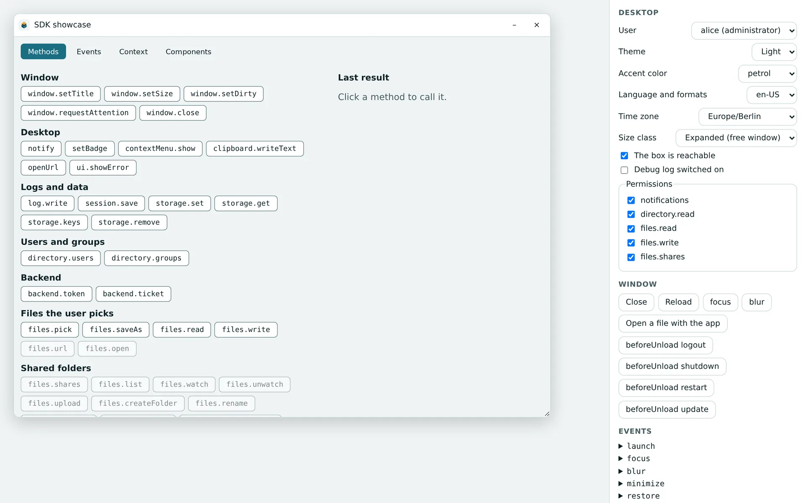
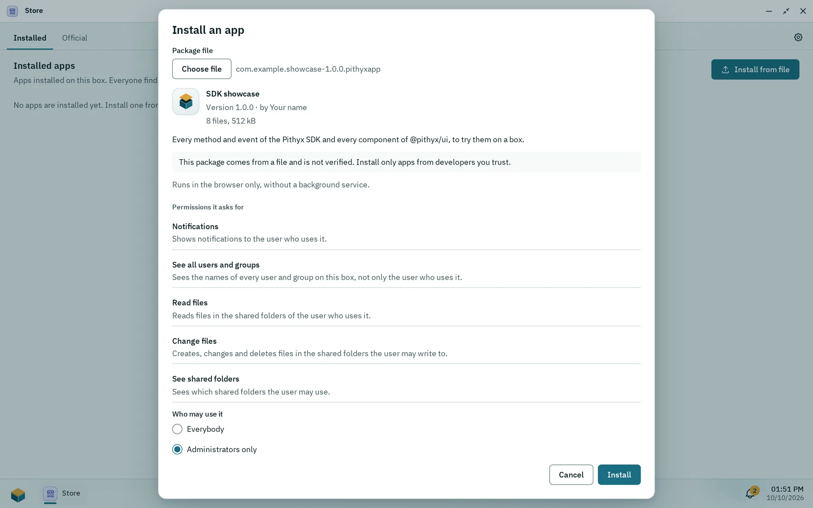

This page takes an app from an empty project to a package you can install: build the frontend, try it on your own computer with the mock desktop of `pithyx dev`, check it with `pithyx validate` and write the package with `pithyx pack`. There is no development mode on the box; you test on the box by installing the package.

## Set up the project

The `pithyx` command has no command that creates a project. Start from any frontend project (the examples use Vite) and add the files the CLI expects at the project root:

- `pithyx.json`, the [manifest](/docs/developers/apps/manifest/). Add `"$schema": "./node_modules/@pithyx/sdk/schema/manifest.v2.schema.json"` for editor support.
- `icon.svg`. The CLI package ships a `template-icon.svg`; `pithyx validate` warns while `icon.svg` is still that icon.
- The built frontend in `dist/` (change the folder with `--frontend <folder>`). Your `entry` must be `frontend/<file>.html`; the content of `dist/` becomes `frontend/` in the package.

Install the packages and connect:

```sh
npm install @pithyx/sdk
npm install --save-dev @pithyx/cli
```

```ts
import { connect } from '@pithyx/sdk';

const app = await connect();
```

The CLI needs Node.js 22.12 or newer. Its Vite plugin (`@pithyx/cli/vite`, Vite 7 or newer) sets the build's base path to `./` so relative asset paths work under `/apps/<id>/`:

```ts
import pithyx from '@pithyx/cli/vite';
import { defineConfig } from 'vite';

export default defineConfig({ plugins: [pithyx()] });
```

## pithyx dev



_The mock desktop of pithyx dev: the side panel changes the user, theme, language and permissions the app sees._

`pithyx dev` starts a mock desktop on `http://127.0.0.1:7400/` (change it with `--port` and `--host`), opens your built frontend in the same sandbox the box uses, and proxies `/apps/<id>/api*` to your backend. After a change, rebuild the frontend and reload.

With the Vite plugin you can run `vite` instead: the mock desktop joins the dev server, the base becomes `/apps/<id>/`, and hot reload works.

The mock desktop has three users (alice, an administrator; bob, in two groups; carol, in none) and a panel to change the theme, accent, language, time zone, size class, online state and permissions, and to see the backend status, storage and events.

A backend runs with `docker compose up --wait --build`. The CLI uses `backend/compose.dev.yaml` if it exists, otherwise the pinned `backend/compose.yaml`, and publishes each endpoint's port on `127.0.0.1` for the proxy. (The box never publishes ports.) Without Docker:

- `--endpoint name=url` (repeatable) sends an endpoint to a server you started yourself and does not start Docker for it.
- `--no-docker` does not start the backend; endpoints without `--endpoint` answer 503.

Press Ctrl+C to stop; the CLI runs `docker compose down` and keeps volumes.

## Build the package

1. Build the frontend (for example `vite build`).
2. `pithyx validate` checks `pithyx.json`, the icon, the layout, the entry file in the built frontend, the Compose file and the image lock. It prints `<level> <code>: <text>` and exits with 1 on errors. It uses the same validators as the box and the same error codes. Before `pithyx build` (which needs Docker) it checks `backend/compose.dev.yaml` instead and warns `cli.backend.unbuilt`.
3. With a backend, make the Compose file pinned by digest: either `pithyx lock` (resolves the images of `backend/compose.yaml` and writes `backend/images.lock.json` for amd64 and arm64; registries are asked anonymously or with the credentials in `~/.docker/config.json`) or `pithyx build` (builds the services of `backend/compose.dev.yaml` that have `build:` and writes both files).
4. `pithyx pack [--out <file.pithyxapp or folder>] [--images]` validates again and writes the package. `--images` adds the images for offline installs and needs Docker.

Details of every command are on [@pithyx/cli](/docs/sdk/cli/).

## Install it on a box



_Install from file shows the package before it installs: the unverified warning, its permissions and who may use it._

Only an administrator can install a package.

1. Open the Store, then **Installed**, and choose **Install from file**.
2. Choose the `.pithyxapp` file. The dialog **Install an app** shows the version and whether this is an install, update, reinstall or downgrade, the author, the file count and size, and the warning "This package comes from a file and is not verified."
3. Review the permissions the app asks for, the folders it wants, whether it has a backend, whether it runs as root, and who may use it.
4. On the first app install of the box, choose the pool for app data; every app keeps its files there. Without a pool the dialog says to create one in Settings > Pools first.
5. Confirm. Installing runs as a job.

After the install, an administrator maps the app's storage requests to shared folders and can revoke permissions. An update that asks for a new permission waits for the administrator's confirmation and the old version keeps running. An update takes a snapshot of the app's data; a rollback returns to the previous version with its data. See [Apps and the Store](/docs/admin/apps-and-store/).

### Install from a script

The Store does nothing a script cannot do with the [REST API](/docs/reference/api/apps/). Sign in as an administrator, upload the package, then install it as a job:

```sh
BOX=https://box.local:7484
curl -sS --cacert root-ca.crt -c cookies -H 'X-Pithyx-Request: 1' -H 'Content-Type: application/json' \
  -d '{"username":"admin","password":"..."}' "$BOX/api/auth/login"
curl -sS --cacert root-ca.crt -b cookies -H 'X-Pithyx-Request: 1' -H 'Content-Type: application/gzip' \
  -X PUT --data-binary @com.example.notes-1.0.0.pithyxapp "$BOX/api/apps/packages"
# The answer is the preview: packageId, action, manifest (with its permissions), addedPermissions, keptData, suggestedAccess, pool.
curl -sS --cacert root-ca.crt -b cookies -H 'X-Pithyx-Request: 1' -H 'Content-Type: application/json' \
  -d '{"pool":"tank","access":"everybody"}' "$BOX/api/apps/packages/<packageId>/install"
# 202 with the job; follow it with GET /api/jobs/<id> until its state is succeeded or failed.
```

- `root-ca.crt` is the box's own certificate authority from `$BOX/api/system/tls/root-ca.crt` (see [Certificates](/docs/admin/certificates/)).
- An account with two-factor sign-in gets a `challenge` from the first call and completes it with `POST /api/auth/login/totp`.
- `pool` is needed only for the first app of the box; `access` (`everybody` or `admins`) defaults to the preview's `suggestedAccess`. A checked package waits 15 minutes for its install.
