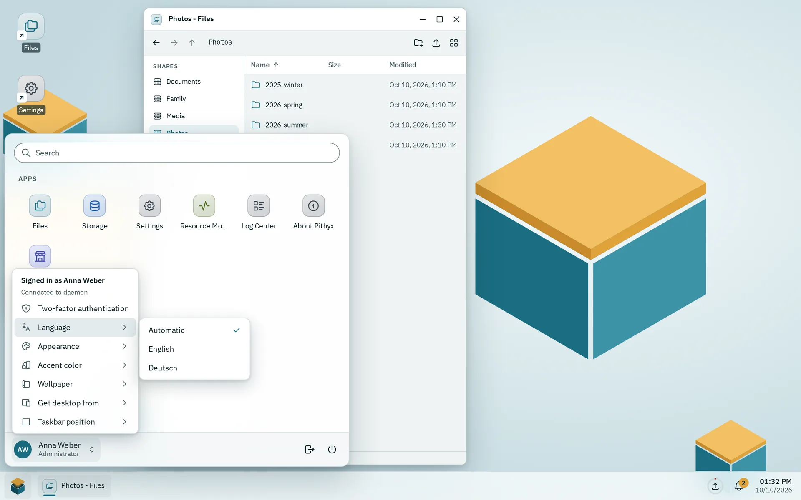

All visible text in the desktop comes from translation files in `i18n/`, English as the reference and German as a required second language. Messages use ICU MessageFormat, the build compiles them ahead of time, and tests fail when a key exists in one language but not the other.

## Keys

- Files are `i18n/<locale>/<namespace>.json`. Today the locales are `en` and `de`, and the namespaces are `auth`, `cli`, `desktop`, `errors`, `files`, `installer`, `jobs`, `logs`, `monitor`, `network`, `notifications`, `settings`, `storage`, `store`, `ui`, `users` and `viewer`.
- Keys are dotted paths in nested JSON, named `area.screen.element`, for example `menu.themeChoice.system`. Error texts are under `errors.<code>`.
- TypeScript checks keys against the English files. There are no string literals in JSX (ESLint, `jsx-text-only` mode).
- German uses the informal "du". Texts never name companies or their products.
- `ui.json` belongs to `@pithyx/ui` and `cli.json` to the mock desktop of `pithyx dev`; the desktop does not load them.
- **Chunking.** The namespaces `desktop`, `auth` and `errors` load before the first render, `notifications` and `jobs` load with the desktop chunk, and every other namespace loads when its app opens (`loadTranslations('files')`). Only the active language is loaded. There is no fallback language, so every language needs every key.

## ICU messages



_The Language submenu offers Automatic and each language in its own name._

Messages use ICU syntax with parameters, plurals and selects:

```json
"windowCount": "{count, plural, one {# window} other {# windows}}"
```

- The build compiles messages to a small syntax tree (`desktop/scripts/compile-messages.ts`), so the production bundle does not ship the ICU parser.
- At runtime a missing or wrong parameter makes the text show its key. A text that shows its key may also mean the namespace is not loaded.
- Tags in messages stay plain text; use `<Trans>` for markup.
- The daemon renders the same messages for texts that leave the API (out-of-band channels) with `IcuMessageFormatter`. A shared test file, `tools/i18n/icu-golden.json`, must give the same result in the desktop (Vitest) and the daemon (xUnit).
- Dates and numbers use `Intl` with the format locale: the language plus the system region, for example `de-AT`. Plural rules follow the language only. Dates are stored in UTC and formatted per user time zone.

**Choosing the language.** In order: the saved choice (`localStorage` key `pithyx.language`, per browser), the browser's language list, the system language from the setup information, then English. The account menu's **Language** submenu offers **Automatic** plus each language in its own name. The system language is set in Settings under **Regional settings**.

## Adding a language

There is no single list of languages. Adding one today means editing these places:

1. Create `i18n/<code>/` with every file that `i18n/en` has.
2. Add the code to `languages` in `desktop/src/i18n.ts`, and update the two places there that hard-code `'en'` and `'de'` (language detection and the stored choice).
3. Add the locale to `ariaLocales` in `desktop/vite.config.ts` (texts of React Aria).
4. Add it to `SystemRegion.Languages` in the daemon (`SystemSettings/SystemContracts.cs`).
5. Update the other lists: the matrix in `tools/design-shots/matrix.ts` and the test `sdk/src/i18n.test.ts`.

The website has its own language files (`website/src/content/i18n/` and `website/src/content/docs/de/`).

Checks that run in `pnpm test`: the same keys in every language, the same files in every language, a text for every SDK transport code and every API error code, a text for every core app, and valid ICU syntax everywhere. The daemon tests check that each error code has an English and a German text.

## Error texts

The API returns a code and parameters, never translated text. The desktop looks the code up as `errors.<code>` with the parameters (`translateError`). The JSON path follows the code, so `app.app.busy` is `errors.app.app.busy`. A failed `fetch` uses the code `network`. The error notice is announced with `role="alert"` and logs the code and request id to the console.

SDK transport codes (`sdk.*`) have their texts under `errors.sdk.*`. The English text of each code is also what the daemon returns as `detail`.
