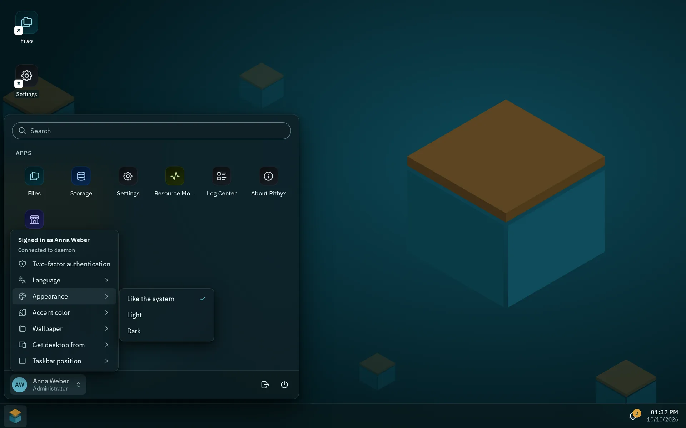

All colors, spacing, type sizes, radii, shadows and motion of the desktop come from one file, `packages/ui/tokens.css`, as CSS custom properties. The file adapts to light and dark with `light-dark()`, offers six accent presets, and works without React.

## Tokens

`tokens.css` is the only token file. The desktop imports it through `desktop/src/theme/index.css`; other projects import `@pithyx/ui/tokens.css`. Component styles are CSS modules.

| Group   | Names                                                                                                                                                                                                                                          |
| ------- | ---------------------------------------------------------------------------------------------------------------------------------------------------------------------------------------------------------------------------------------------- |
| Palette | `--petrol-50` to `--petrol-950`, `--amber-*`, `--neutral-*`, status colors                                                                                                                                                                     |
| Color   | `--color-bg`, `--color-surface-1` to `-3`, `--color-text`, `--color-border`, `--color-focus`, `--color-success`, `--color-warning`, `--color-danger` and more                                                                                  |
| Shell   | `--color-desktop`, `--color-taskbar`, `--color-window-border`, `--color-titlebar`, `--color-note`, `--color-shell-bar`, `--color-shell-menu`                                                                                                   |
| State   | `--color-selection-strong` and `--color-selection-outline` (selected rows and the active navigation item), `--color-info`, `--color-neutral-state` with their `-surface`                                                                       |
| Accent  | `--color-accent`, `-hover`, `-pressed`, `-contrast`, `-subtle`                                                                                                                                                                                 |
| Type    | `--font-sans`, `--font-display`, `--font-mono`, `--font-size-xs` (0.75 rem) to `--font-size-display-2` (2.5 rem)                                                                                                                               |
| Spacing | `--space-0` (2 px), `--space-1` (4 px) to `--space-7` (48 px)                                                                                                                                                                                  |
| Radius  | `--radius-xs` (4 px) to `--radius-lg` (14 px), `--radius-full`; by role `--radius-tag` (3 px), `--radius-control` (4 px), `--radius-card` (5 px), `--radius-window` (6 px)                                                                     |
| Motion  | `--duration-instant` (100 ms) to `--duration-slow` (400 ms), `--ease-standard`                                                                                                                                                                 |
| Layers  | `--z-*` from desktop (0) and windows (100) to tooltip (9000)                                                                                                                                                                                   |
| Sizes   | `--touch-target` 44 px, `--control-height` 36 px, `--taskbar-size` 52 px, `--titlebar-height` 40 px                                                                                                                                            |
| Density | `--row-height` 28 px, `--row-height-md` 36 px, `--row-height-lg` 42 px, `--toolbar-control-height` 32 px, `--nav-width` 260 px, `--details-width` 280 px, `--form-label-width` 200 px, `--form-control-width` 360 px, `--taskbar-height` 44 px |

Adaptations in the file: on `(pointer: coarse)` devices controls, title bars, table rows, navigation items and toolbar controls grow to 44 px and the taskbar to 60 px (`--taskbar-height` to 52 px). With `prefers-reduced-motion: reduce` the durations drop to 1 ms. With `prefers-reduced-transparency: reduce` or forced colors, the taskbar and menus are solid.

**For third-party apps.** Apps in the sandbox do not read these names. The SDK sets a separate, stable set of `--pithyx-*` properties on the app's root element (for example `--pithyx-color-background`, `--pithyx-color-accent`, `--pithyx-font-ui`, `--pithyx-space`). See [@pithyx/sdk](/docs/sdk/sdk/). The internal `--color-*` names may change.

The tokens of the design pass (D394) are the radii by role, the density group and the shell, selection and state colors; the patterns of [`@pithyx/ui`](/docs/sdk/ui/) use them. `--taskbar-height` is for the full-width taskbar of the design pass; the current taskbar still uses `--taskbar-size`.

A test (`packages/ui/src/contrast.test.ts`) parses `tokens.css`, resolves every theme and accent and requires a contrast of at least 4.5 for text and 3 for graphics (WCAG 2.2 AA).

## Light and dark

_Appearance in the account menu; Personal settings has it too, with Accent color and Wallpaper._

The root element has `color-scheme: light dark`, and every semantic color is a `light-dark(a, b)` pair. Setting `data-theme="light"` or `data-theme="dark"` on `<html>` forces a scheme.

The account menu and Personal settings have **Appearance** with **Like the system**, **Light** and **Dark**. The choice is saved per browser in `localStorage` (`pithyx.theme`); "like the system" removes the key. The stored choice is applied before the first render, so the page does not flash.

## Accents

There are six presets: petrol (the default), ocean, indigo, plum, moss and graphite. The row in Personal settings is **Accent color**. The preset is set with `<html data-accent="...">`. The list is curated on purpose: no free color picker, because every preset is contrast-checked in both themes, and no red preset, so an accent never looks like an error.

The accent and the wallpaper (**Pithyx boxes** or **Plain**) are saved on the daemon per user and are the same on every device (`PUT /api/desktop/appearance`). The browser keeps a copy so that the first paint matches. To add an accent, add it to `ACCENTS` in `desktop/src/theme/appearance.ts`, add a `[data-accent='x']` block with the five accent tokens to `tokens.css`, and add `menu.accents.x` in English and German.

## Fonts

The desktop uses three families, all under the SIL Open Font License 1.1, self-hosted as woff2 files in `desktop/public/fonts/` and shipped unmodified:

- **IBM Plex Sans** for the interface (400, italic, 500, 600),
- **Sora** for the word mark and large headings (600, 700),
- **JetBrains Mono** for the terminal, logs and paths (400, 600).

Nothing loads from an external font service. Plex's reserved font name means the files must never be subset, converted or renamed. `tools/fonts/fetch-fonts.sh` downloads pinned versions with checksum verification and is only needed to update them. The licenses are listed in the About app.
