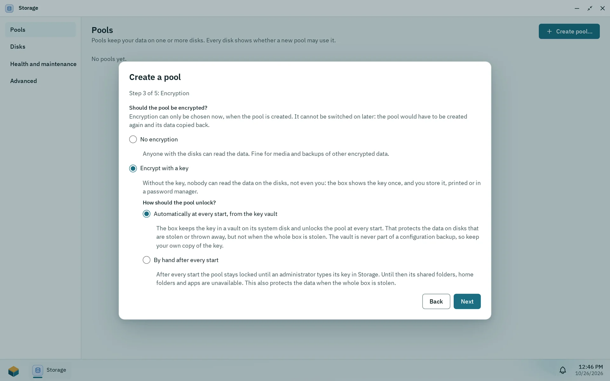

The installer creates the owner account, so a freshly installed box has no separate setup wizard: you sign in at `https://<box-address>:7484`. The browser warns once about the box's own certificate; continue, and see [Certificates](/docs/admin/certificates/) to trust the box on your devices. What is left is to keep the recovery key safe, create a pool for your data and add users. A pool does not exist yet after the installation.

## The owner account

The owner account is the administrator you created in step 4 of the installer. It can do everything, and it is the only account that exists at first. Root stays locked and SSH is off.

To sign in, enter your **User name** and **Password** on the page **Welcome back** and click **Sign in**. After five wrong attempts for the same user name and address within five minutes, sign-in pauses for a short time.

A setup page (**Set up Pithyx**, **Create administrator**) exists too. It appears only when a box has no users at all, for example after a reset. On a box installed with the installer you do not see it.

Two-factor sign-in is optional. To turn it on, open the Pithyx menu, click your name and choose **Two-factor authentication**. See [Your account](/docs/user/account/).

## The recovery key

The recovery key is shown once, at the end of the installation. It looks like `PTHX-` followed by letters and digits in groups of four. It is the only way to reset an administrator password without another administrator. The box stores only a hash of it, so nobody can show it again.

- Print it or store it in a password manager.
- Do not keep it only on the box.
- There is one key for the whole box. It works for any administrator account.
- When you use it, it is replaced: the reset shows a new key and the old one stops working. Resetting also turns off the administrator's two-factor sign-in and ends their sessions.
- The configuration backup contains the recovery key.

If you lose the key and the password, the system has to be reinstalled. See [Recovery and reinstall](/docs/install/recovery/).

## The first pool

_Step 3 of the pool wizard: encryption can only be chosen when the pool is created._

All of your data lives on ZFS pools, and the box starts without one. Create the first pool in the Storage app, which only administrators can open:

1. Open the Pithyx menu and start **Storage**.
2. Click **Create pool…**.
3. Pick the disks, a layout, whether to encrypt, and a name. The steps are **Disks**, **Layout**, **Encryption**, **Name and check**, and **Key** for an encrypted pool.
4. Click **Create pool**.

Notes:

- A disk that holds data asks you to type its serial number before it can be used. The system disk is never offered.
- Encryption can only be chosen now. **Encrypt with a key** shows the pool's key once: store it away from the box before you go on, because without it the data is lost. See [Encryption](/docs/admin/storage/#encryption).
- The wizard can **Show commands** it will run.
- Pool names start with a lowercase letter and may contain lowercase letters, digits, hyphens and underscores.
- You can close the window while the pool is created; a notification tells you when it is done.

Users get a home folder on the first pool with the Pithyx layout once one exists ([Home folders](/docs/admin/home-folders/)). Apps need an app pool, which an administrator picks when installing the first app. Shared folders live on a pool as well. See [Storage](/docs/admin/storage/) and [Shared folders](/docs/admin/shared-folders/).

## Adding users

Pithyx has no invitation links. An administrator creates each account:

1. Open Settings > **Users**.
2. Click **Create user** and enter a user name, an optional display name and a password. Every user is also in the group `users`.
3. Give the person the password in person or through another safe channel.
4. Set the rights with the **Rights** dialog.

A new user can sign in to the desktop, use SMB and open the apps Files and Viewer. Everything else must be granted: other file services (SFTP, WebDAV, FTP), SSH, restart and shut down, the other apps and access to each shared folder. Administrators have all rights.

Users cannot change their own password. An administrator sets a new one with **New password**. See [Users and groups](/docs/admin/users-and-groups/) and [Permissions](/docs/admin/permissions/).

A good last step is a configuration backup. See [Backup and restore](/docs/admin/backup/).
