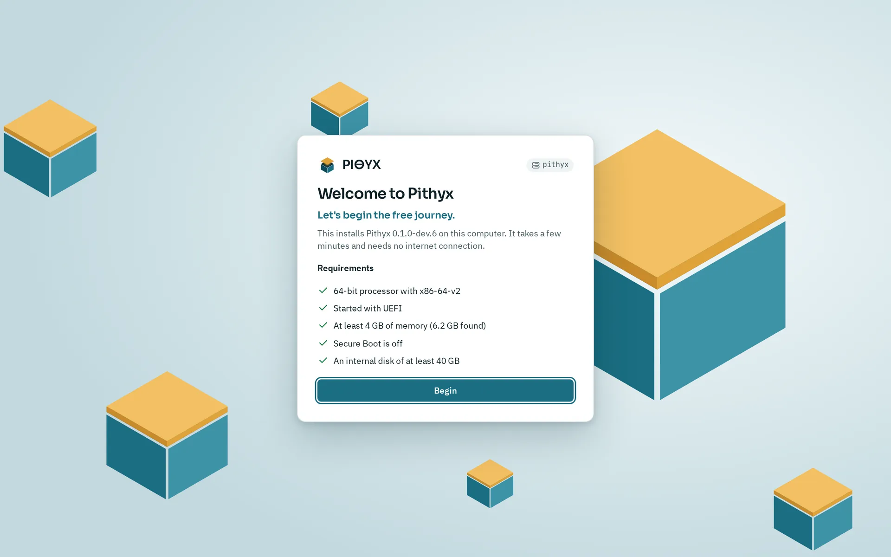
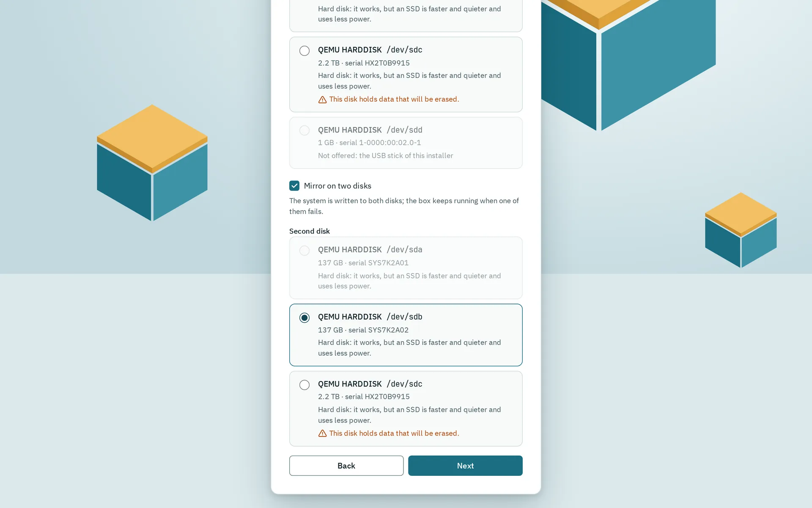
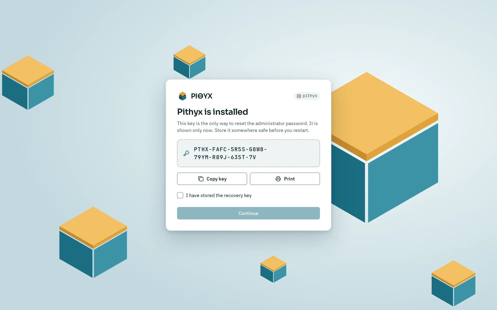

The installer runs in a browser on another device, not on the computer you are installing. You start the computer from the USB stick, open the address shown on its console, and answer five steps: name and region, network, system disk, administrator account and a summary. It erases the system disks you choose, installs Pithyx and shows you a recovery key. It takes a few minutes and needs no internet connection.

## Opening the installer

1. Start the computer from the stick (see [Firmware and boot](/docs/install/firmware-and-boot/)).
2. Read the address on the console, for example `http://192.168.1.50:7484`. IPv6 addresses appear as `http://[address]:7484`. Port 80 forwards to port 7484.
3. Open the address in a browser on a phone, tablet or computer in the same network. The console also shows a QR code for the first address.
4. The page opens with **Welcome to Pithyx** in English or German, following your browser; the language switch below the card changes it. Check the requirements and click **Begin**. The language you picked carries over to step 1, where you choose the language of the box.

The first browser that opens the page owns the installation. Another browser sees **Installation in use** and cannot continue. The console names the address that owns it. To start over, restart the computer from the stick. Do not close the browser during the installation.

## What the checks mean

_The installer lists its five checks before the first step._

The first page, **Requirements**, shows five checks. **Begin** stays disabled until all pass.

| Check                           | What it needs                                          |
| ------------------------------- | ------------------------------------------------------ |
| 64-bit processor with x86-64-v2 | A processor with SSE4.2 and POPCNT                     |
| Started with UEFI               | Firmware in UEFI mode, not legacy (BIOS) mode          |
| At least 2 GB of memory         | The page shows how much it found, and hints below 4 GB |
| Secure Boot is off              | Switch it off in the firmware                          |
| A disk of at least 32 GB        | The stick of this installer does not count             |

Each failed check shows what to do. See [Hardware requirements](/docs/getting-started/requirements/).

## Name and region (step 1)

- **Name of the NAS**: the name of the box, default `pithyx`. Lowercase letters, digits and hyphens, 1 to 63 characters, no hyphen at the start or end.
- **Language**: English or German for the box.
- **Formats**: the region for dates and numbers, or **Follow each user's language**.
- **Time zone**: prefilled from your browser.
- **Time servers (optional)**: separated by commas. Leave empty for the defaults.
- **Keyboard layout of the console**: applies to the installed box.

## Network (step 2)

The page lists every network card with its state: **Connected**, **No cable** or **No address yet**. By default each connected card gets its address by DHCP. For a card, open **Settings of** and the card's name to choose **Fixed address** and, if needed, **Name servers (optional)**. Click **Test connection** to try the settings for a moment: the page may lose its connection for a few seconds, and the result says whether the gateway answers. The settings are always rolled back after the test, whether it succeeded or not. Without changes, the test checks the cards as they are. Below, **After the installation the box answers at** shows the address you will use.

Bonds, VLANs and further options come after the installation, in Settings under Network. See [Network](/docs/admin/network/).

## System disk and mirror (step 3)

_Step 3 with the mirror switched on: the second disk is chosen from the same list._

Pick the disk for the system. Each disk is listed with its model, size and serial number. Disks that cannot be used are greyed out with the reason (the stick of this installer, read only, in use, too small). A disk that holds data shows "This disk holds data that will be erased." A USB disk or a memory card can be chosen but carries a warning that it wears out quickly under the system's writes (see [Hardware requirements](/docs/getting-started/requirements/#disks-and-pools)); built-in eMMC carries none.

- To install on two disks as a mirror, switch on **Mirror on two disks** and choose a **Second disk**. The system is written to both disks and the box keeps running when one fails. The option only appears when two usable disks exist.
- With one disk, the system is still built as a mirror with one member.

Your data does not go on the system disk. You create pools on other disks later in Settings > Pools.

## Administrator account (step 4)

This is the first user of the box. Fill in:

- **User name**: lowercase letters, digits, hyphens and underscores, starting with a letter or underscore, at most 32 characters. Names such as `root` and `docker` are reserved.
- **Display name (optional)**
- **Password** and **Repeat password**: at least 8 characters, and not a widely used password.

Root stays locked. This account gets administrator rights, is the owner account and may use `sudo` over SSH. See [First setup](/docs/install/first-setup/).

## Summary and installation (step 5)

The summary lists the name, language, time zone, keyboard and administrator, and under **These disks will be erased** the disks that will be wiped. Tick **All data on these disks will be erased** and click **Install Pithyx**. Disks you did not choose are not touched.

The page then shows **Installing Pithyx** with these steps: **Partitioning the disks**, **Creating the mirror**, **Creating the file systems**, **Copying the system**, **Writing the settings**, **Installing the boot loader** and **Finishing**. Keep the computer switched on. The step **Creating the mirror** appears even with one disk.

If a step fails, the page shows **The installation failed**, which step failed and the command with its exit code. Click **Change the settings** to go back. Nothing is installed completely after a failure, and you can try again.

## After the restart

_The recovery key appears once, when the installation ends. This one belongs to a deleted test machine._

When the installation ends, the page shows **Pithyx is installed** and your recovery key. Copy or print it, tick **I have stored the recovery key** and click **Continue**. Then the page says **Remove the USB stick**. Remove the stick and click **Restart now**.

The page then shows **Pithyx is starting** and opens the new system by itself as soon as it answers. The installed box speaks HTTPS with a certificate it made itself, so the browser warns once; continue to the page. This can take a few minutes. If nothing happens, open the address `https://<box-address>:7484` yourself. The box usually keeps its address, because the network card identifies itself in the same way, but a router could hand out a different one. The console of the installed box shows the current addresses.

Sign in with the administrator account you created. Then continue with [First setup](/docs/install/first-setup/).
