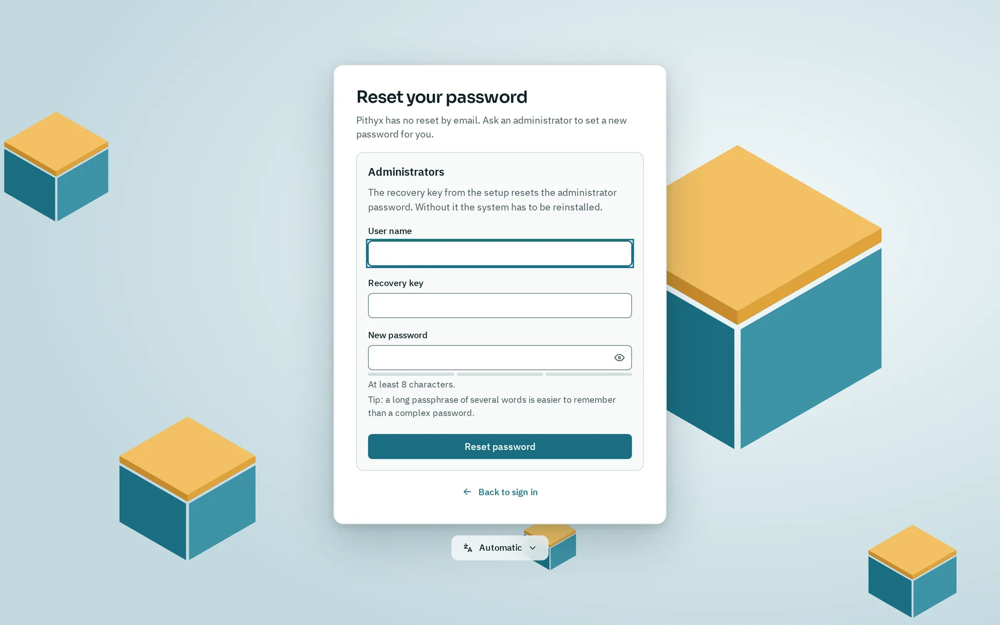

Pithyx has no password reset by email. A user who forgot a password asks an administrator; an administrator uses the recovery key from the installation. If the key is lost too, the system has to be reinstalled. A reinstall erases only the system disk or disks you choose, and your pools can be imported again afterwards.

## Forgotten password

_Forgot password? opens this form. Only administrators can reset their password here, with the recovery key._

**A normal user** asks an administrator. The administrator opens Settings > **Users** and uses **New password** for that user. The user is signed out everywhere and signs in with the new password. File services (SMB and SFTP) get the new password too.

**An administrator** uses the recovery key:

1. On the sign-in page, click **Forgot password?**.
2. Enter your **User name**, the **Recovery key** and a **New password**.
3. Click **Reset password**.
4. The page shows a new recovery key. Store it. The old one no longer works.
5. Sign in with the new password.

What the reset does: it changes the password, turns off two-factor sign-in for that administrator and ends their sessions. It works for any administrator account, including a deactivated one. Anything wrong (user name, key, or an account that is not an administrator) gives the same message, "The user name or recovery key is incorrect." After five failed attempts within five minutes, further attempts are paused for a short time.

**Another administrator** can also set your password in Settings > **Users**, if one is still signed in.

If you lost the recovery key and no administrator can sign in, nothing resets the password. Reinstall (see below). There is no password reset on the console.

**Lost your authenticator app?** Sign in with **Use a recovery code instead** and one of your 10 recovery codes. See [Your account](/docs/user/account/).

## System disk failed

- **Mirror:** if you installed on two disks, the box still starts with one disk missing, because the boot loader sits on both and is kept in sync after every update. The administrators get the notification "A system disk is missing" once per failure. The interface cannot replace a failed system disk; the way back to two disks is a reinstall.
- **Single disk:** the system is lost, but your pools are on other disks and are not affected. Reinstall.

The system disk holds only the system and settings, so rebuilding it is meant to be easy when you have a configuration backup. Your files, apps' data and Docker's data live on the pools, not on the system disk.

## A failed update or a broken system

Before you reinstall, try the boot menu: **Pithyx recovery** (key `r`) rolls back to one of the last three system snapshots, installs an update file from a USB stick or resets the network to DHCP, and every kept snapshot has its own entry. A failed update goes back to its snapshot by itself. See [System updates](/docs/install/updates/#the-recovery-menu).

## Reinstalling

1. If the box still works, make a configuration backup first: Settings > **Backup and restore**, then **Create and download**. Choose a password; without it the backup cannot be restored, and Pithyx cannot recover it. Keep the file off the box. The backup holds users, groups and passwords, two-factor settings, the recovery key, shared folders, file service settings, schedules, system settings, and the list of installed apps. It does not hold the files on your pools. The file ends in `.pithyxbackup` and may be up to 16 MB.
2. Write a new stick and run [the web installer](/docs/install/installer/). Choose the same system disks only. The installer warns about disks that hold data. Do not select your pool disks. Disks you do not choose are not touched.
3. Sign in with the new administrator account and store the new recovery key.
4. Import your pools (next section).
5. Restore the backup: Settings > **Backup and restore**, **Choose file…**, enter the **Backup password** and click **Check backup**. Choose the parts under **What to restore**, click **Restore…** and confirm with **Restore now**. Each part you choose replaces the current one completely. Restoring users signs everyone out, and Pithyx restarts.

A backup made by a newer version of Pithyx cannot be restored. Pithyx keeps a copy of the replaced database next to the new one.

The installer itself does not restore a backup or import pools. The network settings, host name and region are entered again in the installer.

## Importing the pools again

A fresh system does not know your pools. Import them in the Storage app:

1. Open **Storage** and go to the pools.
2. Click **Import a pool…**.
3. Click **Scan disks**. The scan reads the labels of every disk and may wake a sleeping disk. It runs only when you start it.
4. Start with **Import read-only**: nothing is mounted and nothing changes. Check the datasets on the pool's card.
5. Then click **Import for use…**.

A pool that was last used by another system and not exported is marked "Used by another system". After a reinstall this is normal: the old system never exported the pool, and the new one counts as another system. Choose **Import it anyway (force)** and type the pool name. Never do this while another system still uses the pool: two systems writing to one pool destroy it.

If the name is already taken, choose a **New name for the pool**. A pool that cannot be imported usually has missing disks: connect them and scan again. See [Storage](/docs/admin/storage/).
