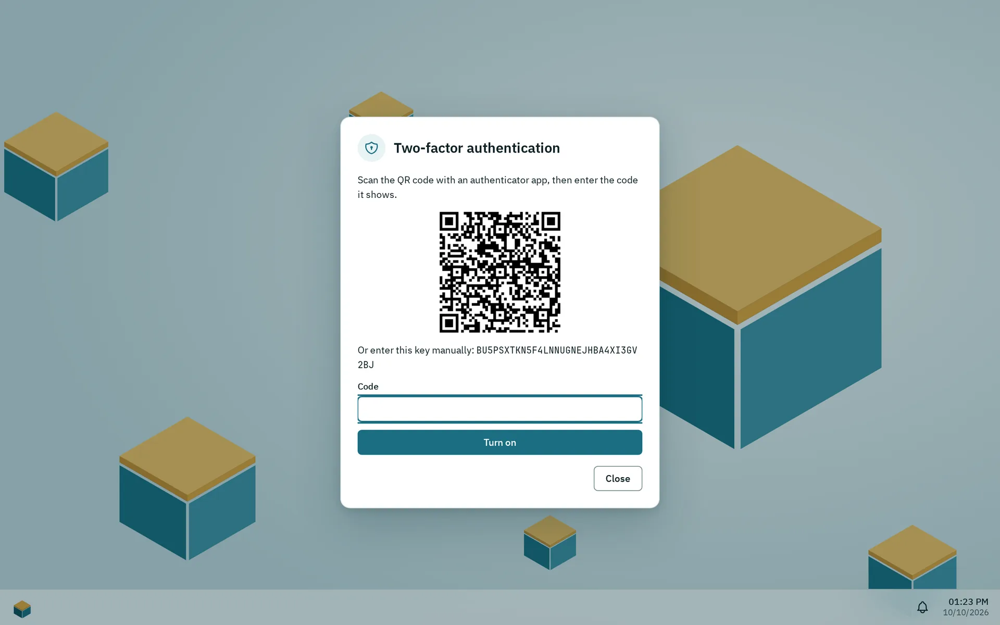
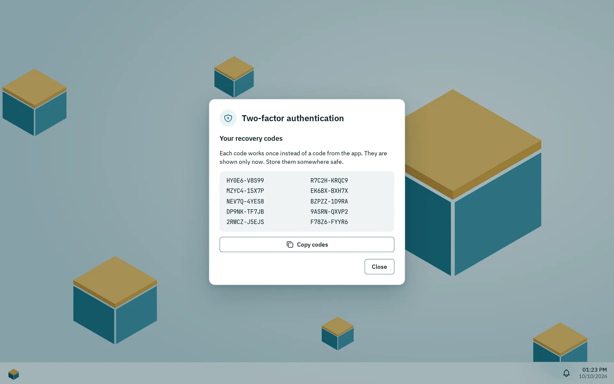

Your account is your user name and password on the box. The same password signs you in to the desktop and to file services such as SMB and SFTP. You cannot change your own password yourself: an administrator sets a new one. You can turn on two-factor sign-in, sign in with a passkey on a device that trusts the box, and choose language, theme, accent color and wallpaper.

## Changing the password

Pithyx has no way for users to change their own password and no reset by email. Ask an administrator to set a new one. The administrator does this in Settings > **Users** with **New password**. You are then signed out everywhere and sign in with the new password. File services use the new password too.

A password must have:

- at least 8 characters and at most 1024,
- no match on the built-in list of widely used passwords.

There are no rules about capital letters or symbols. A long passphrase of several words is easier to remember than a complex password. When an administrator types a new password, the page shows a strength meter (**Weak**, **Medium**, **Strong**) and hints. The meter only advises; a weak password that is long enough is accepted.

If you are an administrator and forgot your password, use the recovery key. See [Recovery and reinstall](/docs/install/recovery/).

## Two-factor sign-in

_Scan the QR code with an authenticator app, then enter the code it shows._

_After the first code the dialog shows ten recovery codes, once. These belong to a deleted test machine._

Two-factor sign-in asks for a code from an authenticator app on your phone in addition to your password. It is optional and applies per user. Any app for time-based codes works (6 digits, 30 seconds).

To turn it on:

1. Open the Pithyx menu, click your name and choose **Two-factor authentication**.
2. Click **Set up**.
3. Scan the QR code with your authenticator app, or enter the key shown below it by hand.
4. Type the code the app shows into **Code** and click **Turn on**.
5. Store the recovery codes. Pithyx shows 10 codes once. Each works one time instead of a code from the app. Click **Copy codes** and keep them somewhere safe.

When you sign in, Pithyx asks for the code after the password. Click **Use a recovery code instead** if you do not have your phone. A code can be used only once. You have five minutes to finish the second step.

To turn it off, open the same dialog, type **Your password** and click **Turn off**. Setting it up again replaces the old secret and creates new recovery codes.

:::note
Two-factor sign-in protects the desktop only. SMB, SFTP, WebDAV and FTP use your password alone.
:::

Keep the recovery codes safe. If you lose both your phone and the codes, ask an administrator for help.

## Trusting the box on this device

The box makes its own certificate, so a browser warns about it until the device trusts the box's root certificate. While it warns, the desktop shows the hint "This device does not trust the box yet, so the browser warns and passkeys stay off." with **Trust this device**; **Do not show again on this device** hides it in this browser. The same steps are in the Pithyx menu under your name, **Trust this device**, as long as the device does not trust the box.

The dialog offers **Download root certificate** and the steps for Windows, macOS, iPhone and iPad, Android, Linux and Firefox. After installing it, restart the browser, open the box again by its name and choose **Check again**; the dialog then says "This device trusts the box." Administrators find the same steps with the certificate's fingerprint in Settings > **Certificates** ([Certificates](/docs/admin/certificates/#trusting-the-box-on-a-device)).

Once the device trusts the box, the browser keeps the desktop's files in its cache and passkeys can be used.

## Passkeys

A passkey signs you in to the desktop without your password and without the two-factor code: your device asks for its PIN, fingerprint or face instead. SMB, SFTP, WebDAV and FTP keep using your password.

Passkeys need:

- a device that trusts the box (see above),
- the box opened by its name, such as `https://pithyx.local:7484`, not by an address like `https://192.168.1.20:7484`,
- a browser with passkeys (current Chrome, Edge, Firefox and Safari have them).

To add one:

1. Open the Pithyx menu, click your name and choose **Passkeys**.
2. Click **Add a passkey**.
3. Give it a **Name**, for example the device or the password manager it is kept in, type your **Current password** and click **Add**.
4. Confirm on your device. The list then shows the passkey with the name of the box it belongs to.

To sign in, click **Sign in with a passkey** on the sign-in page, or pick the passkey your browser offers in the field **User name**. The button appears only where passkeys work.

A passkey belongs to the name you opened the box under: one made at `https://pithyx.local:7484` does not work at `https://pithyx.lan:7484`. Each entry in the list shows its name under **For**, the date it was added and when it was last used; **Synced** marks one that your password manager or phone keeps on several devices. **Remove** deletes a passkey from the box; it no longer signs you in. You can have up to 20.

The same limits on failed attempts as for the password apply. A deactivated account or one without the right to sign in to the desktop cannot sign in with a passkey either. When an administrator resets their password with the recovery key, their passkeys are removed.

## Sessions and devices

Pithyx does not show a list of your sessions and cannot sign out your other devices from the desktop. What it does:

- You stay signed in for up to 7 days without using the desktop and at most 30 days in total. An open desktop keeps the session alive until the 30-day limit.
- **Sign out** ends the session of this browser only.
- When an administrator sets a new password for you or deactivates your account, all your sessions end. Your passkeys stay; a deactivated account cannot use them.
- Each browser is recognized as a device by a cookie, which the box uses to remember your windows. To copy the arrangement of another device, open your account menu and choose **Get desktop from**. See [Layout per device](/docs/user/desktop/#layout-per-device).
- An expired session shows "The session has expired. Please sign in again."

## Language, theme and accent

Open the Pithyx menu, click your name and choose:

- **Language**: **Automatic** (follows your browser, English or German) or a language by its own name. The choice belongs to this device. The sign-in page has its own language selector.
- **Appearance**: **Like the system**, **Light** or **Dark**. This also belongs to this device.
- **Accent color**: **Petrol**, **Ocean**, **Indigo**, **Plum**, **Moss** or **Graphite**. It is saved for your account and is the same on all your devices.
- **Wallpaper**: **Pithyx boxes** or **Plain**, also saved for your account.

Dates, times and number formats follow the region and time zone an administrator set in Settings.

Your display name is set by an administrator; you cannot edit it yourself.

## Notifications by email or push

Open the Pithyx menu, click your name and choose **Notification channels** to get your notifications also when no desktop is open: by **Email** (once an administrator set up the email server) or as a **Webhook** to a push service such as ntfy or Gotify. Each channel picks its **Events** and the least serious notification it gets (**At least**); **Send test** checks it at once. Up to 10 channels per user. The messages are in the language of your desktop. Details, formats and limits: [Notifications by email and webhook](/docs/admin/notifications/).
