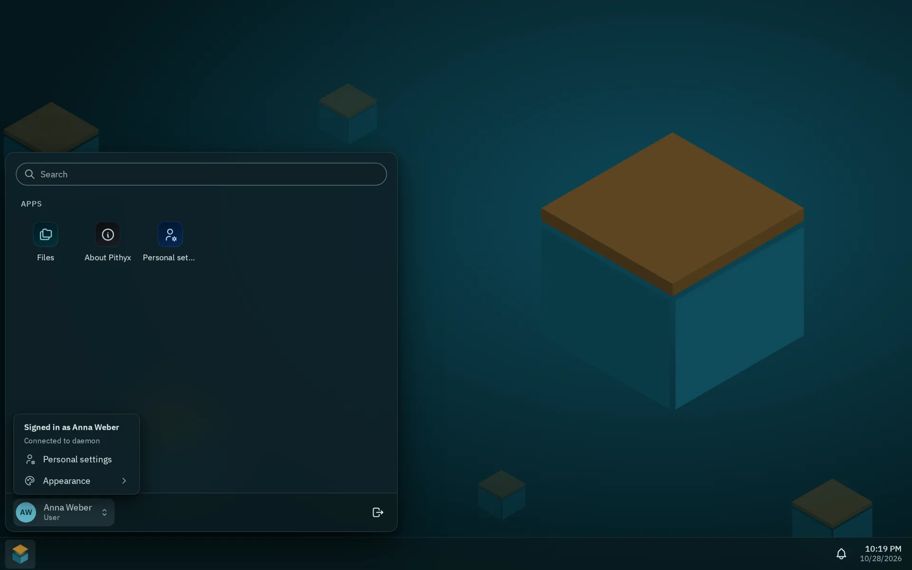
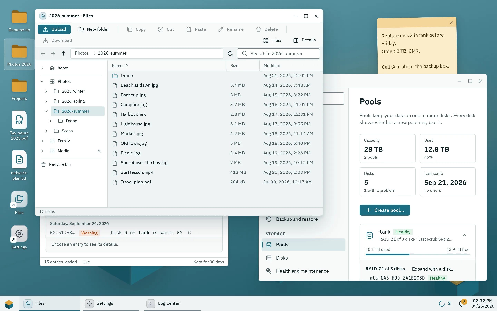

The Pithyx desktop is the page you open in your browser at `https://<box-address>:7484`. It works like a normal computer desktop: apps open in windows, a taskbar shows what is running, and you can put shortcuts and sticky notes on the desktop. The box remembers your windows for each device you use.

## Signing in

1. Open `https://<box-address>:7484` in your browser. Port 80 forwards to it.
2. Type your **User name** and **Password** and click **Sign in**.
3. If you turned on two-factor sign-in, type the code from your authenticator app and click **Verify**. If you lost your phone, click **Use a recovery code instead**.

:::caution
The first time, the browser warns about the box's own certificate; continue to the page. An administrator can make the warning go away for good with the box's root certificate ([Certificates](/docs/admin/certificates/)).
:::

You need the right **Sign in to the desktop**. If your account is deactivated or lacks the right, an administrator has to change that.

After five wrong attempts for the same user name from the same address within five minutes, sign-in pauses for a short time and tells you how many seconds to wait.

To sign out, open the Pithyx menu and click the **Sign out** button in the narrow bar at its left edge, above the power button.

Forgot your password? Click **Forgot password?** on the sign-in page. Pithyx cannot reset a password by email: ask an administrator to set a new one. Administrators can use the recovery key. See [Recovery and reinstall](/docs/install/recovery/).

The sign-in page has its own language selector in the footer. The first time the box is set up, the owner account is created in the installer; see [First setup](/docs/install/first-setup/).

## Windows and snapping

_The app icon in the title bar opens the window menu with the keyboard shortcuts for snapping._

Every app opens in a window. What you can do with a window depends on the width of your browser:

- **1024 pixels or wider:** free windows. You can move and resize them and snap them to the screen edges.
- **600 to 1023 pixels (tablets):** windows fill the screen. Snapped windows share the screen as left and right halves.
- **Under 600 pixels (phones):** one app at a time, full screen.

On a wide screen:

- Drag the title bar to move a window. Drag any edge or corner to resize it.
- Double-click the title bar to maximize the window, and again to restore it.
- Drag a window to the left or right edge to fill half of the screen, or to the top edge to maximize it. On very wide screens (2400 pixels or more) the edges give thirds.
- Drag a maximized or snapped window away from the edge to get its free size back.
- The title bar has **Minimize**, **Maximize** (or **Restore**) and **Close** buttons.
- Click the app icon at the left of the title bar, or right-click the title bar, for the window menu: **Restore**, **Move**, **Size**, **Minimize**, **Maximize**, **Snap left**, **Snap right** and **Close**. **Move** and **Size** let you use the arrow keys (16 pixels per press, with Shift 1 pixel), **Enter** to confirm and **Escape** to cancel.

New windows open slightly offset from each other. You can have at most 50 windows open. Beyond that, opening another app does nothing.

If an app does not answer for five seconds, a dialog says that the app is not responding. Click **Wait** or **Close anyway**; closing anyway loses changes the app has not saved.

## The taskbar

_The account menu opens when you click your initials at the top of the Pithyx menu's left bar._

By default the taskbar is at the bottom of the screen. From the left it has:

- the Pithyx menu button,
- one button per open window with its icon and title; the active one is underlined in the accent color, the others with a thin line,
- the app switcher, with the number of open apps,
- for administrators, the box's state: the pool that needs the most attention, the processor load and the network traffic; each opens Storage or the Resource Monitor (on screens of 1024 pixels and wider),
- the transfers button, while files are being uploaded or downloaded,
- the running tasks button,
- the notifications bell, with a badge for unread notifications,
- the clock.

When more apps run than fit, their buttons get narrower and then scroll: turn the mouse wheel over them or swipe, and the active app always comes into view. The menu button and everything from the transfers button to the clock stay in place.

Click a running app to bring it to the front. Click the active app again to minimize it. Right-click a running app (or press **Shift+F10** on it) for **Minimize** or **Restore**, **Add to desktop** and **Close**.

To move the taskbar, open **Personal settings** (in the Pithyx menu's left bar), choose **Taskbar position** and pick **Bottom**, **Top**, **Left** or **Right**. On phones the taskbar always stays at the bottom and the row is missing.

**The Pithyx menu** opens above the taskbar, attached to the button at its left, or by pressing and releasing the Windows or Command key. It has three parts:

- a narrow bar at the left: your initials (the account menu), your home folder, and at the bottom **Personal settings**, **Sign out** and, with the right, **Power options**,
- the app list with a search field, grouped into **System** (only for administrators: the apps that come with Pithyx), **Apps** and **You**,
- tiles: administrators see the state of each pool, the system (processor and memory) and the updates, each opening its app; everybody sees **Your folders**, the home folder and the shared folders with the access they have, each opening in Files.

The search field finds apps by name only; settings and files are not found there. Your account menu (click your initials) has **Personal settings** and **Appearance**. Personal settings ([Your account](/docs/user/account/#personal-settings)) also has:

- **Default apps**: the file types you chose to always open one way in Files, each with **Forget** ([Files](/docs/user/files/))
- **Open at sign-in**: tick up to 10 apps that open each time you sign in, on every device, in the order you ticked them. A reload of the page only brings back your windows, and an app that is already open is not opened twice. An app may be marked **Suggested by the app**; it is never ticked for you.
- **Notification channels**: send your notifications by email or to a push service such as ntfy or Gotify ([Account](/docs/user/account/#notifications-by-email-or-push))

**Power options** (for administrators and users with the right **Restart and shut down**) has **Restart** and **Shut down**. Both sign every user out and stop file transfers.

**Notifications.** The bell opens a panel with **Running tasks** and **Recent** notifications. Use **Dismiss**, **Mute** or **Clear all**. Press **Escape** to close the panel.

## Desktop items and notes

_Two shortcuts and a sticky note next to two open windows._

The desktop holds shortcuts to apps, files and folders, and sticky notes. They belong to your account and appear on every device. The desktop only holds links: removing a shortcut never touches the file.

- To add a shortcut, right-click an empty spot and choose **New shortcut**, then an app. Or right-click a running app in the taskbar and choose **Add to desktop**.
- To put a file or folder on the desktop, right-click it in Files and choose **Add to desktop**, or drag it from Files onto the desktop. Its shortcut opens it as a double click in Files does; its menu adds **Open with**, **Show in Files** (Files opens its folder with it selected) and, after a rename, **Use original name**. It follows renames and moves made in Files, apps, WebDAV and FTP. A change made over SMB or SFTP, a deleted file, or a shared folder you may no longer read leaves the shortcut greyed out with a broken link, and its menu only offers **Remove from desktop**.
- To add a note, right-click an empty spot and choose **New note**. A note holds up to 4000 characters and saves itself shortly after you stop typing.
- Open a shortcut with a double-click (a single tap on a touch screen), or select it and press **Enter**.
- Right-click a shortcut for **Open**, **Rename**, **Move** and **Remove from desktop**. **F2** renames, **Del** removes.
- Drag icons to move them. Drag on an empty spot to select several. Hold **Ctrl** or **Shift** to add to a selection.
- On a touch screen, press and hold for about half a second to open the menu.
- While a menu is open, a right-click on something else opens that thing's menu instead. The desktop never shows the browser's own menu, except in text fields such as a note's text.
- To delete a note, click **Remove note**. A note with text asks **Delete this note?** first. The text is deleted on all your devices.

The desktop holds at most 200 items. Icons snap to a grid. On small screens they flow in rows like a phone home screen.

## Keyboard shortcuts

These window shortcuts work anywhere on the desktop except while you type in a text field, and except inside the window of an app from the Store or a file: such an app keeps its keys to itself, so click its title bar first.

| Keys                                  | Action                                                        |
| ------------------------------------- | ------------------------------------------------------------- |
| **Alt+Shift+Left** / **Right**        | Snap the window to the left or right                          |
| **Alt+Shift+Up**                      | Maximize                                                      |
| **Alt+Shift+Down**                    | Restore a snapped or maximized window, or minimize a free one |
| **Alt+Shift+Space**                   | Open the window menu of the active window                     |
| **Alt+Shift+Page Up** / **Page Down** | Switch to the previous or next window                         |

Other keys:

- Tap and release the Windows or Command key: open or close the Pithyx menu.
- **Escape**: close the Pithyx menu, the app switcher or the notification panel.
- On the desktop: arrow keys move between icons, **Enter** opens, **F2** renames, **Del** removes, **Shift+F10** or the Menu key opens the context menu.

## Layout per device

The box remembers your windows for each browser you use: which apps are open, where, how big, the taskbar position and small details such as the folder open in Files. When you open the desktop again, the windows return. A device is recognized by a small cookie, which holds no personal data.

- Saved layouts expire 90 days after the last save.
- A window of an app that was removed, or that you may no longer use, is skipped. A notification tells you how many.
- Your desktop items, accent color and wallpaper are the same on all devices. The theme and the language belong to the device.
- To copy the arrangement of another device, open **Personal settings**, click **Get desktop from** and pick the device. If there is none, the list says **No other devices**. The desktop does not follow you between devices by itself.

## Phones and tablets

There is no separate mobile app. The same page adapts to the screen.

- On a phone, an app fills the screen. The app switcher shows the open apps as cards; tap a card to switch, or **Close all**. Swiping sideways along the taskbar also changes apps.
- The browser's back gesture minimizes the open app and takes you to the home screen instead of leaving the desktop.
- On a tablet, windows are maximized and you can snap two side by side.
- Press and hold to open menus. A single tap opens a shortcut.

Related pages: [Files](/docs/user/files/), [Using apps](/docs/user/apps/), [Your account](/docs/user/account/).
