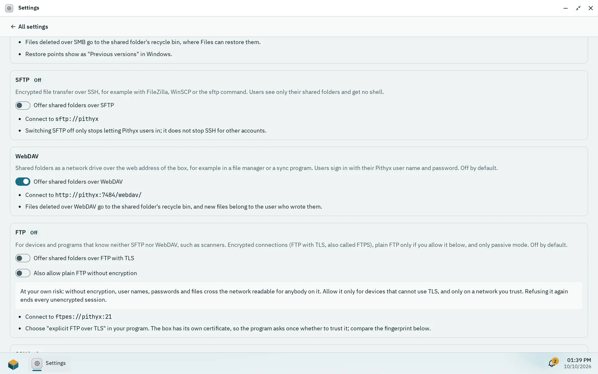

Besides the Files app, your shared folders can be opened from other computers and devices as a network drive or through a file transfer program. Pithyx offers four ways: SMB, SFTP, WebDAV and FTP. You sign in with your Pithyx user name and password. Ask an administrator which of them are switched on for you.

In the steps below, `<box-address>` is the name or IP address you use to open the desktop, for example `192.168.1.50`.

## Which protocol to use



_An administrator switches the file services on in Settings > File services; each card shows the address to use._

| Protocol   | Use it for                                                                            | Notes                                                                                  |
| ---------- | ------------------------------------------------------------------------------------- | -------------------------------------------------------------------------------------- |
| **SMB**    | A network drive on Windows, macOS and Linux for everyday work                         | Needs SMB 3. Older systems cannot connect. Previous versions and the recycle bin work. |
| **SFTP**   | Encrypted transfers with a program such as FileZilla or WinSCP, or the `sftp` command | You see only your home and shared folders and get no shell. Password sign-in only.     |
| **WebDAV** | Programs and file managers that can mount a web folder                                | Address: `https://<box-address>:7484/webdav/`                                          |
| **FTP**    | Devices that know neither SFTP nor WebDAV, such as scanners                           | Only passive mode. Encrypted with TLS; plain FTP only if an administrator allows it.   |

:::caution
The desktop and WebDAV use HTTPS. Windows and macOS mount WebDAV only once the computer trusts the box's root certificate; an administrator finds it in Settings > **Certificates**.
:::

Everyone sees only the shared folders their rights allow, with the access level an administrator gave them: no access, **Read** or **Read and write**. Administrators reach every shared folder.

## Your home folder

Besides the shared folders, every user has a private home folder that only they and the administrators can open. It is the share `home` over SMB (`\\<box-address>\home` on Windows, `smb://<box-address>/home` on macOS and Linux) and the folder `home` at the top over SFTP, WebDAV and FTP. Administrators also find every user's home in the share or folder `homes`. Files you delete in your home go to its recycle bin, except in the SMB share `homes`, where they are gone at once. See [Home folders](/docs/admin/home-folders/).

Two-factor sign-in does not apply here. These services ask for your password only.

## Windows

**SMB (network drive)**

1. Open File Explorer.
2. Click the address bar, type `\\<box-address>\` and press **Enter**.
3. Sign in with your Pithyx user name and password when asked. Tick the option to remember the credentials if you like.
4. Your shared folders appear. To keep one as a drive letter, right-click it and choose **Map network drive**.

The box does not announce itself on the network, so it does not appear under **Network** in Explorer. Always type the address. In Explorer, **Previous versions** shows the daily restore points of a shared folder. Files you delete land in the recycle bin of the shared folder, and you can restore them in the Files app.

**SFTP and FTP:** install a program such as FileZilla or WinSCP and connect to `<box-address>`.

**WebDAV:** in File Explorer, right-click **This PC**, choose **Map network drive** and enter `https://<box-address>:7484/webdav/`. Windows connects only once it trusts the box's root certificate. If it still refuses, use SMB or a WebDAV program instead.

## macOS

**SMB (network drive)**

1. In Finder, choose **Go**, then **Connect to Server**.
2. Type `smb://<box-address>/` and click **Connect**.
3. Sign in with your Pithyx user name and password.

**SFTP:** Finder cannot browse SFTP. Use an SFTP program and connect to `sftp://<box-address>`.

**WebDAV:** in **Connect to Server**, enter `https://<box-address>:7484/webdav/`. macOS connects once it trusts the box's root certificate.

**FTP:** use a program that supports FTP with TLS, and choose "explicit FTP over TLS".

## Linux

**SMB:** most file managers accept `smb://<box-address>/` in the address bar. On the command line you can mount with `mount -t cifs` and `vers=3.0`.

**SFTP:** use `sftp://<box-address>` in your file manager, or run:

```sh
sftp <user>@<box-address>
```

SFTP accepts passwords only. Public keys are not used for SFTP users.

**WebDAV:** a file manager with WebDAV support accepts `davs://<box-address>:7484/webdav/`.

**FTP:** use a client with explicit FTP over TLS, such as `lftp`.

## Phones

There is no special app. Any app that speaks SMB 3, SFTP, WebDAV or FTP with TLS can connect with the settings above. Or use the desktop itself: it works in a phone browser, including the Files app. See [The desktop](/docs/user/desktop/#phones-and-tablets).

For FTP, the box has its own certificate. Your program asks once whether to trust it. Compare the fingerprint it shows with the **Certificate fingerprint (SHA-256)** that an administrator can read in Settings, under **File services**. FTP listens on port 21 and passive data connections use ports 50000 to 50099.

## Signing in

- Use your Pithyx user name (in lower case) and password.
- Your account needs the right for the protocol: **SMB (network drives)**, **SFTP**, **WebDAV** or **FTP**. New users get the SMB right by default. An administrator gives you the others.
- Your account must be active.
- **SMB and SFTP:** if a connection with the right password is refused, sign in once on the web desktop, or ask an administrator to set a new password for you. The services learn your password that way.
- After five wrong attempts for the same user name from the same address within five minutes, further attempts are paused for a short time.
- Files you create belong to your account on the box. You cannot change permissions from Windows.
- If a protocol is switched off, you cannot connect with it. An administrator turns services on in Settings, under **File services**. See [File services](/docs/admin/file-services/).

If something does not work, the usual causes are a missing right, a deactivated account, or a protocol that is switched off.
