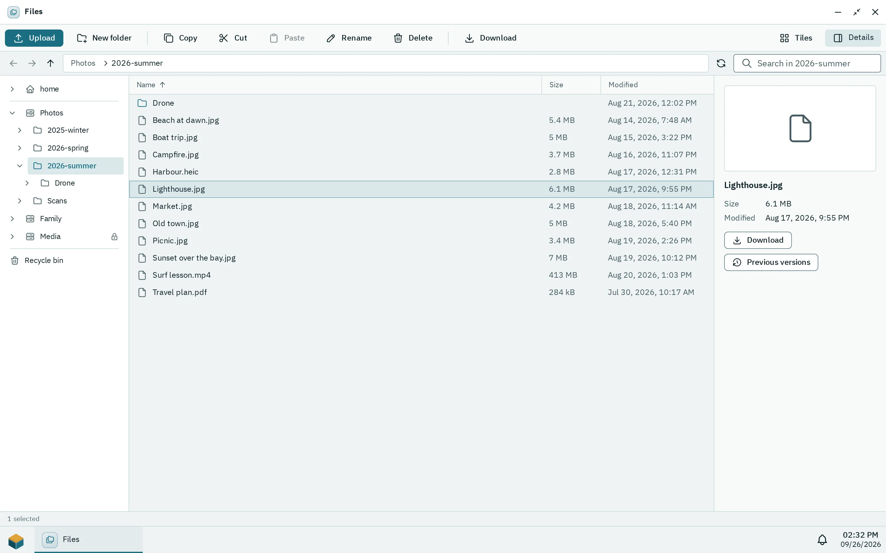
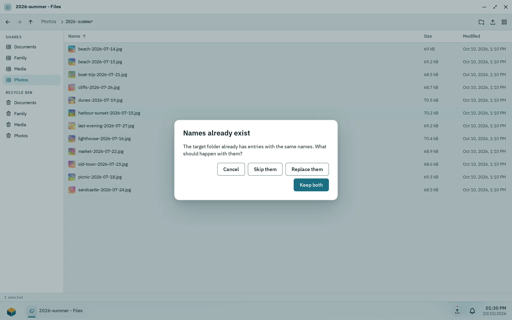
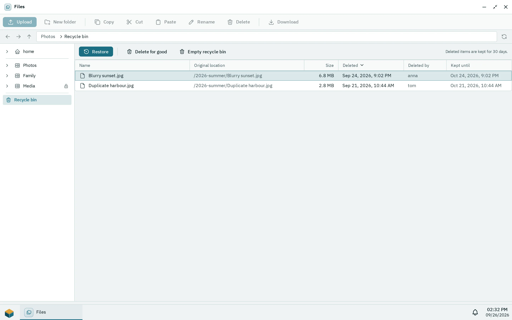

Files is the app for working with the shared folders you may use: open folders, upload and download files, copy and move them, and restore deleted files from the recycle bin. Images, PDFs, text, audio and video open in the Viewer. You need the right to use the Files app and access to at least one shared folder.

## Browsing shared folders

_Files in list view. Right-click an entry for its context menu._

Open **Files** from the Pithyx menu. The sidebar lists your home folder **home** first and your shared folders under it, under **Shares**; Files opens in your home. Your home is private: only you and the administrators can open it. Administrators also see **homes**, which lists every other user's home as a folder, in the same list or tiles as any folder; a double click opens one. The homes themselves cannot be renamed, moved or deleted there, and their menu only offers **Open**. Click an entry to open it. A folder that cannot be reached right now (for example because its pool is offline) shows **Not available**. If the list is empty, you have no shared folders yet and an administrator has to create them. A shared folder marked **Read only** lets you look and download, but not change anything.

To move around:

- Double-click a folder, or select it and press **Enter**, to open it.
- Use the **Back**, **Forward** and **Up one level** buttons, or type a location in the **Path** field.
- **Backspace** or **Alt+Up** goes up one level.
- Click **Name**, **Size** or **Modified** at the top of the list to sort. Click again to reverse the order.
- Use **Show as tiles** or **Show as list** to change the view, and **Comfortable** or **Compact** for the row height.
- The search field (shown as "Search in" and the folder name) looks for names in the current folder.

The status line shows how many items the folder holds, or how many you selected. Long folders load in pages as you scroll. The window remembers its folder and view for the next time.

Opening a file depends on its type: pictures, PDFs, text, audio and video open in the Viewer; other files download. An installed app that is the only one to declare itself the default for a file type opens it instead. To choose, right-click and pick **Open with…**, then an installed app that declares it opens this file type, **Viewer** or **Download**; apps that declare themselves the default for the type come first, and **Default** marks what a double click does now. Tick **Always open .x files this way** before you choose, and every file of that type opens this way from then on, on every device you sign in to. Your choices are in the account menu under **Default apps**, where **Forget** goes back to the usual way. A choice of an app that was removed is ignored. Names that start with `.pithyx-upload-` and the folder `.pithyx-trash` are internal and not shown.

Right-click an item for its menu: **Open**, **Download**, **Open with…**, **Add to desktop**, **Copy**, **Cut**, **Rename**, **Previous versions**, **Move to recycle bin** and **Delete permanently**. Right-click an empty spot for **New folder**, **New file**, **Upload**, **Paste** (after you copied or cut something) and **Select all**. Actions that change something appear only when you may write to the shared folder. Installed apps can add their own entries for the files they handle, for example **Extract here** on an archive; they appear when every selected item fits and work with your rights.

### Previous versions

If an administrator switched on restore points for the shared folder, the box saves a copy once a day and keeps it for 7 days. Right-click a file or folder and choose **Previous versions** to see them. Pick a day, then choose **Replace the current version**, or restore it next to the current one with the date in its name. Restoring needs write access to the folder. If no restore points exist, the list says there are no earlier versions yet.

Restore points live on the same disks as the files. They do not replace a backup on another device.

## Uploading

1. Open the folder you want the files in.
2. Click **Upload** and pick files, or drag files from your computer into the window. Drop them on a folder, a part of the path above the list or a share in the sidebar to put them there.
3. Watch the progress in the transfers button on the taskbar. It shows the speed and the time left, and has a button to cancel a transfer.

Things to know:

- You need write access to the shared folder.
- Files upload one after another.
- There is no limit on file size besides the free space of the pool.
- A file appears in the folder only when it has arrived completely. If the connection drops, nothing is saved and you upload the file again. There is no resume.
- The uploaded file belongs to your account on the box.
- If a name already exists, Files asks what to do (see below).

## Copy, move and conflicts

_The dialog when names already exist in the target folder._

- **Copy and paste:** select items, press **Ctrl+C** (or **Cmd+C**), open the target folder and press **Ctrl+V**. **Ctrl+X** cuts instead of copies.
- **Drag and drop:** dragging items onto another folder, a part of the path above the list or a share in the sidebar moves them there (a share you may only read takes nothing). Hold **Ctrl** or **Alt** while dropping to copy.
- **Rename:** press **F2** or choose **Rename**. A name must not be empty, must not contain `/` and may be at most 255 bytes long.
- **New folder:** choose **New folder**, then type its name.
- **New file:** choose **New file** (in the menu of an empty spot or the button above the list), then type its name with the extension, for example `conf.toml`. The file starts empty; double-click it to open it with its default app.

Copying and moving run in the background with progress and a cancel button. One request handles up to 1000 selected items. Symbolic links are not copied. A folder cannot be copied or moved into itself.

When the target already has items with the same names, a dialog titled **Names already exist** offers:

- **Skip them**: leave the existing items alone.
- **Replace them**: files are replaced, folders are merged.
- **Keep both**: the new item gets a number, for example `Report (2).pdf`.
- **Cancel**.

To download, choose **Download** or open a file that the Viewer cannot show.

## The recycle bin

_Each shared folder has its own recycle bin with the date an entry is deleted for good._

**Move to recycle bin** (the **Del** key) does not delete a file. It moves it into the recycle bin of its shared folder, or of your home. Deleting files over SMB, WebDAV or FTP does the same.

To see a bin, click **Recycle bin** in the sidebar and choose the shared folder. Each entry shows where it came from and when it was deleted. With **Restore** you get it back in its original folder; missing parent folders are created. **Delete for good** removes single items. **Empty recycle bin** removes everything in the bin of that folder. Both ask first, and you need write access.

Files stay in the bin for 30 days by default, then the box deletes them. The bin shows the period in use as a note at the top. Only an administrator can change this period.

To skip the bin, press **Shift+Del** or choose **Delete permanently**. After the question **Delete permanently?** the items are gone for good.

Deleting over SFTP does not use the recycle bin: the files are gone at once.

## Thumbnails and the viewer

**Thumbnails.** Files shows small previews for JPEG, PNG, WebP and GIF images. Other types, including videos and HEIC pictures, show an icon. Previews are drawn when they come into view, and the box keeps them in a cache on the pool (up to 2 GB). Very large images are not previewed: the limits are 256 MiB per file and 50 million pixels.

**The Viewer** opens in its own window. It shows:

- **Images:** JPEG, PNG, WebP, GIF, AVIF, BMP, ICO and SVG. Zoom with the toolbar, or press **+**, **-** and **0** (fit to window).
- **PDF files**
- **Text and code files**, as plain text. Only the first megabyte is shown; download the file to see the rest.
- **Audio and video** in the formats your browser can play.

In the Viewer, **Left** and **Right** go to the previous and next file in the same folder. For types it does not know, the Viewer asks you to download the file.

## Keyboard shortcuts

| Keys                                          | Action                                                              |
| --------------------------------------------- | ------------------------------------------------------------------- |
| Arrow keys                                    | Move the selection (Shift extends it, Ctrl moves without selecting) |
| **Home**, **End**, **Page Up**, **Page Down** | Jump through the list                                               |
| **Enter**                                     | Open                                                                |
| **Space**                                     | Select (Ctrl+Space toggles)                                         |
| **Backspace**, **Alt+Up**                     | Up one level                                                        |
| **F2**                                        | Rename                                                              |
| **Del**                                       | Move to recycle bin                                                 |
| **Shift+Del**                                 | Delete permanently                                                  |
| **Ctrl+A**                                    | Select all                                                          |
| **Ctrl+C**, **Ctrl+X**, **Ctrl+V**            | Copy, cut, paste                                                    |
| **Escape**                                    | Clear the selection                                                 |
| **Shift+F10** or the Menu key                 | Open the context menu                                               |

See also [Access files from other devices](/docs/user/file-access/) and [Shared folders](/docs/admin/shared-folders/).
